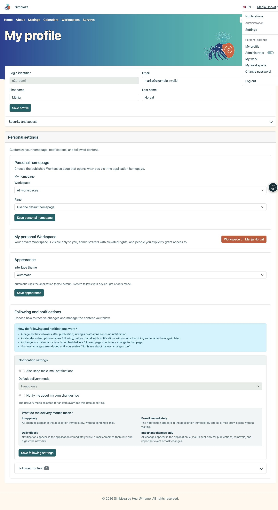
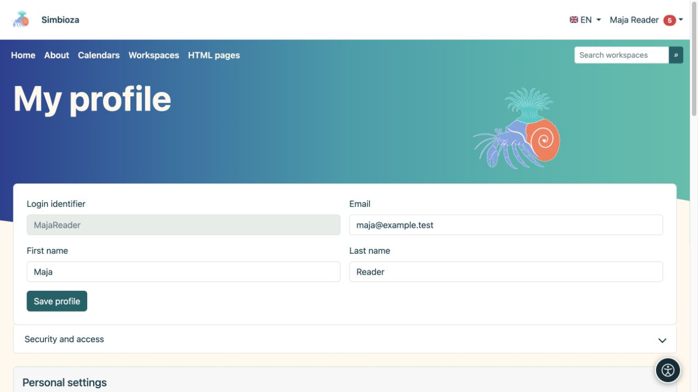

# Inicio de sesión y mi perfil

> Las capturas de pantalla muestran la interfaz en inglés.

**Objetivo:** usar su propia cuenta y ajustar los datos personales sin cambiar toda la instalación.

## Qué puede hacer en el menú de la cuenta

Tras iniciar sesión, haga clic en **su nombre** en la cabecera. El menú solo ofrece las opciones disponibles para su cuenta en esta instalación.

| Opción | Función |
| --- | --- |
| **Notificaciones** | Abre sus notificaciones. El número junto a la opción indica las notificaciones no leídas. |
| **Mi perfil** | Editar los datos personales permitidos y acceder a la seguridad y los ajustes personales. |
| **Mi trabajo** | [Trabajo reciente, sus borradores y contenido pendiente de revisión](moj-rad_es.md), según sus permisos actuales. |
| **Mi espacio de trabajo** | Abre su espacio de trabajo personal ya existente, si está disponible. |
| **Cambiar contraseña** | Cambiar o establecer su contraseña local de Simbioza. |
| **Cerrar sesión** | Finaliza su sesión en Simbioza. |

La sección **Administración**, con el enlace **Ajustes**, y el interruptor **Administrador** están destinados a quienes tienen los permisos administrativos correspondientes. No conceden estos derechos a los usuarios comunes. Si dispone del interruptor, permite activar o desactivar permisos administrativos temporales mediante el proceso que se muestra en pantalla.

<figure class="my-4">

<figcaption>Las opciones del menú dependen de sus permisos y de las funciones activadas.</figcaption>
</figure>

## Iniciar y cerrar sesión

1. Elija **Iniciar sesión** en el menú de la cuenta o siga la acción de inicio de sesión en una página protegida.
2. Para una cuenta local, ingrese su **Identificador de inicio de sesión** y contraseña. El identificador no es necesariamente una dirección de correo electrónico; Utilice el valor que se le asignó.
3. Para una cuenta externa, seleccione el proveedor ofrecido y complete su inicio de sesión. Comuníquese con el administrador si el proveedor esperado está ausente.
4. Al regresar, verifique el nombre mostrado. Termine con **Cerrar sesión** en una computadora compartida.

Si se ofrece **Registrar una nueva cuenta de usuario local**, puede completar el registro. El administrador controla su disponibilidad y campos. Ingresar una dirección de correo electrónico no verifica por sí solo la propiedad de esa dirección.

El inicio de sesión solo para una [encuesta externa](ankete-ispunjavanje_es.md) puede ser independiente de una cuenta Simbioza. El nombre de un encuestado no proporciona automáticamente un perfil de usuario ni permiso para editar páginas.

## Edita sus datos

1. Abra el menú de cuenta → **Mi perfil**.
2. Cambie los campos editables mostrados.
3. Seleccione **Guardar perfil** y lee la confirmación.

**Resultado:** los cambios personales permitidos se guardan. El administrador gestiona los grupos, el estado de la cuenta y los derechos de acceso. Un campo faltante o bloqueado no es motivo para crear otra cuenta.

<figure class="my-4">

<figcaption>Edita sus datos disponibles en el perfil. Guardar estos campos no otorga acceso a contenido privado.</figcaption>
</figure>

## Seguridad y acceso

Abra **Seguridad y acceso** para sus grupos, contraseña local e identidades externas vinculadas. Los cambios de contraseña utilizan los campos disponibles de contraseña actual, nueva contraseña y confirmación. Cambie una contraseña local temporal cuando la pantalla lo requiera.

Establecer una contraseña local no habilita el inicio de sesión web local. También puede servir a [CalDAV](kalendari-povezivanje_es.md#caldav). No ingrese la contraseña de un proveedor externo como contraseña local actual. Vincular o desvincular identidades únicamente a través de las acciones ofrecidas y luego de leer la confirmación.

## Página de inicio personal, apariencia y seguimiento.

Las secciones disponibles dependen de los módulos habilitados:

- Un selector de página de inicio personal ofrece páginas publicadas a las que puede acceder, donde el administrador permite la selección personal.
- **La apariencia** puede ofrecer Automático, Claro, Oscuro y Sistema. Tiene prioridad una política globalmente forzada de luz u oscuridad, por lo que la selección personal puede estar ausente.
- **Mi espacio de trabajo personal** abre su propio espacio; si la autocreación está habilitada, utilice la acción de creación ofrecida.
- **Seguimiento y notificaciones** controlan [lo que sigue y cómo te llegan los cambios](pracenje-obavijesti_es.md).

La apariencia personal no sobrescribe el tema de todos. Para texto más grande y otra asistencia personal, consulte [Accesibilidad](pristupacnost_es.md).

## No puede abrir contenido.

Consulte la cuenta y el enlace exacto. Un elemento faltante puede significar que un permiso no está disponible, contenido no publicado o una característica no utilizada por esta instalación. Una URL directa no otorga acceso y una notificación antigua no puede restaurar el permiso perdido. Envíe al gestor del espacio de trabajo el enlace y la acción necesaria sin su contraseña.

Para conectar otra aplicación, solicite el [API acceso](api-koristenje_es.md) apropiado a través del proceso aprobado; El uso normal del navegador no necesita la clave de API.
