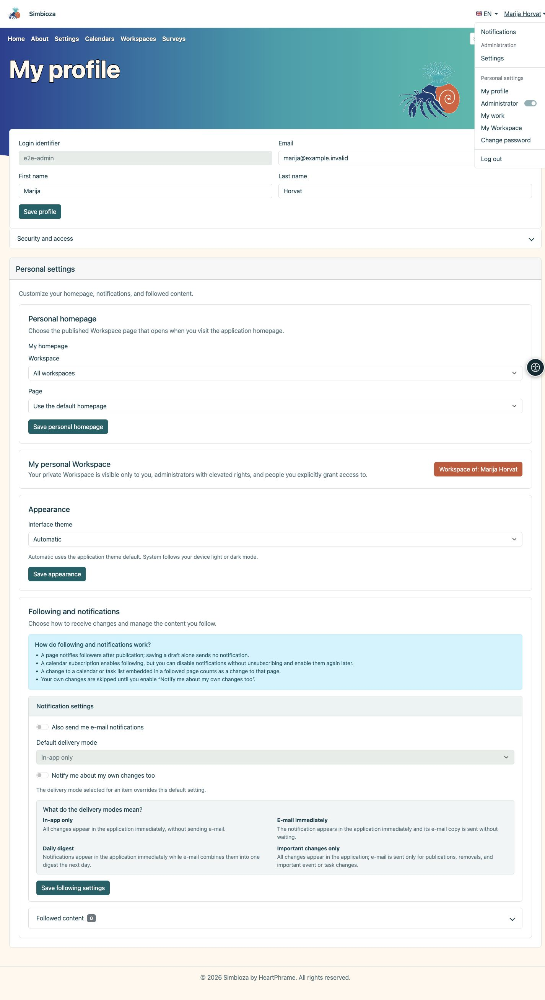
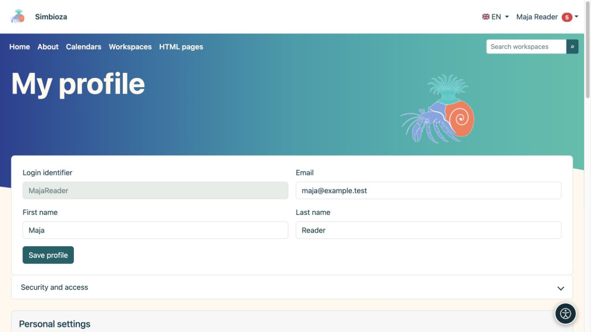

# Connexion et profil personnel

> Les captures d’écran présentent l’interface en anglais.

**Objectif :** utilisez votre propre compte et ajustez vos informations personnelles sans modifier l'ensemble de l'installation.

## Que pouvez-vous faire dans le menu du compte ?

Après la connexion, cliquez sur **votre nom** dans l’en-tête. Le menu propose uniquement les entrées accessibles à votre compte dans cette installation.

| Entrée | Fonction |
| --- | --- |
| **Notifications** | Ouvre vos notifications. Le nombre à côté de l’entrée indique les notifications non lues. |
| **Mon profil** | Modifier les données personnelles autorisées et accéder à la sécurité et aux paramètres personnels. |
| **Mon travail** | [Travail récent, vos brouillons et contenus à réviser](moj-rad_fr.md), selon vos autorisations actuelles. |
| **Mon espace de travail** | Ouvre votre espace personnel existant, s’il est disponible. |
| **Modifier le mot de passe** | Modifier ou définir votre mot de passe local Simbioza. |
| **Se déconnecter** | Met fin à votre connexion à Simbioza. |

La section **Administration**, avec son lien **Paramètres**, et le commutateur **Administrateur** sont destinés aux personnes disposant des autorisations administratives correspondantes. Ils n’accordent pas ces droits aux utilisateurs ordinaires. Si le commutateur est proposé, il permet d’activer ou de désactiver des autorisations administratives temporaires selon la procédure affichée à l’écran.

<figure class="my-4">

<figcaption>Les entrées du menu dépendent de vos autorisations et des fonctionnalités activées.</figcaption>
</figure>

## Connectez-vous et déconnectez-vous

1. Choisissez **Connexion** dans le menu du compte ou suivez l'action de connexion sur une page protégée.
2. Pour un compte local, saisissez votre **Identifiant de connexion** et votre mot de passe. L'identifiant n'est pas nécessairement une adresse email ; utilisez la valeur qui vous a été attribuée.
3. Pour un compte externe, sélectionnez le fournisseur proposé et complétez sa connexion. Contactez l'administrateur si le prestataire attendu est absent.
4. Au retour, vérifiez le nom affiché. Terminez par **Déconnexion** sur un ordinateur partagé.

Si **Enregistrer un nouveau compte d'utilisateur local** est proposé, vous pouvez terminer l'enregistrement. L'administrateur contrôle sa disponibilité et ses champs. La saisie d'une adresse e-mail ne vérifie pas en soi la propriété de cette adresse.

La connexion uniquement à un [sondage externe](ankete-ispunjavanje_fr.md) peut être distincte d'un compte Simbioza. Le nom d'un répondant ne fournit pas automatiquement un profil d'utilisateur ou une autorisation de modifier des pages.

## Modifiez vos coordonnées

1. Ouvrez le menu du compte → **Mon profil**.
2. Modifiez les champs affichés modifiables.
3. Sélectionnez **Enregistrer le profil** et lisez la confirmation.

**Résultat :** les modifications personnelles autorisées sont enregistrées. L'administrateur gère les groupes, l'état des comptes et les droits d'accès. Un champ manquant ou verrouillé n’est pas une raison pour créer un autre compte.

<figure class="my-4">

<figcaption>Modifiez vos informations disponibles dans le profil. La sauvegarde de ces champs ne donne pas accès au contenu privé.</figcaption>
</figure>

## Sécurité et accès

Ouvrez **Sécurité et accès** pour vos groupes, mot de passe local et identités externes liées. Les modifications de mot de passe utilisent les champs disponibles de mot de passe actuel, de nouveau mot de passe et de confirmation. Modifiez un mot de passe local temporaire lorsque l'écran l'exige.

La définition d'un mot de passe local n'autorise pas en soi la connexion Web locale. Il peut également servir à [CalDAV](kalendari-povezivanje_fr.md#caldav). N'entrez pas le mot de passe d'un fournisseur externe comme mot de passe local actuel. Lier ou dissocier les identités uniquement via les actions proposées et après lecture de la confirmation.

## Page d'accueil personnelle, apparence et suivi

Les sections disponibles dépendent des modules activés :

- Un sélecteur de page d'accueil personnel propose des pages publiées auxquelles vous pouvez accéder, où l'administrateur autorise une sélection personnelle.
- **L'apparence** peut proposer Automatique, Clair, Sombre et Système. Une politique de lumière ou d’obscurité imposée à l’échelle mondiale a la priorité, de sorte que la sélection personnelle peut être absente.
- **Mon espace de travail personnel** ouvre votre propre espace ; si l'auto-création est activée, utilisez l'action de création proposée.
- **Suivi et notifications** contrôlent [ce que vous suivez et comment les modifications vous parviennent](pracenje-obavijesti_fr.md).

L’apparence personnelle n’écrase pas le thème de chacun. Pour un texte plus grand et d'autres informations personnelles, voir [Accessibilité](pristupacnost_fr.md).

## Vous ne pouvez pas ouvrir le contenu

Vérifiez le compte et le lien exact. Un élément manquant peut signifier une autorisation indisponible, un contenu non publié ou une fonctionnalité non utilisée par cette installation. Une URL directe n'accorde aucun accès et une ancienne notification ne peut pas restaurer l'autorisation perdue. Envoyez au gestionnaire de l'espace de travail le lien et l'action nécessaire sans votre mot de passe.

Pour connecter une autre application, demandez l'[accès API](api-koristenje_fr.md) approprié via le processus approuvé ; une utilisation ordinaire du navigateur ne nécessite pas de clé API.
