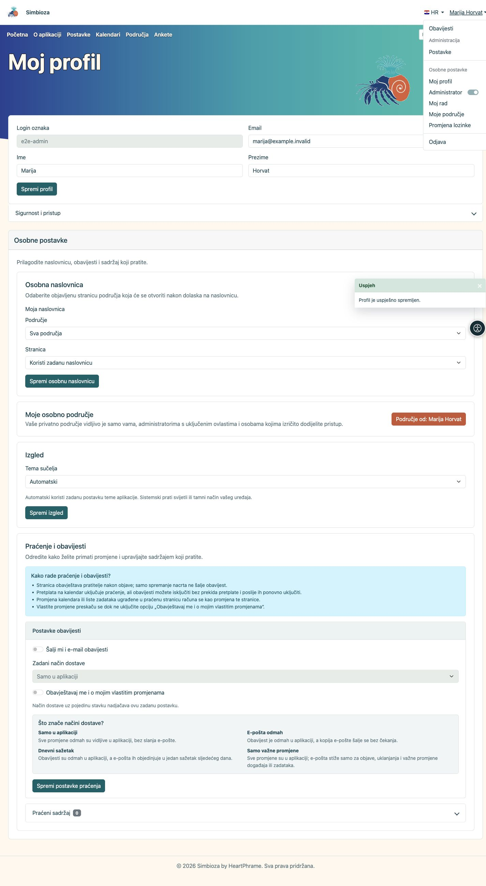
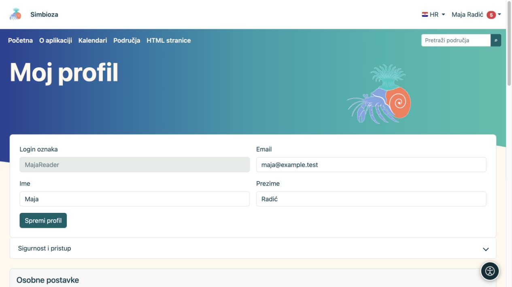

# Prijava i moj profil

**Cilj:** koristiti vlastiti račun i prilagoditi osobne podatke bez mijenjanja postavki cijele Simbioze.

## Što možete u osobnom izborniku

Nakon prijave kliknite **svoje ime** u zaglavlju. Izbornik nudi samo stavke dostupne vašem računu i ovoj instalaciji.

| Stavka | Čemu služi |
| --- | --- |
| **Obavijesti** | Otvara vaše obavijesti. Broj uz stavku označava nepročitane obavijesti. |
| **Moj profil** | Uređivanje dopuštenih osobnih podataka te pristup sigurnosti i osobnim postavkama. |
| **Moj rad** | [Nedavni rad, vlastiti nacrti i sadržaj za pregled](moj-rad_hr.md), prema vašim trenutačnim ovlastima. |
| **Moje područje** | Otvara već postojeće osobno područje, ako vam je dostupno. |
| **Promjena lozinke** | Promjena ili postavljanje lokalne lozinke Simbioze. |
| **Odjava** | Završava vašu prijavu u Simbiozu. |

Odjeljak **Administracija** s poveznicom **Postavke** i prekidač **Administrator** namijenjeni su korisnicima s odgovarajućim administratorskim ovlastima. Običnom korisniku ne dodjeljuju takva prava. Ako vam je prekidač ponuđen, njime uključujete ili isključujete privremene administratorske ovlasti prema postupku prikazanom na zaslonu.

<figure class="my-4">

<figcaption>Ponuda u osobnom izborniku ovisi o vašim ovlastima i uključenim mogućnostima.</figcaption>
</figure>

## Prijavite se i odjavite

1. U korisničkom izborniku odaberite **Prijava** ili otvorite ponuđenu prijavu sa zaštićene stranice.
2. Za lokalni račun unesite **Login oznaku** i lozinku. Login oznaka nije nužno e-mail; upotrijebite podatak koji vam je dodijeljen.
3. Za vanjski račun odaberite ponuđeni izvor prijave i dovršite postupak kod njega. Ako traženi izvor nije ponuđen, javite se administratoru.
4. Nakon povratka provjerite prikazano ime. Na zajedničkom računalu završite rad kroz **Odjava**.

Ako je **Registriraj novi lokalni korisnički račun** ponuđeno, možete ispuniti registraciju. Polja i dostupnost određuje administrator. Unos e-maila u registraciji sam po sebi nije potvrda vlasništva te adrese.

Prijava samo za [vanjsku anketu](ankete-ispunjavanje_hr.md) može biti odvojena od računa Simbioze. Ime ispitanika zato ne znači automatski da imate korisnički profil i prava za uređivanje stranica.

## Uredite vlastite podatke

1. Otvorite korisnički izbornik → **Moj profil**.
2. Promijenite dopuštena prikazana polja.
3. Odaberite **Spremi profil** i pročitajte potvrdu.

**Rezultat:** spremaju se osobni podatci koje smijete mijenjati. Grupe, aktivnost računa i prava uređuje administrator. Polje koje nedostaje ili je nepromjenjivo nije poziv za izradu drugog računa.

<figure class="my-4">

<figcaption>U profilu uređujete svoje dostupne podatke. Spremanje profila nije dodjela pristupa privatnom sadržaju.</figcaption>
</figure>

## Sigurnost i pristup

Otvorite **Sigurnost i pristup** za vlastite grupe, lokalnu lozinku i povezane vanjske prijave. Promjena lozinke traži dostupna polja trenutačne i nove lozinke te njezinu potvrdu. Ako vam je dodijeljena privremena lokalna lozinka, promijenite je prema prikazanoj obvezi.

Postavljanje lokalne lozinke samo po sebi ne uključuje lokalnu web-prijavu. Može služiti i [CalDAV-u](kalendari-povezivanje_hr.md#caldav). Ne upisujte lozinku vanjskog providera kao „trenutačnu lokalnu lozinku”. Povezivanje ili uklanjanje vanjske prijave radite samo kroz ponuđene radnje i nakon čitanja potvrde.

## Osobna naslovnica, izgled i praćenje

Dostupne cjeline ovise o uključenim modulima:

- Osobna naslovnica nudi objavljene stranice kojima smijete pristupiti, ako administrator dopušta vlastiti odabir.
- **Izgled** može ponuditi Automatski, Svijetla, Tamna i Sistemski. Prisilno svijetla ili tamna globalna tema ima prednost; zato izbor ne mora biti dostupan.
- **Moje osobno područje** otvara vaš prostor; ako je samostalna izrada dopuštena, možete ga izraditi ponuđenim gumbom.
- **Praćenje i obavijesti** određuju [koji sadržaj pratite i kako primate promjene](pracenje-obavijesti_hr.md).

Promjene osobnog prikaza ne prepisuju temu svim korisnicima. Za uvećanje teksta ili druge osobne pomoći pogledajte [Pristupačnost](pristupacnost_hr.md).

## Nemate pravo otvoriti sadržaj

Provjerite račun i točnu poveznicu. Skrivena stavka može značiti da nemate pristup, da nije objavljena ili da je instalacija ne koristi. Izravni URL ne dodjeljuje ovlasti; ni spremljena obavijest ne vraća izgubljeno pravo. Pošaljite upravitelju poveznicu i opis potrebne radnje, bez lozinke.

Ako trebate povezati drugu aplikaciju, zatražite odgovarajući [API pristup](api-koristenje_hr.md) prema odobrenom postupku; običan rad u pregledniku ne traži API ključ.
