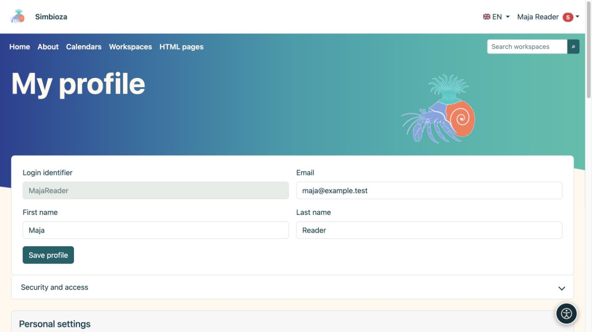

# Accesso e profilo personale

> Le schermate mostrano l’interfaccia in inglese.

**Obiettivo:** utilizza il tuo account e modifica i dati personali senza modificare l'intera installazione.

## Accedere e uscire

1. Scegli **Accedi** nel menu dell'account o segui l'azione di accesso su una pagina protetta.
2. Per un account locale, inserisci il tuo **identificatore di accesso** e la password. L'identificatore non è necessariamente un indirizzo email; usa il valore che ti è stato assegnato.
3. Per un account esterno, seleziona il fornitore offerto e completa l'accesso. Contattare l'amministratore se il fornitore previsto è assente.
4. Al ritorno, controlla il nome visualizzato. Termina con **Esci** su un computer condiviso.

Se viene offerto **Registra un nuovo account utente locale**, puoi completare la registrazione. L'amministratore ne controlla la disponibilità e i campi. L'immissione di un indirizzo email non verifica di per sé la proprietà di quell'indirizzo.

L'accesso solo per un [sondaggio esterno](ankete-ispunjavanje_it.md) può essere separato da un account Simbioza. Il nome di un intervistato non fornisce automaticamente un profilo utente o l'autorizzazione a modificare le pagine.

## Modifica i tuoi dettagli

1. Apri il menu account → **Il mio profilo**.
2. Modificare i campi visualizzati modificabili.
3. Seleziona **Salva profilo** e leggi la conferma.

**Risultato:** le modifiche personali consentite vengono salvate. L'amministratore gestisce i gruppi, lo stato dell'account e i diritti di accesso. Un campo mancante o bloccato non è un motivo per creare un altro account.

<figure class="my-4">

<figcaption>Modifica i dettagli disponibili nel profilo. Il salvataggio di questi campi non garantisce l'accesso ai contenuti privati.</figcaption>
</figure>

## Sicurezza e accesso

Apri **Sicurezza e accesso** per i tuoi gruppi, password locale e identità esterne collegate. Le modifiche alla password utilizzano i campi disponibili: password corrente, nuova password e conferma. Modificare una password locale temporanea quando lo schermo lo richiede.

L'impostazione di una password locale non abilita di per sé l'accesso Web locale. Potrebbe anche servire [CalDAV](kalendari-povezivanje_it.md#caldav). Non inserire la password di un provider esterno come password locale corrente. Collega o scollega le identità solo attraverso le azioni offerte e dopo aver letto la conferma.

## Home page personale, aspetto e seguito

Le sezioni disponibili dipendono dai moduli abilitati:

- Un selettore di home page personale offre pagine pubblicate a cui puoi accedere, dove l'amministratore consente la selezione personale.
- **Aspetto** può offrire Automatico, Chiaro, Scuro e Sistema. Una politica di luce o oscurità forzata a livello globale ha la precedenza, quindi la selezione personale potrebbe essere assente.
- **La mia area di lavoro personale** apre il tuo spazio; se l'autocreazione è abilitata, utilizza l'azione di creazione offerta.
- **Segui e notifiche** controlla [cosa segui e come ti arrivano le modifiche](pracenje-obavijesti_it.md).

L'aspetto personale non sovrascrive il tema di tutti. Per testo più grande e altra assistenza personale, vedere [Accessibilità](pristupacnost_it.md).

## Non è possibile aprire il contenuto

Controlla l'account e il collegamento esatto. Un elemento mancante potrebbe significare un'autorizzazione non disponibile, contenuto non pubblicato o una funzionalità non utilizzata da questa installazione. Un URL diretto non garantisce l'accesso e una vecchia notifica non può ripristinare l'autorizzazione persa. Invia al gestore dell'area di lavoro il collegamento e l'azione necessaria senza la password.

Per connettere un'altra applicazione, richiedere l'[API accesso](api-koristenje_it.md) appropriato tramite la procedura approvata; l'uso normale del browser non richiede la chiave API.
