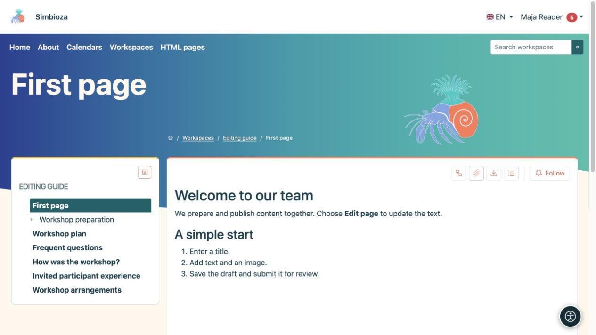
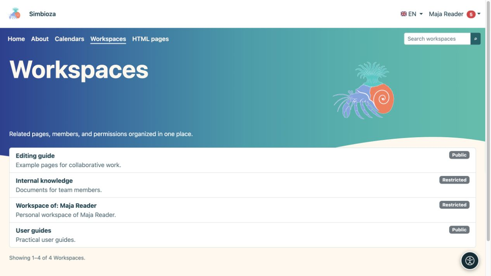
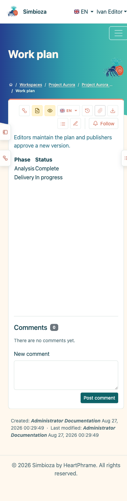
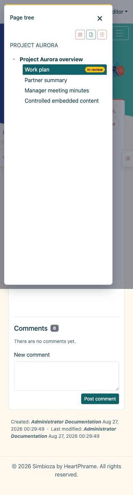
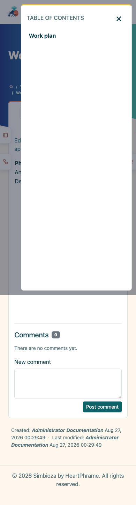

# Inhalte finden und lesen

> Die Bildschirmaufnahmen zeigen die englische Benutzeroberfläche.

[Arbeitsbereiche](podrucja_de.md)

**Ziel:** Öffnen Sie die richtige Seite, ohne die Arbeitsbereichseinstellungen verstehen zu müssen.

## Öffnen Sie einen Arbeitsbereich und eine Seite

1. Wählen Sie im oberen Menü **Arbeitsbereiche**.
2. Suchen Sie einen Arbeitsbereich anhand des Namens oder durchsuchen und öffnen Sie ihn. Die Liste zeigt Arbeitsbereiche, auf die Sie zugreifen können.
3. Wählen Sie im linken Baum einen Seitentitel aus. Der Pfeil neben einem Titel erweitert seine untergeordneten Elemente.
4. Wenn in einem Seiteninhaltsbereich Überschriften aufgeführt sind, wählen Sie eine Überschrift aus, um zu diesem Teil des Textes zu springen.

**Ergebnis:** Sie lesen die veröffentlichte Version, auf die Sie zugreifen dürfen. Mit **Seitenbaum** und **Inhaltsverzeichnis anzeigen / Inhaltsverzeichnis ausblenden** öffnen oder verbergen Sie die Navigation. Inhalt und Berechtigungen ändern sich dadurch nicht.

<figure class="my-4">

<figcaption>Wählen Sie links eine Seite aus, um den veröffentlichten Inhalt rechts zu lesen. Bearbeitungsaktionen hängen von Ihren Berechtigungen ab.</figcaption>
</figure>

## Sprachen und Seitenzusammenfassungen

Das Flaggenmenü zeigt vorhandene Übersetzungen an. Wählen Sie die gewünschte Seitensprache. Eine noch nicht angelegte Übersetzung wird möglicherweise nicht aufgeführt. Daraus ergibt sich keine Berechtigung, die Seite zu übersetzen.

Sofern verfügbar, werden in **Seitenzusammenfassungen** Arbeitsbereichsartikel angezeigt, ohne dass jeder einzelne geöffnet werden muss. Grenzen Sie die Ergebnisse mit Filtern ein und nutzen Sie die angebotene Seitennavigation. **Alle** ist nur verfügbar, wenn weniger als 100 sichtbare Artikel vorhanden sind.

## Warum fehlt etwas?

- Ein **Öffentlicher** Arbeitsbereich oder eine öffentlich zugelassene veröffentlichte Seite kann ohne Anmeldung gelesen werden.
- Inhalte für **Alle authentifizierten Benutzer** erfordern eine Simbioza-Anmeldung.
- Für einen eingeschränkten Arbeitsbereich ist eine Berechtigung für Ihr Konto oder Ihre Gruppe erforderlich. Ein Link allein gewährt keinen Zugriff.
- Möglicherweise haben Sie Zugriff auf nur eine Seite in einem privaten Arbeitsbereich. Die übergeordneten Seiten und die anderen Seiten bleiben möglicherweise verborgen.
- Ein neuer unveröffentlichter Entwurf ist für normale Leser nicht verfügbar. Wenn eine frühere Veröffentlichung vorhanden ist, lesen Sie diese Version, bis die neue veröffentlicht wird.

Wenn der Zugriff verweigert wird, überprüfen Sie, ob Sie das richtige Konto verwenden, und senden Sie dem Arbeitsbereichsmanager den Link, den Sie öffnen möchten.

<figure class="my-4">

<figcaption>Maja sieht öffentliche Arbeitsbereiche, ihren persönlichen Arbeitsbereich und einen Arbeitsbereich, der eine speziell freigegebene Seite enthält. Diese Liste öffnet nicht alle privaten Seiten.</figcaption>
</figure>

## Lesen auf einem Telefon

Auf einem schmalen Bildschirm öffnen seitliche Schaltflächen den Baum und den Inhalt. Tippen Sie auf eine Schaltfläche, wählen Sie eine Seite oder Überschrift aus und schließen Sie dann das Bedienfeld, um mit dem Lesen fortzufahren. Es stehen dieselben Seiten zur Verfügung wie auf einem Computer; ein kleinerer Bildschirm gewährt keine zusätzlichen Berechtigungen.

<figure class="my-4">

<figcaption>Ein komplettes mobiles Ansichtsfenster mit seitlichen Schaltflächen für den Baum und den Inhalt.</figcaption>
</figure>

<figure class="my-4">

<figcaption>Der Arbeitsbereichsbaum wird als spezielle Karte geöffnet.</figcaption>
</figure>

<figure class="my-4">

<figcaption>Der Inhalt des Dokuments wird als spezielle Karte geöffnet.</figcaption>
</figure>

## Ihr persönlicher Arbeitsbereich

Sofern verfügbar, erscheint **Mein persönlicher Arbeitsbereich** unter **Mein Profil → Folgen und Benachrichtigungen**. Wenn Sie noch keinen haben und der Administrator die Selbsterstellung zulässt, wählen Sie dort **Meinen persönlichen Arbeitsbereich erstellen**. Sie erhalten einen eingeschränkten Arbeitsbereich, in dem Sie schreiben und Zugriffe vergeben können. Andere Benutzer erhalten keinen Zugriff, bis Sie ihn gewähren. Ein Administrator mit aktiven Administratorrechten kann den Arbeitsbereich weiterhin verwalten.
