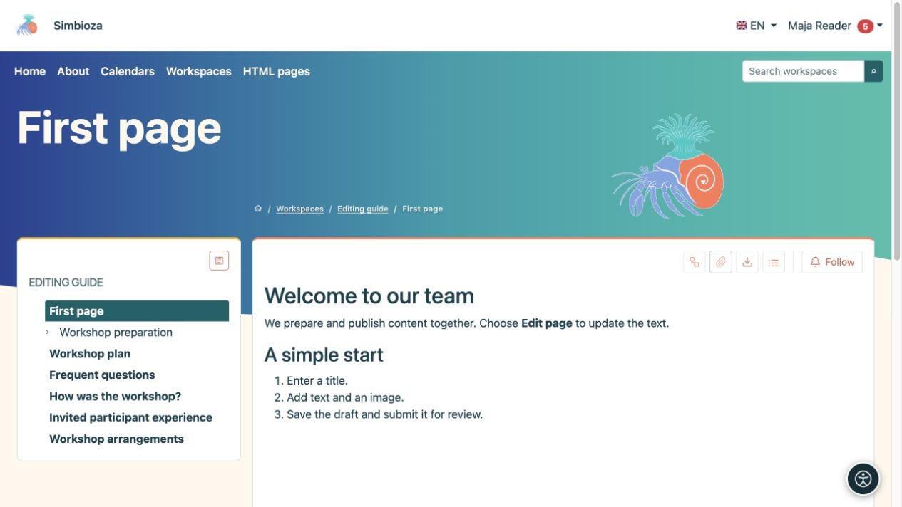
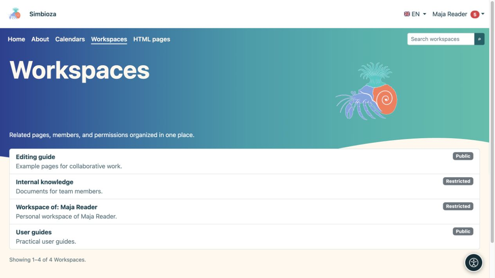

# Find and read content

[Workspaces](podrucja_en.md)

**Goal:** open the right page without needing to understand workspace settings.

## Open a workspace and page

1. Choose **Workspaces** in the top menu.
2. Find a workspace by name or search and open it. The list shows workspaces you may access.
3. Select a page title in the left-hand tree. The arrow beside a title expands its children.
4. If a page contents panel lists headings, select a heading to jump to that part of the text.

**Result:** you read the accessible published version. The **Tree** and **Show contents / Hide contents** controls open or hide navigation; they do not change content or permissions.

<figure class="my-4">

<figcaption>Choose a page on the left to read its published content on the right. Editing actions depend on your permissions.</figcaption>
</figure>

## Languages and page summaries

The flag menu offers existing translations. Choose the page language you want to read. A translation which has not been prepared may not be listed; this does not grant permission to translate it.

Where available, **Page summaries** shows workspace articles without opening each one. Narrow the results with filters and use the offered pagination. **All** is available only when fewer than 100 visible articles exist.

## Why is something missing?

- A **Public** workspace or publicly permitted published page can be read without signing in.
- Content for **All authenticated users** requires a Simbioza sign-in.
- A restricted workspace requires permission for your account or group. A link alone does not grant access.
- You may have access to just one page in a private workspace. Its parents and the other pages may remain hidden.
- A new unpublished draft is unavailable to ordinary readers. If an earlier publication exists, you read that version until the new one is published.

If access is denied, check that you are using the right account and send the workspace manager the link you are trying to open.

<figure class="my-4">

<figcaption>Maja sees public workspaces, her personal workspace and a workspace containing a specifically shared page. This list does not open all private pages.</figcaption>
</figure>

## Reading on a phone

On a narrow screen, side buttons open the tree and contents. Tap a button, choose a page or heading, then close the panel to continue reading. The same pages are available as on a computer; a smaller screen does not grant additional permissions.

<figure class="my-4">

<figcaption>A complete mobile viewport with side buttons for the tree and contents.</figcaption>
</figure>

<figure class="my-4">

<figcaption>The Workspace tree opens as a dedicated card.</figcaption>
</figure>

<figure class="my-4">

<figcaption>The document contents open as a dedicated card.</figcaption>
</figure>

## Your personal workspace

Where available, **My personal workspace** appears under **My profile → Following and notifications**. If you do not have one and the administrator allows self-creation, choose **Create my personal workspace** there. You receive a restricted workspace in which you can write and assign access. Other users do not gain access until you grant it; an administrator with active administrator privileges can still manage the workspace.
