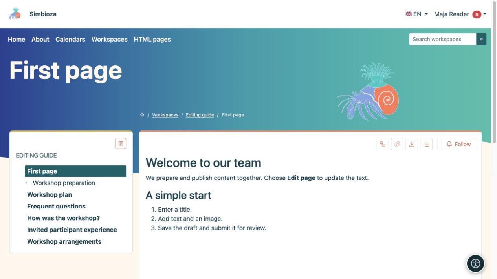
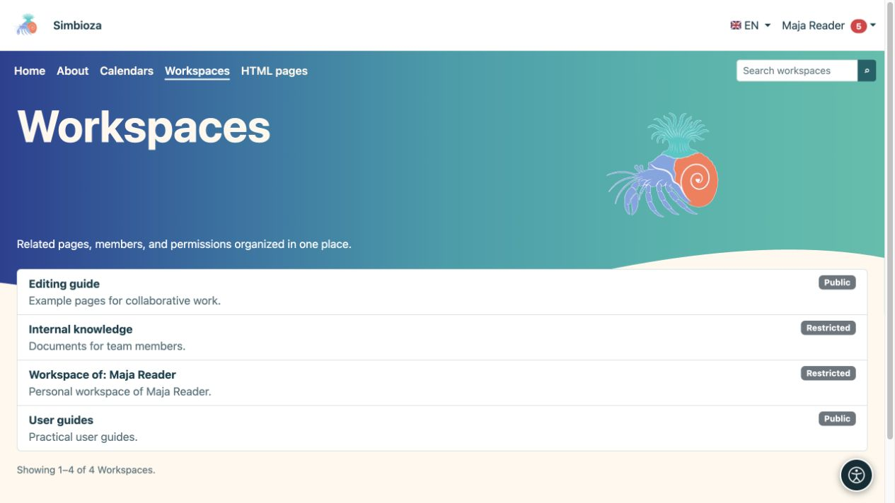

# Buscar y leer contenidos

> Las capturas de pantalla muestran la interfaz en inglés.

[Espacios de trabajo](podrucja_es.md)

**Objetivo:** abrir la página correcta sin necesidad de comprender la configuración del espacio de trabajo.

## Abrir un espacio de trabajo y una página

1. Elija **Espacios de trabajo** en el menú superior.
2. Busque un espacio de trabajo por nombre o búsquelo y ábralo. La lista muestra los espacios de trabajo a los que puede acceder.
3. Seleccione el título de una página en el árbol de la izquierda. La flecha al lado de un título expande sus elementos secundarios.
4. Si el panel de contenido de una página enumera encabezados, seleccione un encabezado para saltar a esa parte del texto.

**Resultado:** leíste la versión publicada accesible. Los controles **Árbol** y **Mostrar contenidos/Ocultar contenidos** abren u ocultan la navegación; no cambian el contenido ni los permisos.

<figure class="my-4">

<figcaption>Elija una página a la izquierda para leer su contenido publicado a la derecha. Las acciones de edición dependen de sus permisos.</figcaption>
</figure>

## Idiomas y resúmenes de páginas

El menú de banderas ofrece las traducciones existentes. Elija el idioma en el que desea leer la página. Una traducción que todavía no se ha preparado puede no aparecer en la lista; esto no concede permiso para traducirla.

Cuando esté disponible, **Resúmenes de páginas** muestra artículos del espacio de trabajo sin abrir cada uno. Limite los resultados con filtros y utilice la paginación ofrecida. **Todo** está disponible solo cuando existen menos de 100 artículos visibles.

## ¿Por qué falta algo?

- Un espacio de trabajo **Público** o una página publicada permitida públicamente se puede leer sin iniciar sesión.
- El contenido para **Todos los usuarios autenticados** requiere un inicio de sesión Simbioza.
- Un espacio de trabajo restringido requiere permiso para su cuenta o grupo. Un enlace por sí solo no otorga acceso.
- Es posible que tenga acceso a solo una página en un espacio de trabajo privado. Sus páginas superiores y las otras páginas pueden permanecer ocultas.
- Un nuevo borrador inédito no está disponible para los lectores comunes. Si existe una publicación anterior, lee esa versión hasta que se publique la nueva.

Si se deniega el acceso, compruebe que está utilizando la cuenta correcta y envíe al gestor del espacio de trabajo el enlace que está intentando abrir.

<figure class="my-4">

<figcaption>Maja ve espacios de trabajo públicos, su espacio de trabajo personal y un espacio de trabajo que contiene una página específicamente compartida. Esta lista no abre todas las páginas privadas.</figcaption>
</figure>

## leyendo en un teléfono

En una pantalla estrecha, los botones laterales abren el árbol y los contenidos. Toque un botón, elija una página o encabezado, luego cierre el panel para continuar leyendo. Están disponibles las mismas páginas que en una computadora; una pantalla más pequeña no otorga permisos adicionales.

<figure class="my-4">

<figcaption>Una ventana gráfica móvil completa con botones laterales para el árbol y contenidos.</figcaption>
</figure>

<figure class="my-4">

<figcaption>El árbol del espacio de trabajo se abre como una tarjeta dedicada.</figcaption>
</figure>

<figure class="my-4">

<figcaption>El contenido del documento se abre como una tarjeta dedicada.</figcaption>
</figure>

## Tu espacio de trabajo personal

Cuando esté disponible, **Mi espacio de trabajo personal** aparece en **Mi perfil → Seguimiento y notificaciones**. Si no tiene uno y el administrador permite la creación propia, elija **Crear mi espacio de trabajo personal** allí. Recibirá un espacio de trabajo restringido en el que podrá escribir y asignar acceso. Otros usuarios no obtienen acceso hasta que usted se lo conceda; un administrador con privilegios de administrador activos aún puede administrar el espacio de trabajo.
