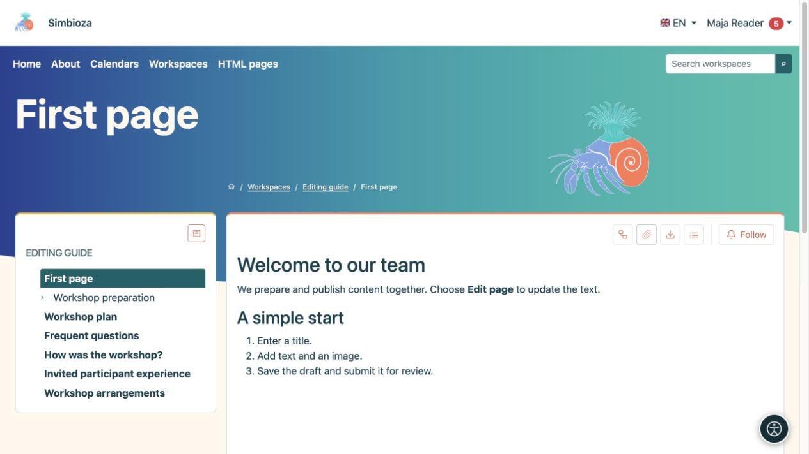
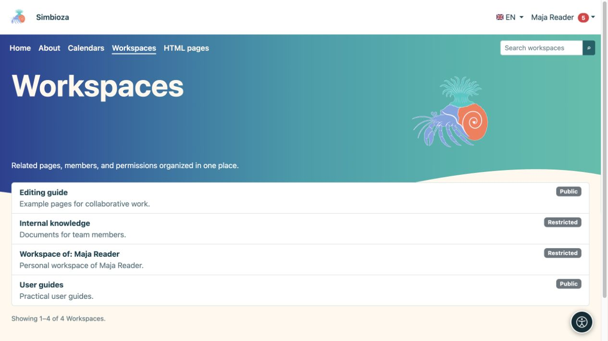

# Trouver et lire du contenu

> Les captures d’écran présentent l’interface en anglais.

[Espaces de travail](podrucja_fr.md)

**Objectif :** ouvrez la bonne page sans avoir besoin de comprendre les paramètres de l'espace de travail.

## Ouvrir un espace de travail et une page

1. Choisissez **Espaces de travail** dans le menu supérieur.
2. Recherchez un espace de travail par son nom ou recherchez-le et ouvrez-le. La liste affiche les espaces de travail auxquels vous pouvez accéder.
3. Sélectionnez un titre de page dans l'arborescence de gauche. La flèche à côté d'un titre développe ses enfants.
4. Si un panneau de contenu de page répertorie les titres, sélectionnez un titre pour accéder à cette partie du texte.

**Résultat :** vous avez lu la version publiée accessible. Les commandes **Arbre** et **Afficher le contenu / Masquer le contenu** ouvrent ou masquent la navigation ; ils ne modifient pas le contenu ou les autorisations.

<figure class="my-4">

<figcaption>Choisissez une page à gauche pour lire son contenu publié à droite. Les actions de modification dépendent de vos autorisations.</figcaption>
</figure>

## Langues et résumés de pages

Le menu des drapeaux propose les traductions existantes. Choisissez la langue de la page que vous souhaitez lire. Une traduction qui n'a pas été préparée peut ne pas être répertoriée ; cela n'accorde pas la permission de le traduire.

Le cas échéant, les **Résumés de page** affichent les articles de l'espace de travail sans les ouvrir chacun. Affinez les résultats avec des filtres et utilisez la pagination proposée. **Tout** est disponible uniquement lorsqu'il existe moins de 100 articles visibles.

## Pourquoi manque-t-il quelque chose ?

- Un espace de travail **Public** ou une page publiée autorisée publiquement peut être lu sans se connecter.
- Le contenu pour **Tous les utilisateurs authentifiés** nécessite une connexion Simbioza.
- Un espace de travail restreint nécessite une autorisation pour votre compte ou groupe. Un lien seul ne donne pas accès.
- Vous pouvez avoir accès à une seule page dans un espace de travail privé. Ses parents et les autres pages peuvent rester masqués.
- Une nouvelle ébauche non publiée n’est pas accessible aux lecteurs ordinaires. S'il existe une publication antérieure, vous lisez cette version jusqu'à ce que la nouvelle soit publiée.

Si l'accès est refusé, vérifiez que vous utilisez le bon compte et envoyez au gestionnaire de l'espace de travail le lien que vous essayez d'ouvrir.

<figure class="my-4">

<figcaption>Maja voit des espaces de travail publics, son espace de travail personnel et un espace de travail contenant une page spécifiquement partagée. Cette liste n'ouvre pas toutes les pages privées.</figcaption>
</figure>

## Lire sur un téléphone

Sur un écran étroit, des boutons latéraux ouvrent l'arborescence et le contenu. Appuyez sur un bouton, choisissez une page ou un titre, puis fermez le panneau pour continuer la lecture. Les mêmes pages sont disponibles que sur un ordinateur ; un écran plus petit n'accorde pas d'autorisations supplémentaires.

<figure class="my-4">

<figcaption>Une fenêtre mobile complète avec des boutons latéraux pour l'arborescence et le contenu.</figcaption>
</figure>

<figure class="my-4">

<figcaption>L'arborescence de l'espace de travail s'ouvre sous la forme d'une carte dédiée.</figcaption>
</figure>

<figure class="my-4">

<figcaption>Le contenu du document s'ouvre sous forme d'une carte dédiée.</figcaption>
</figure>

## Votre espace de travail personnel

Lorsqu'il est disponible, **Mon espace de travail personnel** apparaît sous **Mon profil → Suivis et notifications**. Si vous n'en avez pas et que l'administrateur autorise l'auto-création, choisissez **Créer mon espace de travail personnel** ici. Vous recevez un espace de travail restreint dans lequel vous pouvez écrire et attribuer un accès. Les autres utilisateurs n'ont pas accès tant que vous ne l'accordez pas ; un administrateur disposant de privilèges d'administrateur actifs peut toujours gérer l'espace de travail.
