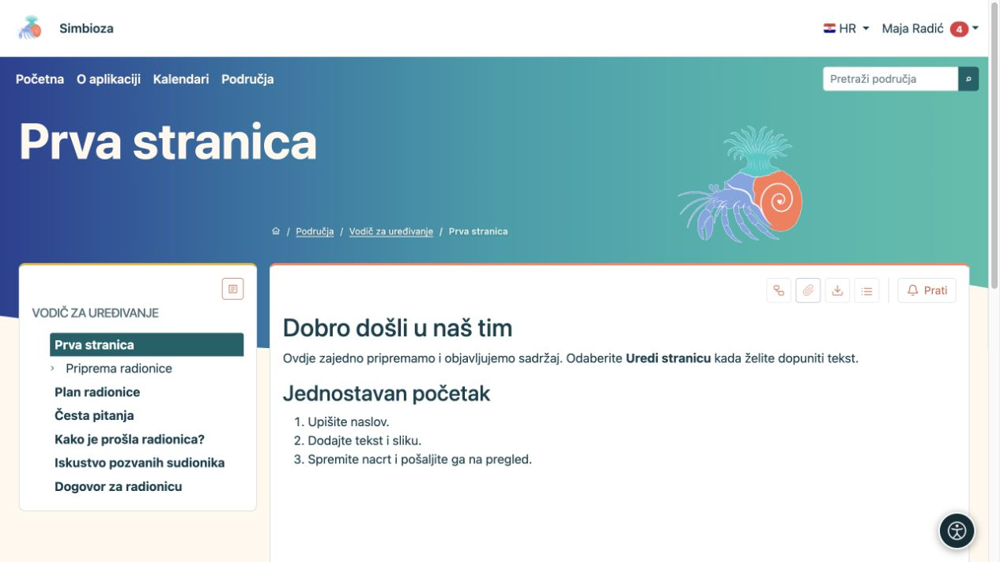
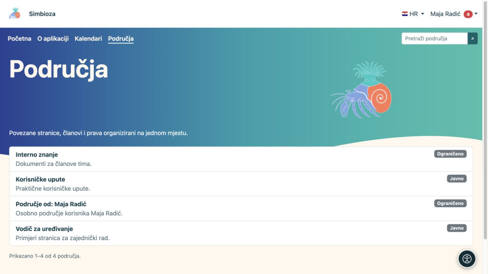
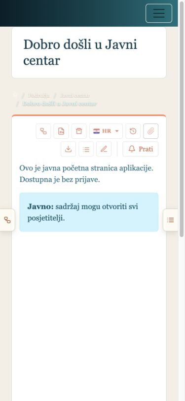
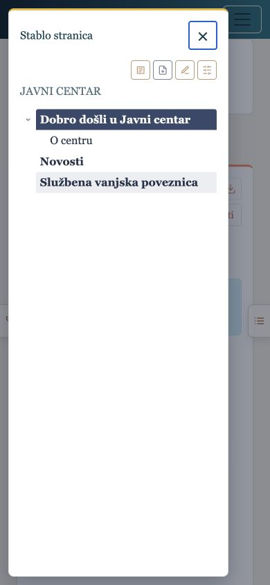
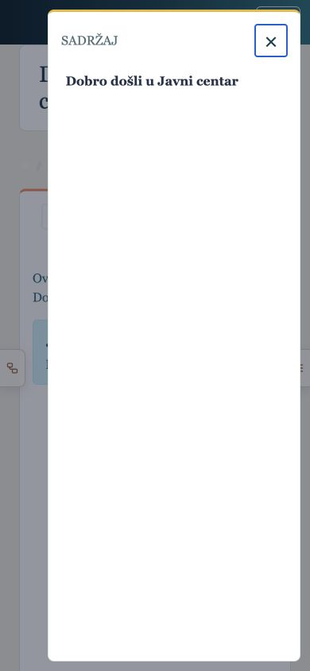

# Pronađite i pročitajte sadržaj

[Područja](podrucja_hr.md)

**Cilj:** otvoriti pravu stranicu bez potrebe za poznavanjem postavki područja.

## Otvorite područje i stranicu

1. Odaberite **Područja** u gornjem izborniku.
2. Pronađite područje po nazivu ili pretrazi i otvorite ga. Popis prikazuje područja koja smijete vidjeti.
3. U lijevom stablu odaberite naslov stranice. Strelica uz naslov otvara njegove podstranice.
4. Ako stranica ima sadržaj s popisom naslova, odaberite željeni naslov kako biste došli do tog dijela teksta.

**Rezultat:** čitate objavljenu inačicu stranice na koju imate pravo pristupa. Ikone **Stablo** i **Prikaži sadržaj / Sakrij sadržaj** otvaraju ili skrivaju navigaciju; time ne mijenjate sadržaj ni ovlasti.

<figure class="my-4">

<figcaption>Lijevo odaberite stranicu; objavljeni sadržaj prikazuje se desno. Uredničke radnje ovise o vašim pravima.</figcaption>
</figure>

## Dostupni jezici i sažeci

Izbornik sa zastavicom nudi postojeće prijevode. Odaberite jezik stranice koji želite čitati. Ako prijevod nije pripremljen, možda ga neće biti na popisu; to nije pravo za uređivanje prijevoda.

**Sažetci stranica**, gdje su ponuđeni, prikazuju članke područja bez otvaranja svake stranice. Filtrima suzite prikaz i koristite ponuđeno straničenje. Odabir **Sve** dostupan je samo kada ima manje od 100 vidljivih članaka.

## Zašto nešto ne vidite?

- **Javno** područje ili javno dopuštenu objavljenu stranicu možete čitati bez prijave.
- Sadržaj za **Sve prijavljene** traži prijavu u Simbiozu.
- Ograničeno područje zahtijeva dopuštenje korisniku ili grupi. Sama poveznica ne daje novo pravo.
- Možete imati pristup samo jednoj stranici privatnog područja. Tada ne morate vidjeti njezine roditelje ni ostale stranice.
- Novi neobjavljeni nacrt nije obična čitateljska stranica. Ako postoji ranija objava, čitate nju dok nova ne bude objavljena.

Ako dobijete poruku o nedopuštenom pristupu, provjerite koristite li pravi račun i pošaljite upravitelju poveznicu koju pokušavate otvoriti.

<figure class="my-4">

<figcaption>Maja vidi javno dostupna područja, svoje osobno područje i područje s posebno dopuštenom javnom stranicom. Popis ne otvara sve privatne stranice.</figcaption>
</figure>

## Čitanje na mobitelu

Na uskom zaslonu stablo i sadržaj otvaraju se bočnim gumbima. Dodirnite gumb, odaberite stranicu ili naslov pa zatvorite otvorenu karticu kako biste nastavili čitati. Dostupne su iste stranice kao na računalu; uži zaslon ne otvara dodatna prava.

<figure class="my-4">

<figcaption>Cijeli mobilni zaslon s bočnim gumbima za stablo i sadržaj.</figcaption>
</figure>

<figure class="my-4">

<figcaption>Stablo područja otvara se kao zasebna kartica prikladna dodiru.</figcaption>
</figure>

<figure class="my-4">

<figcaption>Sadržaj dokumenta otvara se kao zasebna mobilna kartica.</figcaption>
</figure>

## Vaše osobno područje

Ako vam je dostupno, poveznica **Moje osobno područje** nalazi se u **Moj profil → Praćenje i obavijesti**. Ako ga još nemate i administrator je dopustio izradu, ondje odaberite **Izradi moje osobno područje**. Dobivate ograničeno područje u kojem možete pisati i sami dodjeljivati pristup. Drugi korisnici ne dobivaju pristup dok im ga ne dodijelite; administrator s uključenim administratorskim ovlastima i dalje može upravljati područjem.
