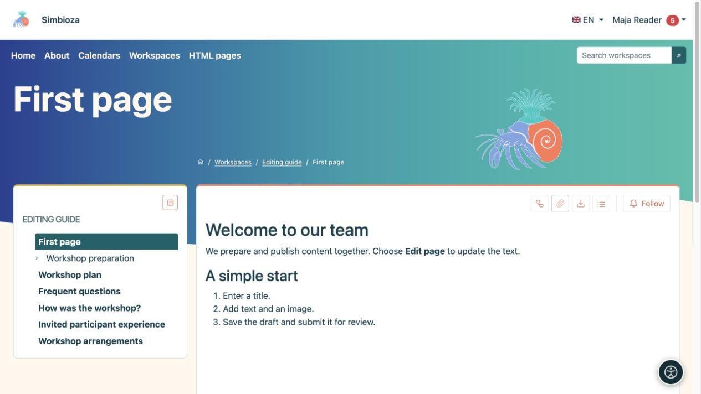
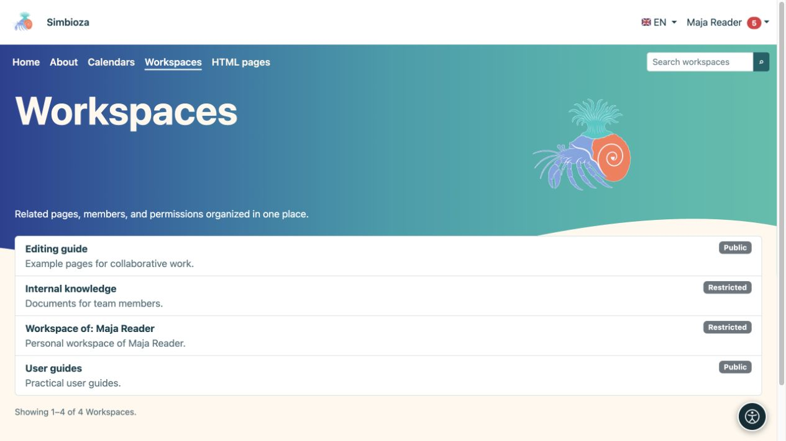

# Trovare e leggere contenuti

> Le immagini mostrano l'interfaccia in inglese.

[Aree di lavoro](podrucja_it.md)

**Obiettivo:** aprire la pagina corretta senza dover conoscere le impostazioni delle aree di lavoro.

## Aprire un'area di lavoro e una pagina

1. Scegliere **Aree di lavoro** nel menu superiore.
2. Trovare un'area per nome o con la ricerca e aprirla. L'elenco mostra le aree a cui si ha accesso.
3. Selezionare il titolo di una pagina nell'albero a sinistra. La freccia accanto a un titolo ne espande le pagine figlie.
4. Se il riquadro dell'indice della pagina elenca i titoli, selezionarne uno per passare a quella parte del testo.

**Risultato:** si legge la versione pubblicata accessibile. I comandi **Albero** e **Mostra indice / Nascondi indice** aprono o nascondono la navigazione; non modificano contenuti o autorizzazioni.

<figure class="my-4">

<figcaption>Scegliere una pagina a sinistra per leggerne il contenuto pubblicato a destra. Le azioni di modifica dipendono dalle autorizzazioni.</figcaption>
</figure>

## Lingue e riepiloghi delle pagine

Il menu con le bandiere propone le traduzioni esistenti. Scegliere la lingua della pagina che si desidera leggere. Una traduzione non ancora preparata potrebbe non comparire; questo non concede l'autorizzazione a tradurla.

Quando disponibile, **Riepiloghi delle pagine** mostra gli articoli dell'area di lavoro senza doverli aprire uno alla volta. Restringere i risultati con i filtri e utilizzare la suddivisione in pagine proposta. **Tutti** è disponibile soltanto quando esistono meno di 100 articoli visibili.

## Perché manca qualcosa?

- Un'area di lavoro **Pubblica** o una pagina pubblicata con autorizzazione pubblica può essere letta senza accedere.
- I contenuti per **Tutti gli utenti autenticati** richiedono l'accesso a Simbioza.
- Un'area riservata richiede un'autorizzazione per il proprio account o gruppo. Il solo collegamento non concede l'accesso.
- Si può avere accesso a una sola pagina di un'area privata. Le pagine superiori e le altre pagine possono restare nascoste.
- Una nuova bozza non pubblicata non è disponibile ai lettori ordinari. Se esiste una pubblicazione precedente, si legge quella versione finché non viene pubblicata la nuova.

Se l'accesso viene negato, verificare di utilizzare l'account corretto e inviare al responsabile dell'area di lavoro il collegamento che si sta tentando di aprire.

<figure class="my-4">

<figcaption>Maja vede le aree pubbliche, la propria area personale e un'area che contiene una pagina condivisa appositamente con lei. Questo elenco non apre tutte le pagine private.</figcaption>
</figure>

## Leggere sul telefono

Su uno schermo stretto, i pulsanti laterali aprono l'albero e l'indice. Toccare un pulsante, scegliere una pagina o un titolo, quindi chiudere il riquadro per continuare a leggere. Sono disponibili le stesse pagine che su un computer; uno schermo più piccolo non concede autorizzazioni aggiuntive.

<figure class="my-4">

<figcaption>Vista completa su dispositivo mobile con pulsanti laterali per albero e indice.</figcaption>
</figure>

<figure class="my-4">

<figcaption>L'albero dell'area di lavoro si apre in un riquadro dedicato.</figcaption>
</figure>

<figure class="my-4">

<figcaption>L'indice del documento si apre in un riquadro dedicato.</figcaption>
</figure>

## La propria area di lavoro personale

Quando disponibile, **La mia area di lavoro personale** compare in **Il mio profilo → Elementi seguiti e notifiche**. Se non se ne possiede una e l'amministratore consente la creazione autonoma, scegliere lì **Crea la mia area di lavoro personale**. Si ottiene un'area riservata in cui si può scrivere e assegnare l'accesso. Gli altri utenti non hanno accesso finché non viene loro concesso; un amministratore con privilegi amministrativi attivi può comunque gestire l'area.
