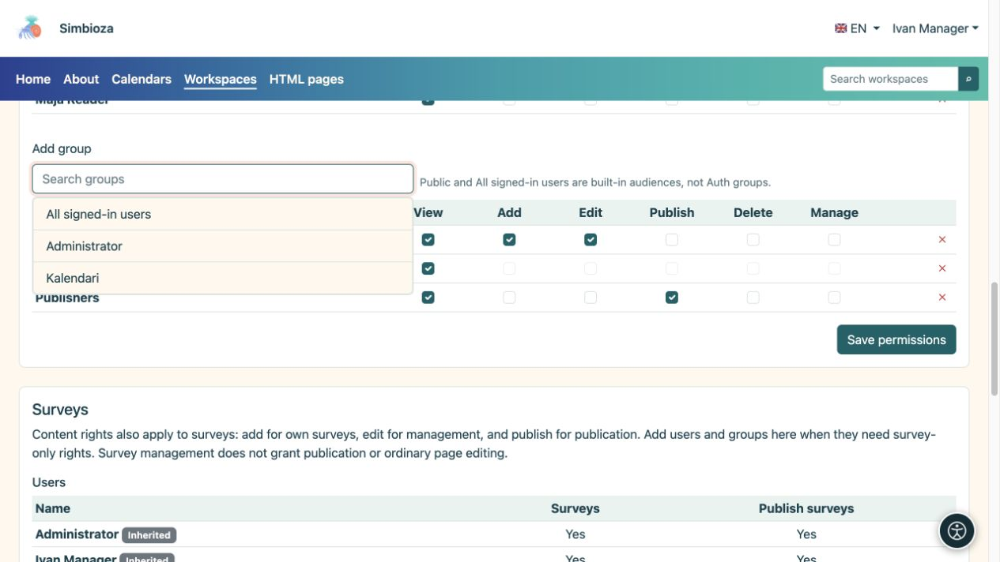
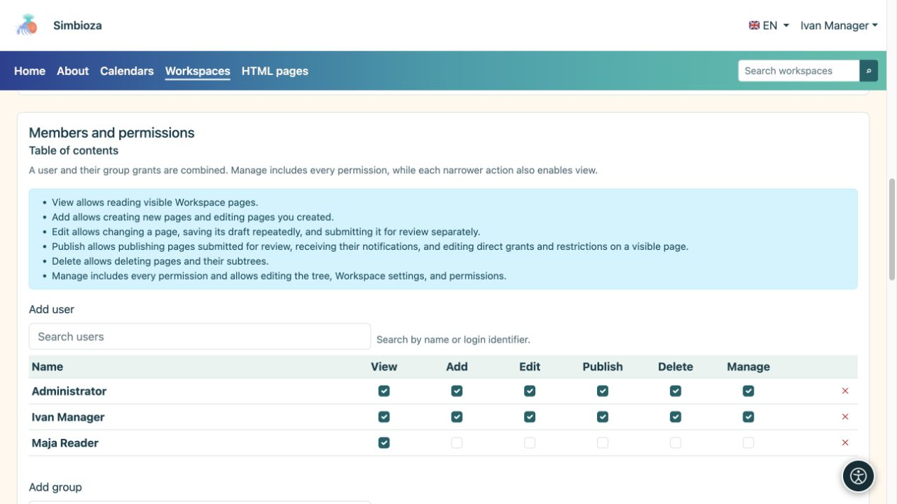

# Mitglieder hinzufügen und Berechtigungen vergeben

> Die Bildschirmaufnahmen zeigen die englische Benutzeroberfläche.

[Arbeitsbereiche](podrucja_de.md)

**Ziel:** jeder Person den Zugriff gewähren, den ihre Arbeit erfordert. Ein Arbeitsbereichsmanager oder Administrator befolgt dieses Verfahren. Für eine Ausnahme auf nur einer Seite verwenden Sie [Seitenzugriff](podrucja-prava-stranice_de.md).

## Fügen Sie einen Benutzer oder eine Gruppe hinzu

1. Öffnen Sie die Verwaltungsseite des ausgewählten Arbeitsbereichs und suchen Sie nach **Mitglieder und Berechtigungen → Inhalt**.
2. Öffnen Sie **Benutzer hinzufügen** oder **Gruppe hinzufügen**, suchen Sie einen Namen und wählen Sie ihn aus. Für eine lange Liste nutzen Sie die Suche und die angebotenen Zusatzladungen.
3. Wählen Sie die erforderlichen Berechtigungen in der hinzugefügten Zeile aus, indem Sie die Tabelle unten verwenden.
4. Berechtigungen speichern. Bitten Sie die Person, den Arbeitsbereich mit ihrem eigenen Konto zu öffnen und die beabsichtigte Aktion auszuprobieren.

**Ergebnis:** Die Person oder die Mitglieder der Gruppe erhalten die ausgewählten Arbeitsbereichsberechtigungen. Eine Berechtigung für eine Gruppe gilt für deren Mitglieder; Sie müssen nicht jede Person einzeln hinzufügen.

<figure class="my-4">

<figcaption>Wählen Sie ein Ergebnis aus, um es der Tabelle hinzuzufügen, wählen Sie die erforderlichen Berechtigungen aus und speichern Sie die Änderung.</figcaption>
</figure>

| Berechtigung | Was es erlaubt |
| --- | --- |
| **Sicht** | Lesen Sie zugängliche veröffentlichte Seiten. |
| **Hinzufügen** | Erstellen Sie eine Seite in einem zulässigen Teil des Baums und arbeiten Sie an einer eigenen neuen Seite. Es ist nicht gestattet, die Seiten aller anderen zu bearbeiten. |
| **Bearbeiten** | Entwürfe schreiben und speichern; Ohne Veröffentlichungsgenehmigung ändert sich dadurch nichts an dem, was die Leser sehen. |
| **Veröffentlichen** | Vorschau und Veröffentlichung von Entwürfen. Diese Berechtigung allein erlaubt es nicht, ihren Text zu bearbeiten. |
| **Löschen** | Löschen Sie erlaubte Seiten oder Teilbäume. Nachkommenberechtigungen werden ebenfalls überprüft. |
| **Verwalten** | Pflegen Sie den Arbeitsbereich und die Berechtigungen und nutzen Sie dessen Verwaltungsaktionen. Es umfasst die weiteren Betriebsgenehmigungen; Auch das Archivieren einer Seite erfordert Verwaltung. |

<figure class="my-4">

<figcaption>Maja hat nur Ansicht; Manager Ivan hat jede Berechtigung. Erteilen Sie nur die Berechtigungen, die für die vereinbarte Arbeit erforderlich sind.</figcaption>
</figure>

## Öffentlich, alle angemeldeten Benutzer oder ausgewählte Personen?

- **Öffentlich** ermöglicht das Lesen ohne Anmeldung. Gäste erhalten kein Bearbeitungsrecht.
- **Alle authentifizierten Benutzer** umfassen jedes angemeldete Simbioza-Konto und nicht nur Mitglieder einer echten Gruppe.
- Lassen Sie bei einem eingeschränkten Arbeitsbereich ein breites Publikum aus. Fügen Sie nur die erforderlichen Personen und Gruppen hinzu.

Der Name des Arbeitsbereichs, das Design oder der ausgeblendete Baum schränken den Zugriff nicht ein. Diese Berechtigungen steuern zusammen mit etwaigen Seitenausnahmen und -einschränkungen den Zugriff.

## Wenn jemand mehreren Gruppen angehört

Berechtigungen des Benutzers und seiner Gruppen werden kombiniert. Durch das Entfernen einer Zeile bleibt möglicherweise eine von einer anderen Gruppe erteilte Berechtigung bestehen. Um eine Seite und ihre Nachkommen einzuschränken, verwenden Sie [Inherited-Right-Restriktionen](podrucja-prava-stranice_de.md).

## Separate Umfrageberechtigungen

Wenn Umfragen aktiviert sind, werden im Abschnitt **Umfragen** nur Umfrageberechtigungen hinzugefügt. Content-Zuschüsse, die bereits für Umfragen gelten, werden als vererbt angezeigt; Ändern Sie sie im Inhalt. Die Umfrageverwaltung gewährt nicht zwangsläufig eine normale Seitenbearbeitung, und für die Veröffentlichung der Umfrage ist eine gesonderte Berechtigung erforderlich.

Die Teilnahme an der Umfrage und die Anzeige der Ergebnisse werden separat konfiguriert. Siehe [Umfrageberechtigungen](ankete-pocetak_de.md).

**Beispiel:** Erteilen Sie den Redakteuren die Rechte zum Anzeigen, Hinzufügen und Bearbeiten. Geben Sie Publishern Ansichts- und Veröffentlichungsrechte. Eine Person kann beiden Gruppen angehören. Bevor Sie den Zugriff umfassender gewähren, prüfen Sie, ob ein Redakteur einen Entwurf speichern und ein Herausgeber ohne unnötige Administratorrechte veröffentlichen kann.
