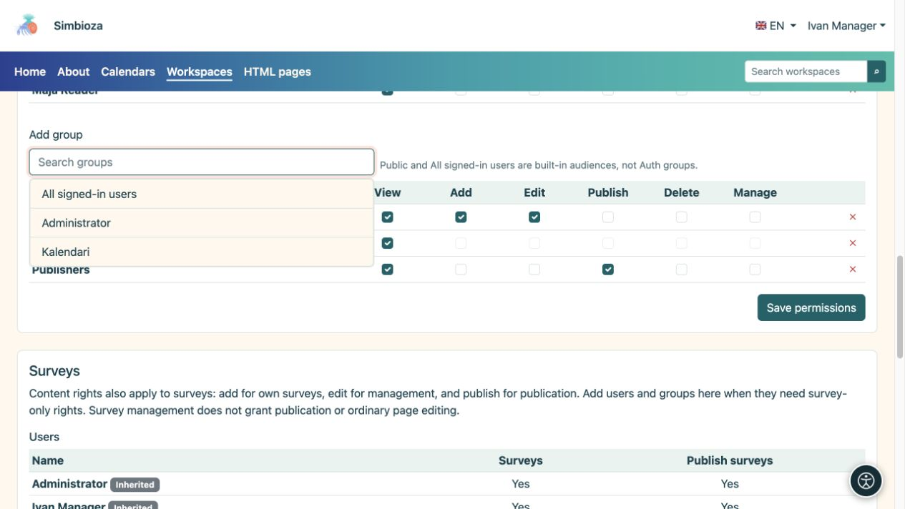
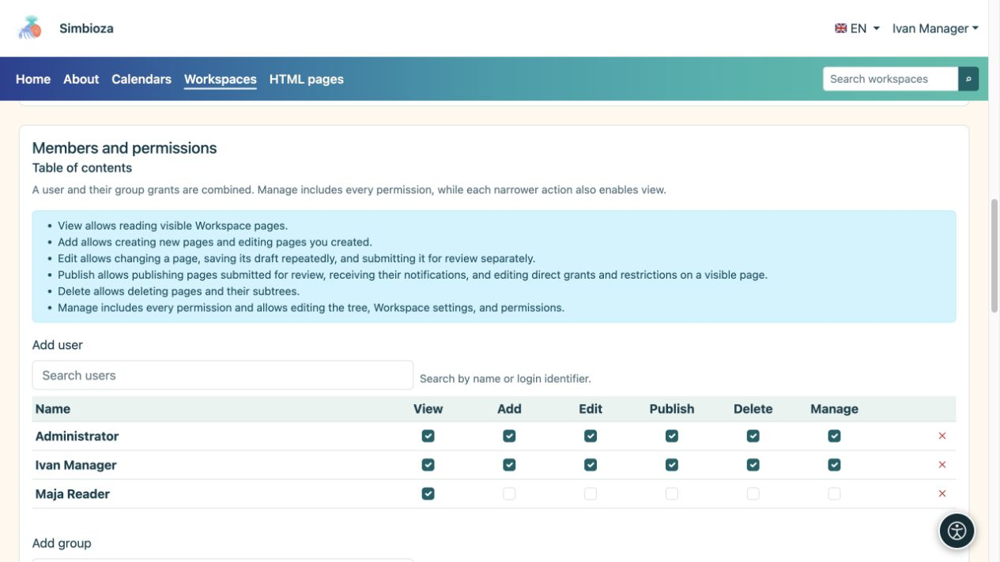

# Add members and assign permissions

[Workspaces](podrucja_en.md)

**Goal:** give each person the access their work requires. A workspace manager or administrator follows this procedure. For an exception on just one page, use [page access](podrucja-prava-stranice_en.md).

## Add a user or group

1. Open the selected workspace's management page and find **Members and permissions → Content**.
2. Open **Add user** or **Add group**, find a name and select it. For a long list, use search and the offered additional loading.
3. Select the required permissions in the added row, using the table below.
4. Save permissions. Ask the person to open the workspace with their own account and try the intended action.

**Result:** the person or group members receive the selected workspace permissions. A group grant covers its members without adding each person individually.

<figure class="my-4">

<figcaption>Choose a result to add it to the table, select the required permissions and save the change.</figcaption>
</figure>

| Permission | What it allows |
| --- | --- |
| **View** | Read accessible published pages. |
| **Add** | Create a page in an allowed part of the tree and work on their own new page. It does not grant editing of everyone else's pages. |
| **Edit** | Write and save drafts; without publication permission this does not change what readers see. |
| **Publish** | Preview and publish drafts. This permission alone does not allow editing their text. |
| **Delete** | Delete permitted pages or subtrees. Descendant permissions are checked too. |
| **Manage** | Maintain the workspace and permissions and use its management actions. It includes the other operational permissions; archiving a page also requires management. |

<figure class="my-4">

<figcaption>Maja has View only; manager Ivan has every permission. Grant only the permissions required for the agreed work.</figcaption>
</figure>

## Public, all signed-in users, or selected people?

- **Public** grants reading without sign-in. Guests do not receive editing rights.
- **All authenticated users** includes every signed-in Simbioza account, rather than just members of one real group.
- For a restricted workspace, omit broad audiences. Add only the required people and groups.

The workspace name, theme or hidden tree do not restrict access. These permissions, together with any page exceptions and restrictions, control access.

## When someone belongs to several groups

Permissions from the user and their groups are combined. Removing one row may leave a permission supplied by another group. To restrict a page and its descendants, use [inherited-right restrictions](podrucja-prava-stranice_en.md).

## Separate survey permissions

With Surveys enabled, the **Surveys** section adds survey-only permissions. Content grants which already apply to surveys appear as inherited; change them in Content. Survey management does not necessarily grant ordinary page editing, and survey publication is a separate permission.

Survey participation and result viewing are configured separately. See [survey permissions](ankete-pocetak_en.md).

**Example:** give Editors view, add and edit rights. Give Publishers view and publish rights. One person may belong to both groups. Before granting access more widely, check that an editor can save a draft and a publisher can publish without unnecessary administrator rights.
