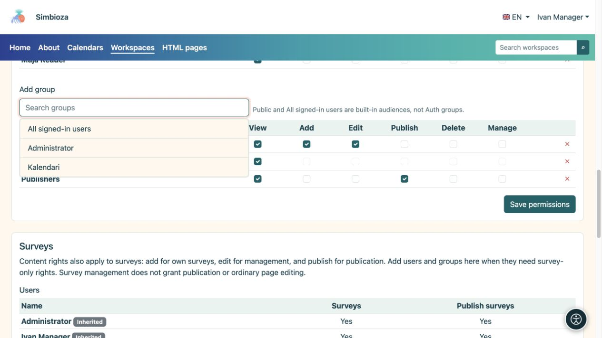
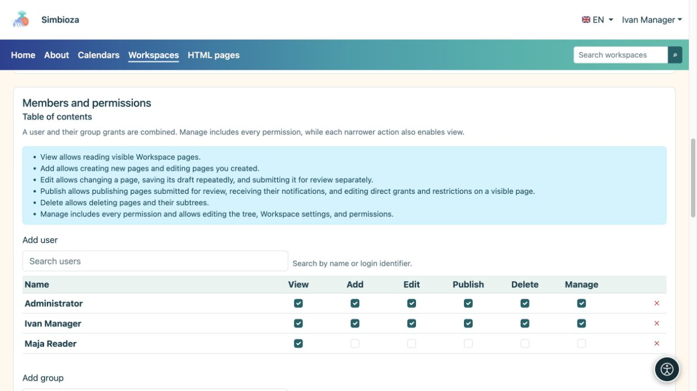

# Añadir miembros y asignar permisos

> Las capturas de pantalla muestran la interfaz en inglés.

[Espacios de trabajo](podrucja_es.md)

**Objetivo:** brindar a cada persona el acceso que su trabajo requiere. Un administrador o gestor del espacio de trabajo sigue este procedimiento. Para una excepción en una sola página, utilice [acceso a la página](podrucja-prava-stranice_es.md).

## Agregar un usuario o grupo

1. Abra la página de administración del espacio de trabajo seleccionado y busque **Miembros y permisos → Contenido**.
2. Abra **Agregar usuario** o **Agregar grupo**, busque un nombre y selecciónelo. Para obtener una lista larga, utilice la búsqueda y la carga adicional ofrecida.
3. Seleccione los permisos requeridos en la fila agregada, usando la siguiente tabla.
4. Guardar permisos. Pídale a la persona que abra el espacio de trabajo con su propia cuenta e intente la acción prevista.

**Resultado:** la persona o los miembros del grupo reciben los permisos seleccionados para el espacio de trabajo. Los permisos de un grupo se aplican a sus miembros sin necesidad de añadir a cada persona por separado.

<figure class="my-4">

<figcaption>Elija un resultado para agregarlo a la tabla, seleccione los permisos requeridos y guarde el cambio.</figcaption>
</figure>

| Permiso | lo que permite |
| --- | --- |
| **Vista** | Leer páginas publicadas accesibles. |
| **Agregar** | Cree una página en una parte permitida del árbol y trabaje en su propia página nueva. No permite la edición de las páginas de los demás. |
| **Editar** | Escribir y guardar borradores; sin permiso de publicación, esto no cambia lo que ven los lectores. |
| **Publicar** | Obtenga una vista previa y publique borradores. Este permiso por sí solo no permite editar su texto. |
| **Borrar** | Eliminar páginas o subárboles permitidos. También se verifican los permisos de los descendientes. |
| **Administrar** | Mantener el espacio de trabajo y los permisos y utilizar sus acciones de gestión. Incluye los demás permisos operativos; archivar una página también requiere administración. |

<figure class="my-4">

<figcaption>Maja tiene sólo Ver; El gestor Iván tiene todo el permiso. Conceder únicamente los permisos necesarios para el trabajo acordado.</figcaption>
</figure>

## ¿Público, todos los usuarios que han iniciado sesión o personas seleccionadas?

- **Público** permite la lectura sin necesidad de iniciar sesión. Los invitados no reciben derechos de edición.
- **Todos los usuarios autenticados** incluye todas las cuentas Simbioza que hayan iniciado sesión, en lugar de solo los miembros de un grupo real.
- Para un espacio de trabajo restringido, omita audiencias amplias. Agregue solo las personas y grupos requeridos.

El nombre del espacio de trabajo, el tema o el árbol oculto no restringen el acceso. Estos permisos, junto con las excepciones y restricciones de la página, controlan el acceso.

## Cuando alguien pertenece a varios grupos

Se combinan los permisos del usuario y sus grupos. Eliminar una fila puede dejar un permiso proporcionado por otro grupo. Para restringir una página y sus descendientes, utilice [restricciones de derechos heredados](podrucja-prava-stranice_es.md).

## Permisos de encuesta separados

Con Encuestas habilitadas, la sección **Encuestas** agrega permisos solo para encuestas. Las concesiones de contenido que ya se aplican a las encuestas aparecen como heredadas; cámbielos en Contenido. La gestión de encuestas no necesariamente otorga la edición normal de la página y la publicación de la encuesta es un permiso independiente.

La participación en la encuesta y la visualización de resultados se configuran por separado. Consulte [permisos de encuesta](ankete-pocetak_es.md).

**Ejemplo:** conceda a los editores derechos de visualización, adición y edición. Otorgue a los editores derechos de visualización y publicación. Una persona puede pertenecer a ambos grupos. Antes de otorgar un acceso más amplio, verifique que Una persona con permiso para publicar pueda guardar un borrador y que Una persona con permiso para publicar pueda publicar sin derechos de administrador innecesarios.
