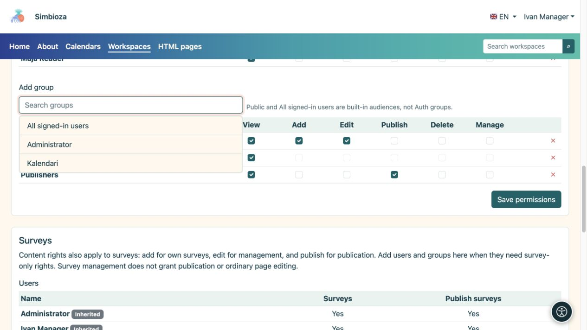
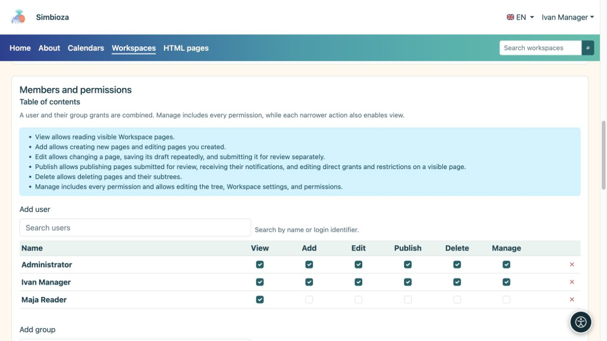

# Ajouter des membres et attribuer des droits

> Les captures d’écran présentent l’interface en anglais.

[Espaces de travail](podrucja_fr.md)

**Objectif :** donner à chaque personne l'accès dont son travail a besoin. Un gestionnaire ou un administrateur d'espace de travail suit cette procédure. Pour une exception sur une seule page, utilisez [accès à la page](podrucja-prava-stranice_fr.md).

## Ajouter un utilisateur ou un groupe

1. Ouvrez la page de gestion de l'espace de travail sélectionné et recherchez **Membres et autorisations → Contenu**.
2. Ouvrez **Ajouter un utilisateur** ou **Ajouter un groupe**, recherchez un nom et sélectionnez-le. Pour une longue liste, utilisez la recherche et le chargement supplémentaire proposé.
3. Sélectionnez les autorisations requises dans la ligne ajoutée, à l'aide du tableau ci-dessous.
4. Enregistrez les autorisations. Demandez à la personne d'ouvrir l'espace de travail avec son propre compte et d'essayer l'action prévue.

**Résultat :** la personne ou les membres du groupe reçoivent les droits sélectionnés pour l’espace de travail. Un droit attribué à un groupe couvre ses membres sans ajouter chaque personne séparément.

<figure class="my-4">

<figcaption>Choisissez un résultat pour l'ajouter au tableau, sélectionnez les autorisations requises et enregistrez la modification.</figcaption>
</figure>

| Autorisation | Ce qu'il permet |
| --- | --- |
| **Voir** | Lisez les pages publiées accessibles. |
| **Ajouter** | Créez une page dans une partie autorisée de l'arborescence et travaillez sur sa propre nouvelle page. Il n'autorise pas la modification des pages de tout le monde. |
| **Modifier** | Rédiger et enregistrer des brouillons ; sans autorisation de publication, cela ne change pas ce que voient les lecteurs. |
| **Publier** | Prévisualisez et publiez les brouillons. Cette autorisation à elle seule ne permet pas de modifier leur texte. |
| **Supprimer** | Supprimez les pages ou sous-arborescences autorisées. Les autorisations descendantes sont également vérifiées. |
| **Gérer** | Gérez l’espace de travail et les autorisations et utilisez ses actions de gestion. Il inclut les autres autorisations opérationnelles ; archiver une page nécessite également une gestion. |

<figure class="my-4">

<figcaption>Maja a uniquement la vue ; le manager Ivan a toutes les autorisations. Accordez uniquement les autorisations requises pour le travail convenu.</figcaption>
</figure>

## Public, tous les utilisateurs connectés ou personnes sélectionnées ?

- **Public** autorise la lecture sans connexion. Les invités ne reçoivent pas de droits d’édition.
- **Tous les utilisateurs authentifiés** incluent tous les comptes Simbioza connectés, plutôt que uniquement les membres d'un groupe réel.
- Pour un espace de travail restreint, omettez un large public. Ajoutez uniquement les personnes et les groupes requis.

Le nom de l'espace de travail, le thème ou l'arborescence masquée ne restreignent pas l'accès. Ces autorisations, ainsi que toutes les exceptions et restrictions de page, contrôlent l'accès.

## Quand quelqu'un appartient à plusieurs groupes

Les autorisations de l'utilisateur et de ses groupes sont combinées. La suppression d'une ligne peut laisser une autorisation fournie par un autre groupe. Pour restreindre une page et ses descendants, utilisez [restrictions de droits hérités](podrucja-prava-stranice_fr.md).

## Autorisations de sondage séparées

Lorsque les sondages sont activés, la section **Sondages** ajoute des droits propres aux sondages. Les droits de contenu qui s’appliquent déjà aux sondages apparaissent comme hérités ; modifiez-les dans Contenu. La gestion des sondages ne donne pas nécessairement le droit de modifier les pages ordinaires, et leur publication reste un droit distinct.

La participation au sondage et l'affichage des résultats sont configurés séparément. Voir [autorisations d'interrogation](ankete-pocetak_fr.md).

**Exemple :** accordez au groupe Éditeurs les droits de consultation, d’ajout et de modification. Accordez au groupe Responsables de publication les droits de consultation et de publication. Une personne peut appartenir aux deux groupes. Avant d’élargir les accès, vérifiez qu’un éditeur peut enregistrer un brouillon et qu’un responsable de publication peut le publier sans droits d’administrateur superflus.
