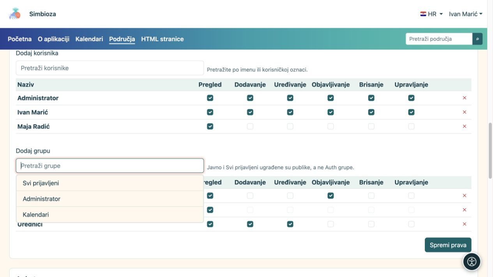
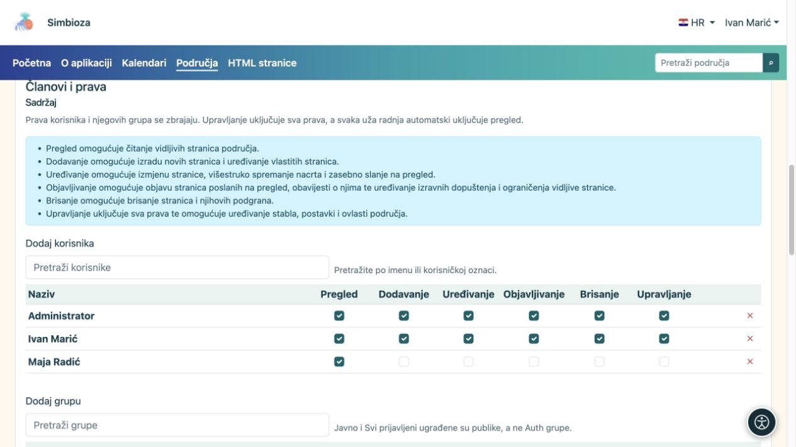

# Dodajte članove i dodijelite prava

[Područja](podrucja_hr.md)

**Cilj:** svakoj osobi dati pristup potreban za posao. Ovaj postupak radi upravitelj područja ili administrator. Za iznimku na samo jednoj stranici koristite [prava stranice](podrucja-prava-stranice_hr.md).

## Dodajte korisnika ili grupu

1. Otvorite upravljanje željenim područjem i pronađite **Članovi i prava → Sadržaj**.
2. U **Dodaj korisnika** ili **Dodaj grupu** otvorite birač, pronađite naziv i odaberite ga. Za dugačak popis upotrijebite pretragu i ponuđeno dodatno učitavanje.
3. U dodanom retku označite potrebna prava prema tablici ispod.
4. Spremite prava. Zatražite da korisnik otvori područje svojim računom i provjeri dogovorenu radnju.

**Rezultat:** dodana osoba ili članovi grupe dobivaju izabrana prava na području. Dodjela grupi obuhvaća njezine članove; nije potrebno unositi svakog pojedinačno.

<figure class="my-4">

<figcaption>Kliknite rezultat pretrage da ga dodate u tablicu, a zatim označite prava i spremite promjenu.</figcaption>
</figure>

| Pravo | Što osoba može |
| --- | --- |
| **Pregled** | Čitati dostupne objavljene stranice. |
| **Dodavanje** | Stvoriti novu stranicu u dopuštenom dijelu stabla i raditi na svojoj novoj stranici. To nije pravo uređivanja svih tuđih stranica. |
| **Uređivanje** | Pisati i spremati nacrt; bez zasebnog prava objave ne mijenja ono što čitatelji vide. |
| **Objavljivanje** | Pregledati i objaviti nacrt. Samo to pravo ne daje uređivanje njegova teksta. |
| **Brisanje** | Obrisati dopuštenu stranicu ili podgranu. Prava se provjeravaju i za podređene stavke. |
| **Upravljanje** | Održavati područje i prava te koristiti njegove upraviteljske radnje. Uključuje ostala operativna prava; arhiviranje stranice također traži upravljanje. |

<figure class="my-4">

<figcaption>Maja ima samo pregled, a upravitelj Ivan sva prava. Dodjeljujte samo prava potrebna za dogovoreni posao.</figcaption>
</figure>

## Javno, svi prijavljeni ili odabrane osobe?

- **Javno** daje čitanje bez prijave. Gostima se ne daje uređivanje.
- **Svi prijavljeni** obuhvaća svaki prijavljeni račun Simbioze; ne odnosi se samo na članove jedne stvarne grupe.
- Za ograničeno područje nemojte dodavati opću publiku. Dodajte samo potrebne osobe i grupe.

Naziv područja, njegova tema ili sakriveno stablo ne ograničavaju pristup. Pristup određuju ova prava te moguće iznimke i ograničenja na stranicama.

## Kada je korisnik u više grupa

Prava korisnika i njegovih grupa zbrajaju se. Uklanjanje jednog retka ne mora ukloniti pravo koje osoba dobiva drugom grupom. Ako treba ograničiti jednu stranicu i njezine potomke, upotrijebite [ograničenje naslijeđenih prava](podrucja-prava-stranice_hr.md).

## Posebna prava anketa

Ako je modul anketa uključen, odjeljak **Ankete** daje dodatne ovlasti samo za ankete. Postojeće dodjele sadržaja koje već vrijede za ankete prikazane su kao naslijeđene; mijenjaju se u odjeljku Sadržaj. Dodjeljivanje upravljanja anketama ne mora dati uređivanje običnih stranica, a objavljivanje anketa zasebno je pravo.

Pravo ispunjavanja ankete i pregleda njezinih rezultata podešava se zasebno. Pogledajte [ovlasti anketa](ankete-pocetak_hr.md).

**Praktičan primjer:** grupi Urednici dodijelite pregled, dodavanje i uređivanje. Grupi Objavljivači dodijelite pregled i objavljivanje. Jedna osoba može biti u obje grupe. Prije šire dodjele provjerite da urednik može spremiti nacrt, a objavljivač objaviti sadržaj bez nepotrebnih administratorskih prava.
