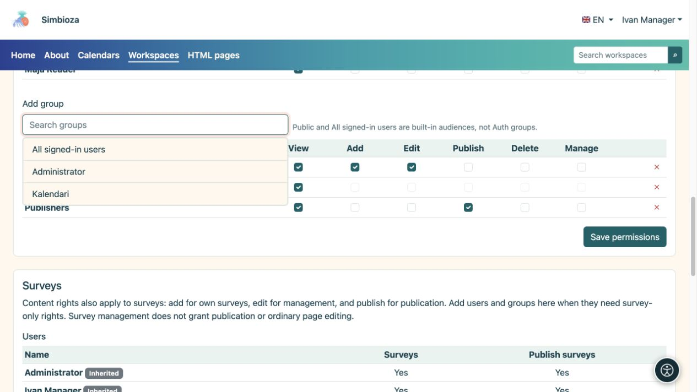
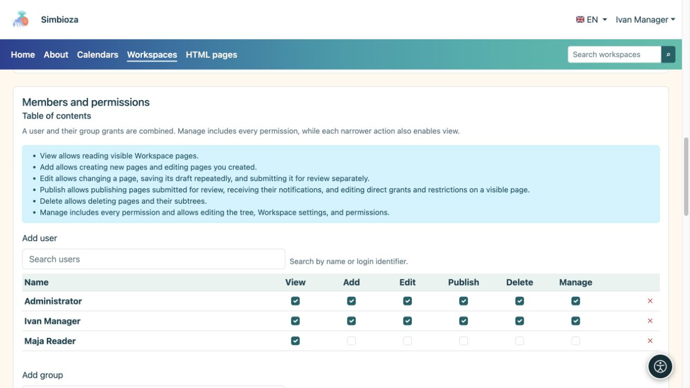

# Aggiungi membri e assegna autorizzazioni

> Le schermate mostrano l’interfaccia in inglese.

[Aree di lavoro](podrucja_it.md)

**Obiettivo:** fornire a ogni persona l'accesso richiesto dal proprio lavoro. Un manager o un amministratore dell'area di lavoro segue questa procedura. Per un'eccezione su una sola pagina, utilizzare [accesso alla pagina](podrucja-prava-stranice_it.md).

## Aggiungi un utente o un gruppo

1. Apri la pagina di gestione dell'area di lavoro selezionata e trova **Membri e autorizzazioni → Contenuto**.
2. Apri **Aggiungi utente** o **Aggiungi gruppo**, trova un nome e selezionalo. Per un lungo elenco, utilizza la ricerca e il caricamento aggiuntivo offerto.
3. Seleziona le autorizzazioni richieste nella riga aggiunta, utilizzando la tabella seguente.
4. Salva permessi. Chiedi alla persona di aprire l'area di lavoro con il proprio account e provare l'azione prevista.

**Risultato:** la persona o i membri del gruppo ricevono le autorizzazioni selezionate per l'area di lavoro. Un'autorizzazione assegnata a un gruppo vale per tutti i suoi membri, senza aggiungere ciascuna persona separatamente.

<figure class="my-4">

<figcaption>Scegli un risultato per aggiungerlo alla tabella, seleziona le autorizzazioni richieste e salva la modifica.</figcaption>
</figure>

| Autorizzazione | Cosa consente |
| --- | --- |
| **Visualizza** | Leggere le pagine pubblicate accessibili. |
| **Aggiungi** | Crea una pagina in una parte consentita dell'albero e lavora sulla propria nuova pagina. Non garantisce la modifica delle pagine di tutti gli altri. |
| **Modifica** | Scrivere e salvare bozze; senza il permesso di pubblicazione ciò non cambia ciò che vedono i lettori. |
| **Pubblica** | Anteprima e pubblicazione di bozze. Questa autorizzazione da sola non consente di modificare il testo. |
| **Elimina** | Elimina le pagine o i sottoalberi consentiti. Vengono controllati anche i permessi dei discendenti. |
| **Gestisci** | Mantenere l'area di lavoro e le autorizzazioni e utilizzare le relative azioni di gestione. Comprende gli altri permessi operativi; anche l'archiviazione di una pagina richiede la gestione. |

<figure class="my-4">

<figcaption>Maja ha Solo visualizzazione; il manager Ivan ha ogni permesso. Concedere solo le autorizzazioni necessarie per il lavoro concordato.</figcaption>
</figure>

## Pubblico, tutti gli utenti che hanno effettuato l'accesso o persone selezionate?

- **Pubblico** garantisce la lettura senza effettuare l'accesso. Gli ospiti non ricevono diritti di modifica.
- **Tutti gli utenti autenticati** include tutti gli account Simbioza a cui è stato effettuato l'accesso, anziché solo i membri di un gruppo reale.
- Per un'area di lavoro ristretto, ometti un pubblico vasto. Aggiungi solo le persone e i gruppi richiesti.

Il nome dell'area di lavoro, il tema o l'albero nascosto non limitano l'accesso. Queste autorizzazioni, insieme a eventuali eccezioni e restrizioni della pagina, controllano l'accesso.

## Quando qualcuno appartiene a più gruppi

Le autorizzazioni dell'utente e dei suoi gruppi vengono combinate. La rimozione di una riga potrebbe lasciare un'autorizzazione fornita da un altro gruppo. Per limitare una pagina e i suoi discendenti, utilizzare [restrizioni sui diritti ereditati](podrucja-prava-stranice_it.md).

## Autorizzazioni di sondaggio separate

Con i sondaggi abilitati, la sezione **Sondaggi** aggiunge autorizzazioni solo per i sondaggi. Le concessioni di contenuto che già si applicano ai sondaggi appaiono come ereditate; modificarli in Contenuto. La gestione del sondaggio non garantisce necessariamente la normale modifica della pagina e la pubblicazione del sondaggio è un'autorizzazione separata.

La partecipazione al sondaggio e la visualizzazione dei risultati sono configurate separatamente. Vedere [autorizzazioni sondaggio](ankete-pocetak_it.md).

**Esempio:** assegna al gruppo dei redattori i diritti di visualizzazione, aggiunta e modifica. Assegna al gruppo dei responsabili della pubblicazione i diritti di visualizzazione e pubblicazione. Una persona può appartenere a entrambi i gruppi. Prima di concedere un accesso più ampio, verifica che un redattore possa salvare una bozza e che un responsabile della pubblicazione possa pubblicarla senza diritti amministrativi non necessari.
