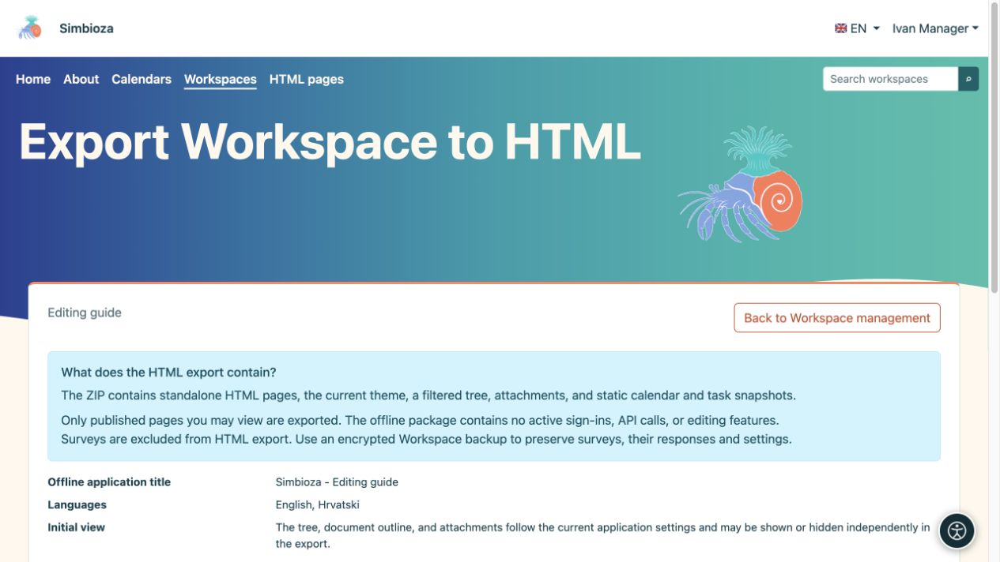
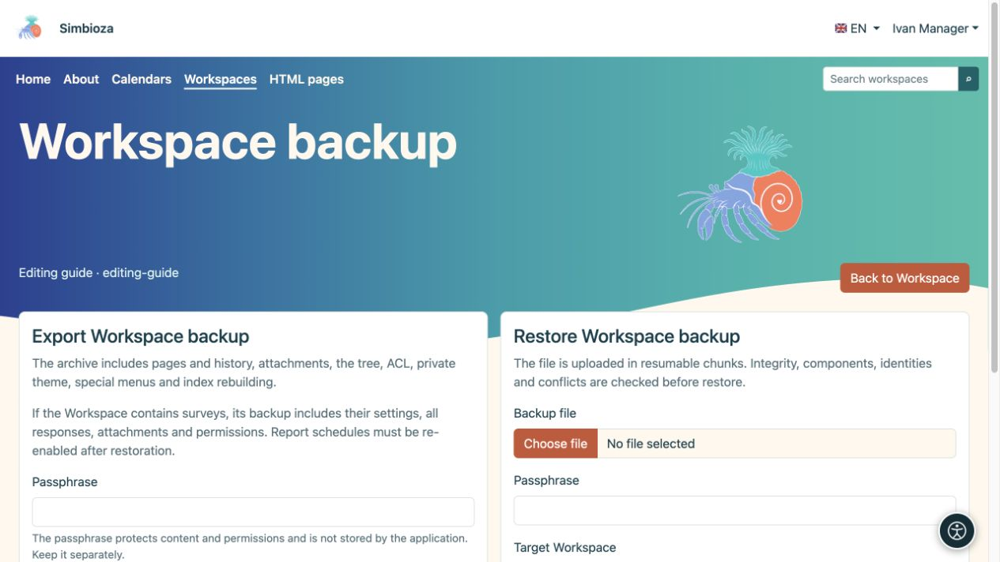

# Einen Arbeitsbereich exportieren oder eine Sicherung wiederherstellen

> Die Bildschirmaufnahmen zeigen die englische Benutzeroberfläche.

[Arbeitsbereiche](podrucja_de.md)

**Für:** Arbeitsbereichsmanager und -administratoren. Wählen Sie zunächst Ihr Ziel: Benötigen Leser statische Seiten oder benötigen Sie eine Kopie, von der der Arbeitsbereich wiederhergestellt werden kann?

| Sie brauchen… | Verwenden… |
| --- | --- |
| Dokumentation, die als gewöhnliches Webpaket geöffnet wird | **HTML exportieren** |
| Inhalt, Verlauf, Umfrageantworten und Einstellungen zur Wiederherstellung | **Arbeitsbereich-Sicherung** |
| Die gesamte Installation, einschließlich globaler Einstellungen | Die vollständige Site-Sicherung eines Administrators |

## HTML zum Lesen exportieren

1. Öffnen Sie die Arbeitsbereichseinstellungen und die Exportaktion HTML.
2. Überprüfen Sie die zugänglichen veröffentlichten Seiten und Navigations-/Anzeigeoptionen.
3. Starten Sie den Export und laden Sie ZIP herunter.
4. Extrahieren Sie es und öffnen Sie **index.html**. Überprüfen Sie Navigation, Bilder und Links.

**Ergebnis:** ein statisches Paket veröffentlichter Seiten, die Sie lesen können. Ausgenommen sind unzugängliche Seiten und unveröffentlichte Entwürfe. Das Paket wird außerhalb einer authentifizierten Simbioza-Sitzung geöffnet. Geben Sie es daher nur für die vorgesehene Zielgruppe frei.

<figure class="my-4">

<figcaption>Der statische HTML-Export ist vom Backup getrennt. Umfragen sind von diesem Paket HTML ausgeschlossen.</figcaption>
</figure>

<figure class="my-4">

<figcaption>Die exportierte Site wird ohne eine authentifizierte Sitzung oder die Live-Sitzung Simbioza API geöffnet.</figcaption>
</figure>

Umfragen werden in HTML-Exporten weggelassen: Ein statisches Paket kann die Teilnehmeranmeldung, die Übermittlung von Antworten oder die Ergebnisse nicht wiederherstellen. Verwenden Sie Backup, um Umfragen zu übertragen.

Ausgewählte genehmigte Skripte begleiten den Export: Lokale Dateien und Inline-Code werden kopiert, während genehmigte externe CSS/JavaScript-Links verbleiben, die eine Netzwerkverbindung erfordern. Die nativen interaktiven Tabellen von Simbioza verfügen über lokalen Laufzeitcode. Funktionen, die von der Anmeldung oder einem Live-API abhängig sind, werden nicht zu einer Offline-Anwendung.

## Erstellen Sie ein Arbeitsbereich-Backup

1. Öffnen Sie **Arbeitsbereichssicherung verwalten**.
2. Wählen Sie „Exportieren“ und geben Sie eine starke Verschlüsselungspassphrase ein.
3. Laden Sie das Archiv herunter und bewahren Sie die Passphrase separat auf. Ohne sie können Sie den verschlüsselten Inhalt nicht lesen.

Die Sicherung umfasst unterstützte Inhalte, Versionen, Anhänge, den Baum, Berechtigungen, private Designs, spezielle Menüs und Daten von teilnehmenden Modulen. Bei Umfragen werden Fragen, Einstellungen, Übersetzungen, Überarbeitungen, alle gespeicherten akzeptierten Antworten, Berechtigungen und Medien übertragen. Globale Umfrageeinstellungen und technische externe Anmeldeverbindungen gehören zur vollständigen Site-Sicherung; siehe [Umfragesicherung](ankete-backup-detalji_de.md).

<figure class="my-4">

<figcaption>Der Export erfolgt auf der linken Seite und der Upload zum Wiederherstellen auf der rechten Seite. Geben Sie die Passphrase in das entsprechende Feld ein und bewahren Sie sie getrennt vom Archiv auf.</figcaption>
</figure>

## Überprüfen Sie eine Kopie und stellen Sie sie wieder her

1. Laden Sie ZIP auf dem Sicherungsbildschirm hoch und geben Sie die Passphrase ein.
2. Führen Sie zunächst die Prüfung durch. Lesen Sie die Modulliste, die Inhaltszusammenfassung, Versionswarnungen und Zielkonflikte.
3. Wählen Sie für einen Test eine neue Kopie und einen neuen Slug. Durch die Wiederherstellung eines vorhandenen Arbeitsbereichs werden möglicherweise dessen Daten ersetzt. Sichern Sie zuerst das Ziel.
4. Bestätigen Sie den entsprechenden Wiederherstellungsmodus erst, nachdem Sie ihn überprüft haben.
5. Öffnen Sie den wiederhergestellten Arbeitsbereich und überprüfen Sie Seiten, Sprachen, Anhänge, Berechtigungen und verknüpfte Inhalte als vorgesehener Benutzer.

<figure class="my-4">

<figcaption>Der Preflight validiert das Backup und akzeptiert einen neuen Ziel-Slug.</figcaption>
</figure>

<figure class="my-4">

<figcaption>Project Aurora wurde als separater Arbeitsbereich mit einem neuen Slug wiederhergestellt.</figcaption>
</figure>

**Kalender und Besprechungen:** Neue Arbeitsbereichs-Backups umfassen verknüpfte Kalender und ihre Ereignisse, Organisatoren, Teilnehmer, Antworten, Reservierungen und Genehmiger. Sie enthalten auch Definitionen der Ressourcenkalender, die für diese Besprechungen benötigt werden. Eine vorhandene Ressource mit derselben stabilen Identität kann wiederverwendet werden; Durch das Kopieren eines Arbeitsbereichs wird nicht für jeden gemeinsam genutzten Raum ein unabhängiger Zeitplan erstellt. Nicht verwandte Ereignisse auf einer solchen Ressource werden nicht angezeigt oder ersetzt, nur weil eine Besprechung sie verwendet.

Private CalDAV-Anmeldeinformationen sind von der Sicherung des Arbeitsbereichs ausgeschlossen. Verwenden Sie für eine vollständige Wiederherstellung des Kalendersystems die Kalenderkomponente eines Administrators oder ein vollständiges Site-Backup. Unvollständige ältere Sitzungsarchive werden vor der Wiederherstellung abgelehnt; Normale ältere Ereignisse werden weiterhin unterstützt. Wenn in einer früheren Kopie Besprechungsaufzeichnungen fehlen, erstellen Sie ein neues Backup mit dem aktualisierten Modul oder verwenden Sie ein vollständiges Backup.

Abgeleitete Suchdaten werden entsprechend der Unterstützung des aktivierten Moduls neu erstellt. Überprüfen Sie nach der Wiederherstellung von Umfragen deren Status, Berichtsempfänger und Einstellungen, anstatt blind mit der Sammlung von Antworten oder Berichten fortzufahren. siehe [Umfragesicherung](ankete-backup-detalji_de.md).
