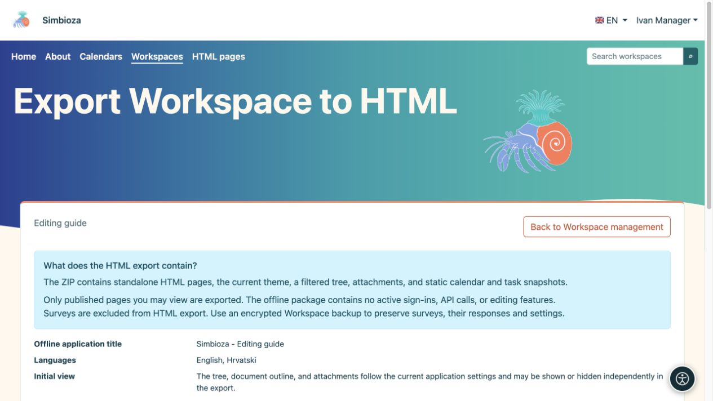
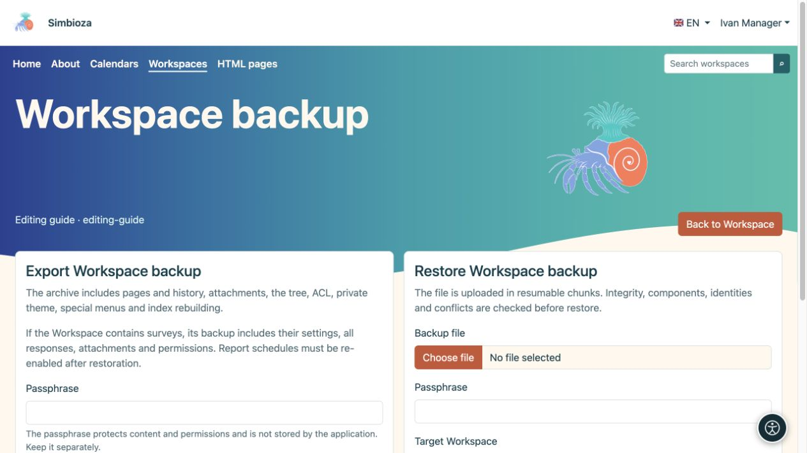

# Export a workspace or restore a backup

[Workspaces](podrucja_en.md)

**For:** workspace managers and administrators. First choose your goal: do readers need static pages, or do you need a copy from which the workspace can be restored?

| You need… | Use… |
| --- | --- |
| Documentation which opens as an ordinary web package | **HTML export** |
| Content, history, survey responses and settings for restoration | **Workspace backup** |
| The whole installation, including global settings | An administrator's full-site backup |

## HTML export for reading

1. Open the workspace settings and its HTML export action.
2. Review the accessible published pages and navigation/display options.
3. Start the export and download the ZIP.
4. Extract it and open **index.html**. Check navigation, images and links.

**Result:** a static package of published pages you may read. Inaccessible pages and unpublished drafts are excluded. The package opens outside an authenticated Simbioza session, so share it only with the intended audience.

<figure class="my-4">

<figcaption>Static HTML export is separate from backup. Surveys are excluded from this HTML package.</figcaption>
</figure>

<figure class="my-4">

<figcaption>The exported site opens without an authenticated session or the live Simbioza API.</figcaption>
</figure>

Surveys are omitted from HTML exports: a static package cannot recreate participant sign-in, response submission or results. Use backup to transfer surveys.

Selected approved scripts accompany the export: local files and inline code are copied, while approved external CSS/JavaScript remain links requiring a network connection. Simbioza's native interactive tables have local runtime code. Features depending on sign-in or a live API do not become an offline application.

## Create a workspace backup

1. Open **Manage workspace backup**.
2. Choose export and enter a strong encryption passphrase.
3. Download the archive and keep its passphrase separately. Without it, you cannot read the encrypted content.

Backup includes supported content, versions, attachments, the tree, permissions, private theme, special menus and data from participating modules. For surveys, it transfers questions, settings, translations, revisions, all saved accepted responses, permissions and media. Global Survey settings and technical external-sign-in connections belong to full-site backup; see [survey backup](ankete-backup-detalji_en.md).

<figure class="my-4">

<figcaption>Export is on the left and restore upload on the right. Enter the passphrase in the corresponding field and keep it separately from the archive.</figcaption>
</figure>

## Check and restore a copy

1. Upload the ZIP on the backup screen and enter the passphrase.
2. Run the check first. Read the module list, content summary, version warnings and destination conflicts.
3. For a trial, choose a new copy and slug. Restoring over an existing workspace may replace its data; back up the destination first.
4. Confirm the appropriate restore mode only after reviewing it.
5. Open the restored workspace and check pages, languages, attachments, permissions and linked content as the intended user.

<figure class="my-4">

<figcaption>The preflight validates the backup and accepts a new target slug.</figcaption>
</figure>

<figure class="my-4">

<figcaption>Project Aurora was restored as a separate Workspace with a new slug.</figcaption>
</figure>

**Calendars and meetings:** new workspace backups include linked calendars and their events, organisers, participants, responses, reservations and approvers. They also carry definitions of resource calendars needed by those meetings. An existing resource with the same stable identity may be reused; copying a workspace does not create an independent schedule for every shared room. Unrelated events on such a resource are not exposed or replaced merely because a meeting uses it.

Private CalDAV credentials are excluded from workspace backup. Use an administrator's Calendar-component or full-site backup for complete calendar-system recovery. Incomplete older meeting archives are rejected before restoration; ordinary older events remain supported. If a previous copy lacks meeting records, create a new backup with the updated module or use a complete backup.

Derived search data is rebuilt as supported by the enabled module. After restoring surveys, review their state, report recipients and settings rather than blindly resuming response collection or reports; see [survey backup](ankete-backup-detalji_en.md).
