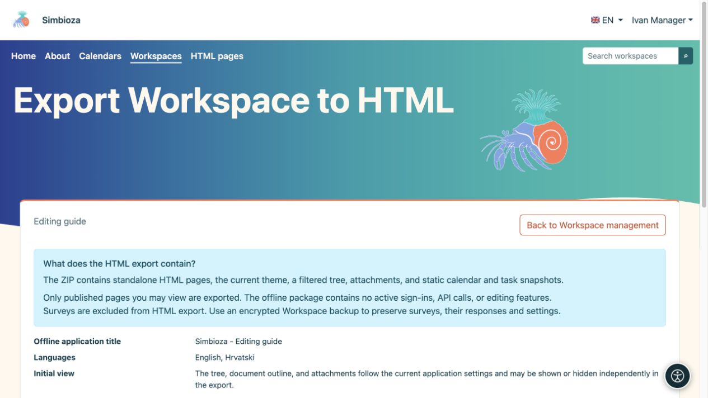
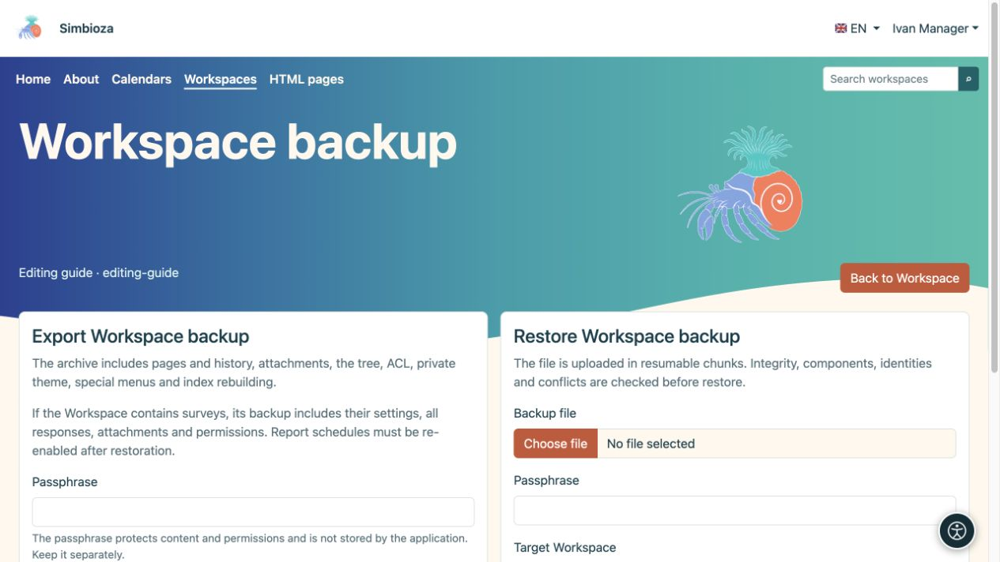

# Exportar un espacio de trabajo o restaurar una copia de seguridad

> Las capturas de pantalla muestran la interfaz en inglés.

[Espacios de trabajo](podrucja_es.md)

**Para:** administradores y gestores de espacios de trabajo. Primero elija su objetivo: ¿los lectores necesitan páginas estáticas o necesita una copia desde la cual se pueda restaurar el espacio de trabajo?

| Necesitas… | Usar… |
| --- | --- |
| Documentación que se abre como un paquete web normal. | **HTML exportación** |
| Contenido, historia, respuestas a la encuesta y entornos para la restauración. | **Copia de seguridad del espacio de trabajo** |
| Toda la instalación, incluida la configuración global. | Copia de seguridad completa del sitio de un administrador |

## HTML exportar para lectura

1. Abra la configuración del espacio de trabajo y su acción de exportación HTML.
2. Revise las páginas publicadas accesibles y las opciones de navegación/visualización.
3. Inicie la exportación y descargue el archivo ZIP.
4. Extráigalo y abra **index.html**. Consulte navegación, imágenes y enlaces.

**Resultado:** un paquete estático de páginas publicadas que puede leer. Se excluyen las páginas inaccesibles y los borradores inéditos. El paquete se abre fuera de una sesión Simbioza autenticada, así que compártalo solo con la audiencia prevista.

<figure class="my-4">

<figcaption>La exportación estática HTML está separada de la copia de seguridad. Las encuestas están excluidas de este paquete HTML.</figcaption>
</figure>

<figure class="my-4">

<figcaption>El sitio exportado se abre sin una sesión autenticada o el Simbioza API en vivo.</figcaption>
</figure>

Las encuestas se omiten en las exportaciones HTML: un paquete estático no puede recrear el inicio de sesión de los participantes, el envío de respuestas ni los resultados. Utilice una copia de seguridad para transferir encuestas.

Los scripts aprobados seleccionados acompañan la exportación: los archivos locales y el código en línea se copian, mientras que CSS/JavaScript externos aprobados siguen siendo enlaces que requieren una conexión de red. Las tablas interactivas nativas de Simbioza tienen código de tiempo de ejecución local. Las funciones que dependen del inicio de sesión o de un API en vivo no se convierten en una aplicación fuera de línea.

## Crear una copia de seguridad del espacio de trabajo

1. Abra **Administrar copia de seguridad del espacio de trabajo**.
2. Elija exportar e ingrese una contraseña de cifrado segura.
3. Descargue el archivo y guarde su contraseña por separado. Sin él, no se puede leer el contenido cifrado.

La copia de seguridad incluye contenido compatible, versiones, archivos adjuntos, árbol, permisos, tema privado, menús especiales y datos de los módulos participantes. Para las encuestas, transfiere preguntas, configuraciones, traducciones, revisiones, todas las respuestas aceptadas guardadas, permisos y medios. La configuración de la encuesta global y las conexiones técnicas de inicio de sesión externo pertenecen a la copia de seguridad completa del sitio; consulte [copia de seguridad de la encuesta](ankete-backup-detalji_es.md).

<figure class="my-4">

<figcaption>Exportar está a la izquierda y restaurar carga a la derecha. Ingrese la frase de contraseña en el campo correspondiente y guárdela separada del archivo.</figcaption>
</figure>

## Verificar y restaurar una copia

1. Cargue ZIP en la pantalla de respaldo e ingrese la frase de contraseña.
2. Ejecute la verificación primero. Lea la lista de módulos, el resumen de contenido, las advertencias de versión y los conflictos de destino.
3. Para una prueba, elija una nueva copia y slug. La restauración de un espacio de trabajo existente puede reemplazar sus datos; primero haga una copia de seguridad del destino.
4. Confirme el modo de restauración apropiado solo después de revisarlo.
5. Abra el espacio de trabajo restaurado y verifique las páginas, idiomas, archivos adjuntos, permisos y contenido vinculado según el usuario previsto.

<figure class="my-4">

<figcaption>La verificación previa valida la copia de seguridad y acepta un nuevo slug objetivo.</figcaption>
</figure>

<figure class="my-4">

<figcaption>El Proyecto Aurora se restauró como un espacio de trabajo independiente con un nuevo slug.</figcaption>
</figure>

**Calendarios y reuniones:** las nuevas copias de seguridad del espacio de trabajo incluyen calendarios vinculados y sus eventos, organizadores, participantes, respuestas, reservas y aprobadores. También contienen definiciones de calendarios de recursos necesarios para esas reuniones. Se puede reutilizar un recurso existente con la misma identidad estable; Copiar un espacio de trabajo no crea un horario independiente para cada sala compartida. Los eventos no relacionados en dicho recurso no se exponen ni reemplazan simplemente porque una reunión lo utilice.

Las credenciales privadas CalDAV están excluidas de la copia de seguridad del espacio de trabajo. Utilice un componente de calendario del administrador o una copia de seguridad de todo el sitio para una recuperación completa del sistema de calendario. Los archivos de reuniones antiguos incompletos se rechazan antes de su restauración; Los eventos antiguos ordinarios siguen siendo compatibles. Si una copia anterior carece de registros de reuniones, cree una nueva copia de seguridad con el módulo actualizado o utilice una copia de seguridad completa.

Los datos de búsqueda derivados se reconstruyen según lo admita el módulo habilitado. Después de restaurar las encuestas, revise su estado, informe a los destinatarios y la configuración en lugar de reanudar ciegamente la recopilación de respuestas o los informes; consulte [copia de seguridad de la encuesta](ankete-backup-detalji_es.md).
