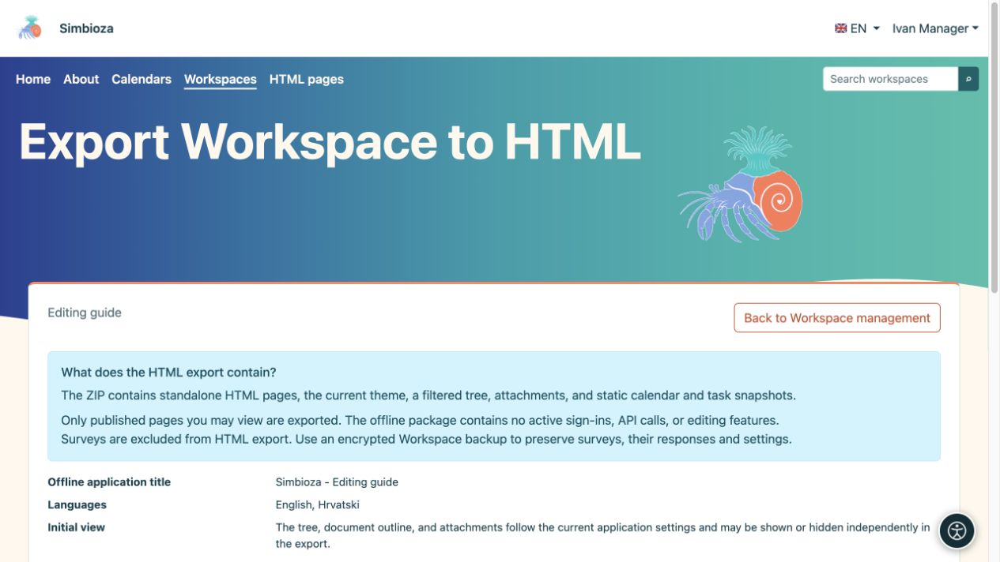
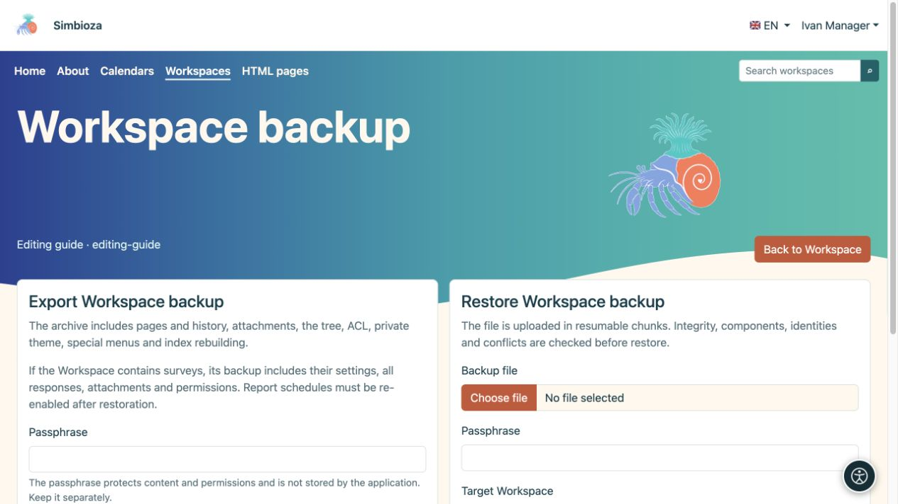

# Exporter un espace de travail ou restaurer une sauvegarde

> Les captures d’écran présentent l’interface en anglais.

[Espaces de travail](podrucja_fr.md)

**Pour :** les gestionnaires et administrateurs d'espace de travail. Choisissez d’abord votre objectif : les lecteurs ont-ils besoin de pages statiques ou avez-vous besoin d’une copie à partir de laquelle l’espace de travail peut être restauré ?

| Vous avez besoin… | Utiliser… |
| --- | --- |
| Documentation qui s'ouvre comme un package Web ordinaire | **HTML exportation** |
| Contenu, historique, réponses aux sondages et paramètres de restauration | **Sauvegarde de l'espace de travail** |
| L'ensemble de l'installation, y compris les paramètres globaux | Sauvegarde complète du site d'un administrateur |

## HTML exportation pour lecture

1. Ouvrez les paramètres de l'espace de travail et son action d'exportation HTML.
2. Passez en revue les pages publiées accessibles et les options de navigation/affichage.
3. Démarrez l'exportation et téléchargez le ZIP.
4. Extrayez-le et ouvrez **index.html**. Vérifiez la navigation, les images et les liens.

**Résultat :** un package statique de pages publiées que vous pouvez lire. Les pages inaccessibles et les brouillons non publiés sont exclus. Le package s'ouvre en dehors d'une session Simbioza authentifiée, partagez-le donc uniquement avec le public visé.

<figure class="my-4">

<figcaption>L’exportation statique HTML est distincte de la sauvegarde. Les sondages sont exclus de ce package HTML.</figcaption>
</figure>

<figure class="my-4">

<figcaption>Le site exporté s'ouvre sans session authentifiée ni Simbioza API en direct.</figcaption>
</figure>

Les sondages sont omis des exportations HTML : un package statique ne peut pas recréer la connexion des participants, la soumission des réponses ou les résultats. Utilisez la sauvegarde pour transférer les sondages.

Les scripts approuvés sélectionnés accompagnent l'exportation : les fichiers locaux et le code en ligne sont copiés, tandis que les CSS/JavaScript externes approuvés restent des liens nécessitant une connexion réseau. Les tables interactives natives de Simbioza ont un code d'exécution local. Les fonctionnalités dépendant de la connexion ou d'un API en direct ne deviennent pas une application hors ligne.

## Créer une sauvegarde de l'espace de travail

1. Ouvrez **Gérer la sauvegarde de l'espace de travail**.
2. Choisissez Exporter et entrez une phrase secrète de cryptage fort.
3. Téléchargez l'archive et conservez sa phrase secrète séparément. Sans cela, vous ne pouvez pas lire le contenu crypté.

La sauvegarde comprend le contenu pris en charge, les versions, les pièces jointes, l'arborescence, les autorisations, le thème privé, les menus spéciaux et les données des modules participants. Pour les sondages, il transfère les questions, les paramètres, les traductions, les révisions, toutes les réponses acceptées enregistrées, les autorisations et les médias. Les paramètres de Global Survey et les connexions techniques de connexion externe appartiennent à la sauvegarde complète du site ; voir [sauvegarde de l'interrogation](ankete-backup-detalji_fr.md).

<figure class="my-4">

<figcaption>L'exportation est à gauche et la restauration du téléchargement à droite. Saisissez la phrase secrète dans le champ correspondant et conservez-la séparément des archives.</figcaption>
</figure>

## Vérifier et restaurer une copie

1. Téléchargez le ZIP sur l'écran de sauvegarde et entrez la phrase secrète.
2. Exécutez d'abord la vérification. Lisez la liste des modules, le résumé du contenu, les avertissements de version et les conflits de destination.
3. Pour un essai, choisissez une nouvelle copie et un nouveau slug. La restauration sur un espace de travail existant peut remplacer ses données ; sauvegardez d’abord la destination.
4. Confirmez le mode de restauration approprié uniquement après l'avoir examiné.
5. Ouvrez l'espace de travail restauré et vérifiez les pages, les langues, les pièces jointes, les autorisations et le contenu lié en tant qu'utilisateur prévu.

<figure class="my-4">

<figcaption>Le contrôle en amont valide la sauvegarde et accepte un nouveau slug cible.</figcaption>
</figure>

<figure class="my-4">

<figcaption>Le projet Aurora a été restauré en tant qu'espace de travail distinct avec un nouveau slug.</figcaption>
</figure>

**Calendriers et réunions :** les nouvelles sauvegardes d'espace de travail incluent les calendriers liés et leurs événements, organisateurs, participants, réponses, réservations et approbateurs. Ils contiennent également des définitions des calendriers de ressources nécessaires à ces réunions. Une ressource existante avec la même identité stable peut être réutilisée ; copier un espace de travail ne crée pas un planning indépendant pour chaque salle partagée. Les événements sans rapport sur une telle ressource ne sont pas exposés ou remplacés simplement parce qu'une réunion l'utilise.

Les informations d'identification privées CalDAV sont exclues de la sauvegarde de l'espace de travail. Utilisez la sauvegarde du composant Calendrier ou de l'intégralité du site d'un administrateur pour une récupération complète du système de calendrier. Les archives incomplètes des réunions plus anciennes sont rejetées avant restauration ; les événements ordinaires plus anciens restent pris en charge. Si une copie précédente ne contient pas d'enregistrements de réunion, créez une nouvelle sauvegarde avec le module mis à jour ou utilisez une sauvegarde complète.

Les données de recherche dérivées sont reconstruites comme pris en charge par le module activé. Après avoir restauré les sondages, examinez leur état, signalez les destinataires et les paramètres plutôt que de reprendre aveuglément la collecte des réponses ou les rapports ; voir [sauvegarde de l'interrogation](ankete-backup-detalji_fr.md).
