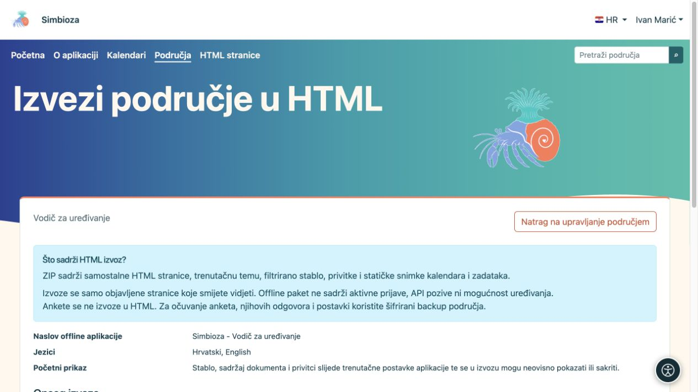
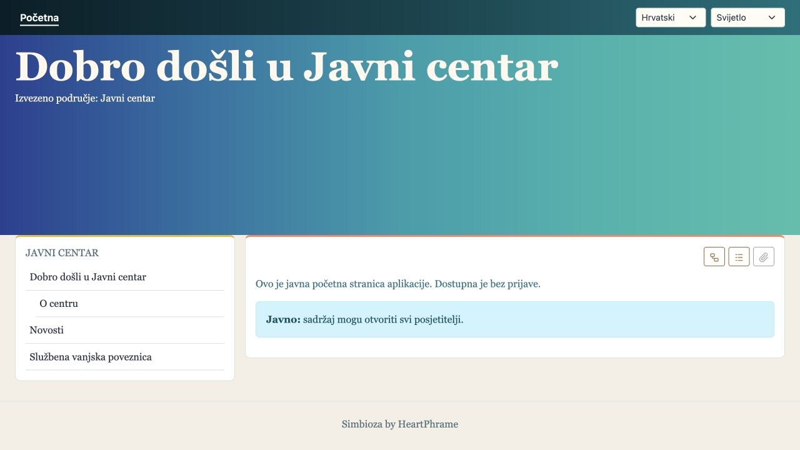
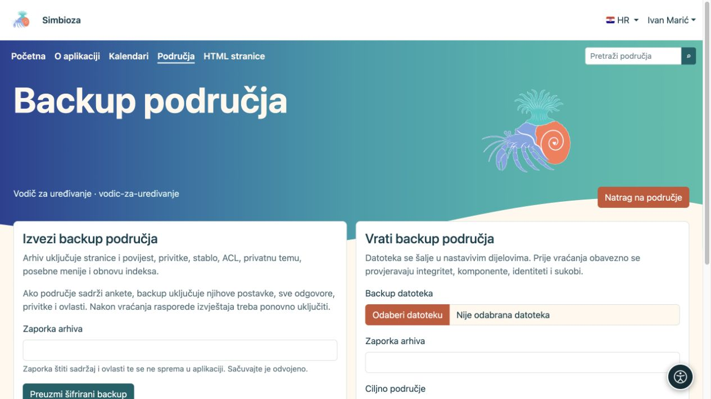
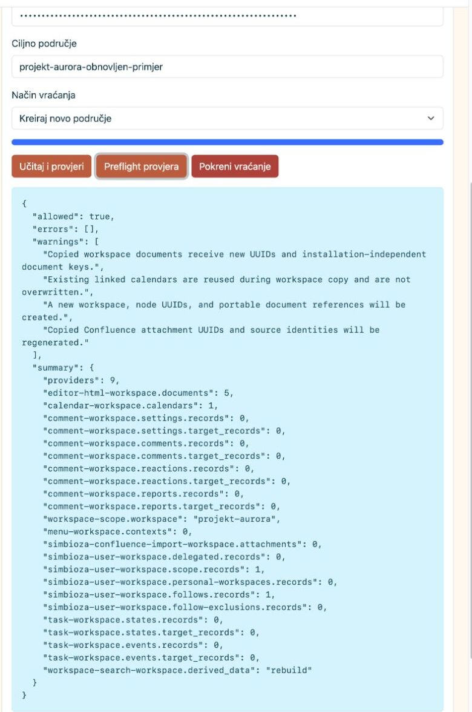
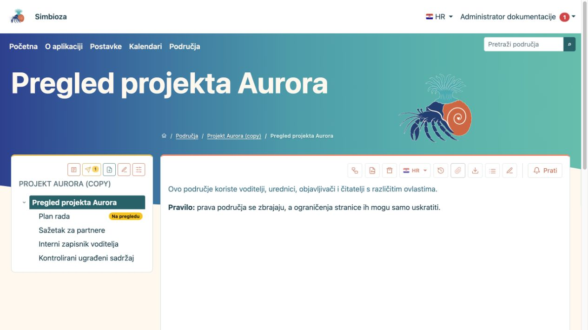

# Izvezite područje ili vratite kopiju

[Područja](podrucja_hr.md)

**Za koga:** za upravitelja područja ili administratora. Prvo odaberite cilj: želite li čitatelju dati statične stranice ili sačuvati kopiju iz koje se područje može vratiti?

| Trebate… | Koristite… |
| --- | --- |
| Dokumentaciju koja se otvara kao običan web-paket | **HTML izvoz** |
| Sadržaj, povijest, odgovore anketa i postavke za kasniji povrat | **Backup područja** |
| Cijelu instalaciju s globalnim postavkama | Administratorski backup cijelog sitea |

## HTML izvoz za pregled

1. Otvorite postavke područja i radnju HTML izvoza.
2. Pregledajte dostupne objavljene stranice i ponuđene opcije navigacije/prikaza.
3. Pokrenite izvoz i preuzmite ZIP.
4. Raspakirajte ga te otvorite **index.html**. Provjerite navigaciju, slike i poveznice.

**Rezultat:** dobivate statični paket objavljenih stranica koje smijete čitati. Nedostupne stranice i neobjavljeni nacrti ne izvoze se. Paket se otvara izvan prijavljene Simbioze, pa ga dijelite samo s publikom kojoj je sadržaj namijenjen.

<figure class="my-4">

<figcaption>Opis razdvaja statični HTML izvoz od sigurnosne kopije. Ankete se u ovaj HTML paket ne izvoze.</figcaption>
</figure>

<figure class="my-4">

<figcaption>Izvezena stranica radi bez prijave i bez živog Simbioza API-ja.</figcaption>
</figure>

Ankete se izostavljaju iz HTML izvoza: statični paket ne može ponovno stvoriti prijavu ispitanika, predaju odgovora i rezultate. Za prijenos anketa koristite backup.

Odobrene odabrane skripte prate izvoz: lokalne datoteke i ugrađeni kod kopiraju se, a odobreni vanjski CSS/JavaScript ostaju poveznice kojima treba mreža. Simbiozine vlastite interaktivne tablice imaju lokalni izvršni kod. Funkcije koje ovise o prijavi ili živom API-ju ne pretvaraju se u offline aplikaciju.

## Izradite backup područja

1. Otvorite **Upravljaj backupom područja**.
2. Odaberite izvoz i unesite jaku frazu za šifriranje.
3. Preuzmite arhiv i frazu spremite odvojeno. Bez fraze nećete moći pročitati šifrirani sadržaj.

Backup obuhvaća podržani sadržaj, inačice, privitke, stablo, prava, privatnu temu, posebne izbornike i podatke povezanih modula. Za ankete prenosi pitanja, postavke, prijevode, revizije, sve spremljene prihvaćene odgovore, ovlasti i medije. Globalne postavke anketa i tehničke veze vanjske prijave pripadaju backupu cijelog sitea; pogledajte [backup anketa](ankete-backup-detalji_hr.md).

<figure class="my-4">

<figcaption>Izvoz je lijevo, prijenos kopije za vraćanje desno. Frazu upišite u odgovarajuće polje i čuvajte odvojeno od arhiva.</figcaption>
</figure>

## Provjerite i vratite kopiju

1. Prenesite ZIP na ekran backupa i unesite frazu.
2. Najprije pokrenite provjeru. Pročitajte popis modula, sadržaj, upozorenja o verzijama i sukobe cilja.
3. Za probu odaberite novu kopiju i novi slug. Vraćanje u postojeće područje može zamijeniti njegove podatke; prije toga napravite aktualnu kopiju cilja.
4. Potvrdite odgovarajući način vraćanja tek nakon pregleda.
5. Otvorite vraćeno područje i provjerite stranice, jezike, privitke, prava i povezani sadržaj kao predviđeni korisnik.

<figure class="my-4">

<figcaption>Preflight prikazuje sadržaj i omogućuje novi ciljni slug prije stvaranja kopije.</figcaption>
</figure>

<figure class="my-4">

<figcaption>Projekt Aurora uspješno je vraćen kao zasebno područje s novim slugom.</figcaption>
</figure>

**Važno za kalendare i sastanke:** novi backup područja uključuje povezane kalendare i pripadajuće događaje, organizatore, sudionike, odgovore, rezervacije i odobravatelje. Dodaje i definicije potrebnih resursnih kalendara. Postojeći resurs s istim stabilnim identitetom može se ponovno koristiti; kopija područja ne znači neovisan novi raspored svih zajedničkih prostorija. Nepovezani događaji takvog resursa ne otkrivaju se niti zamjenjuju samo zato što ga sastanak koristi.

Privatne CalDAV vjerodajnice ne prenose se backupom područja. Za potpuni oporavak kalendarskog sustava koristite administratorski backup komponente Kalendari ili sitea. Stariji nepotpuni arhivi sastanaka odbijaju se prije vraćanja; obični stariji događaji ostaju podržani. Ako staroj kopiji nedostaju zapisi sastanaka, napravite novu kopiju nadograđenim modulom ili upotrijebite potpuni backup.

Izvedeni podatci pretrage obnavljaju se prema mogućnostima uključenog modula. Ranije prikupljanje odgovora i slanje izvještaja anketa nakon vraćanja ne uključujte naslijepo; provjerite stanje ankete, primatelje i postavke prema [uputama za ankete](ankete-backup-detalji_hr.md).
