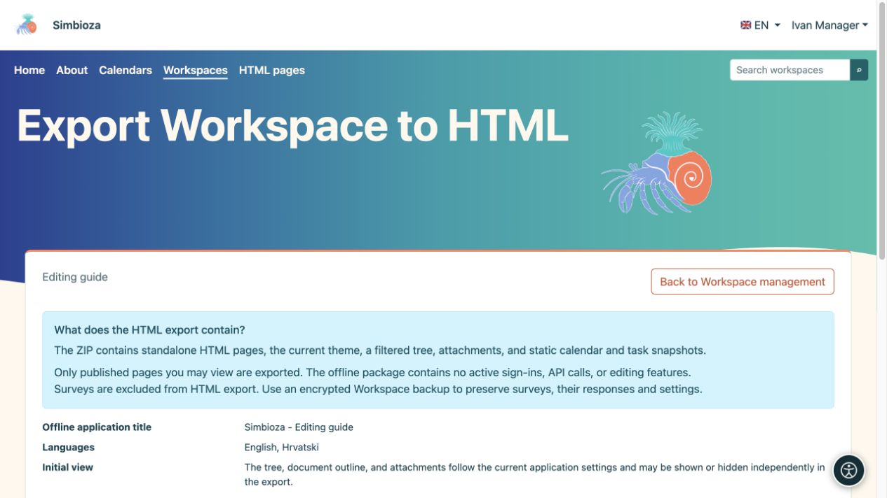
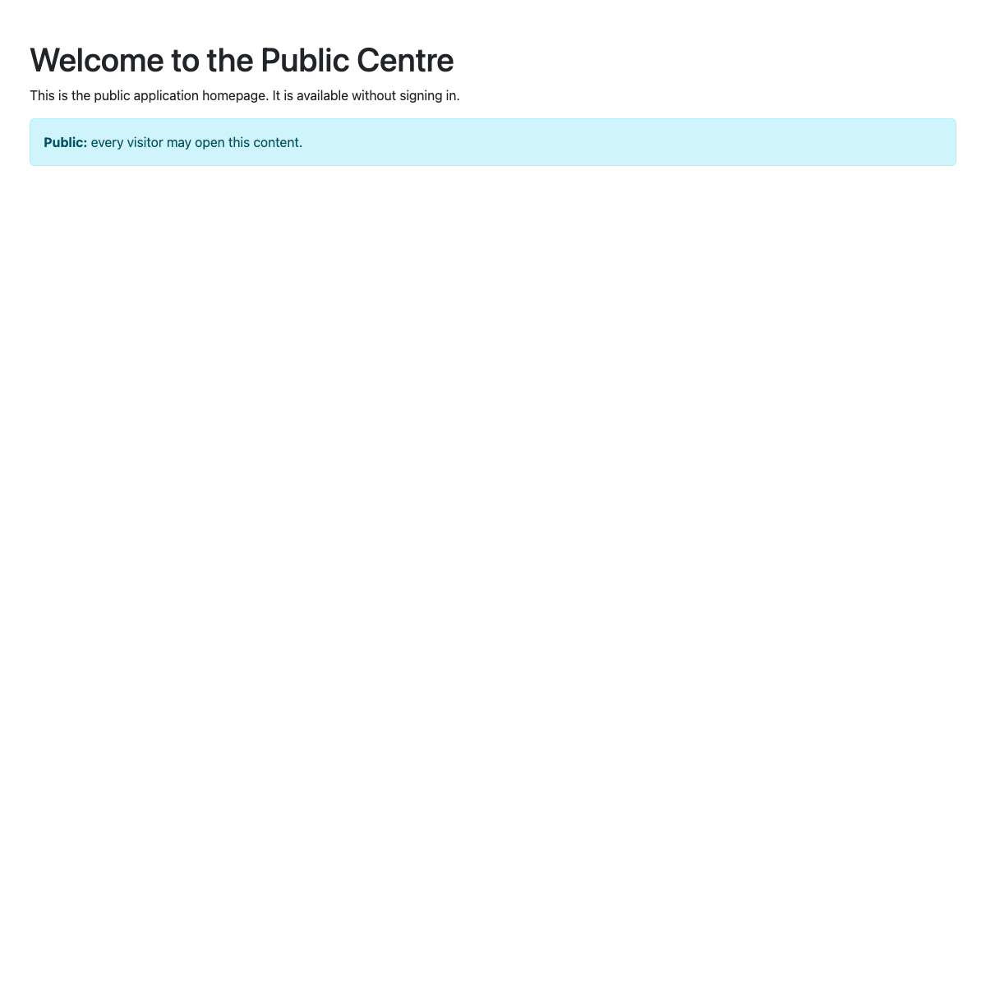
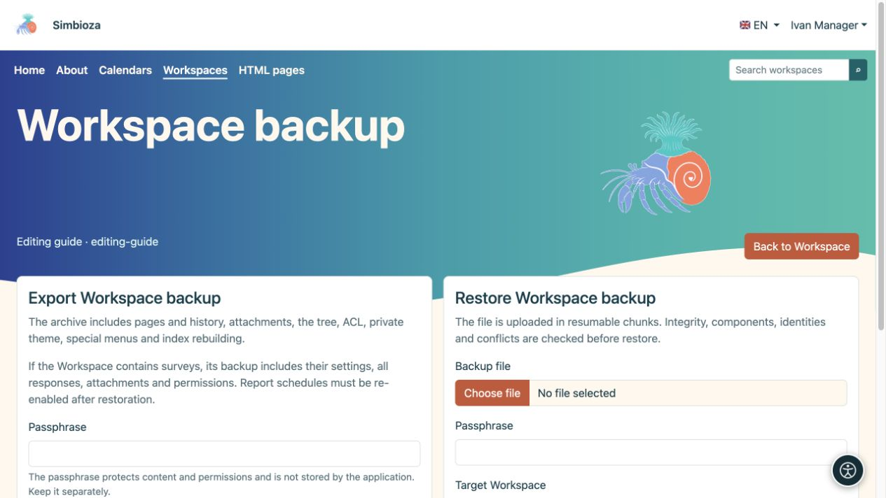
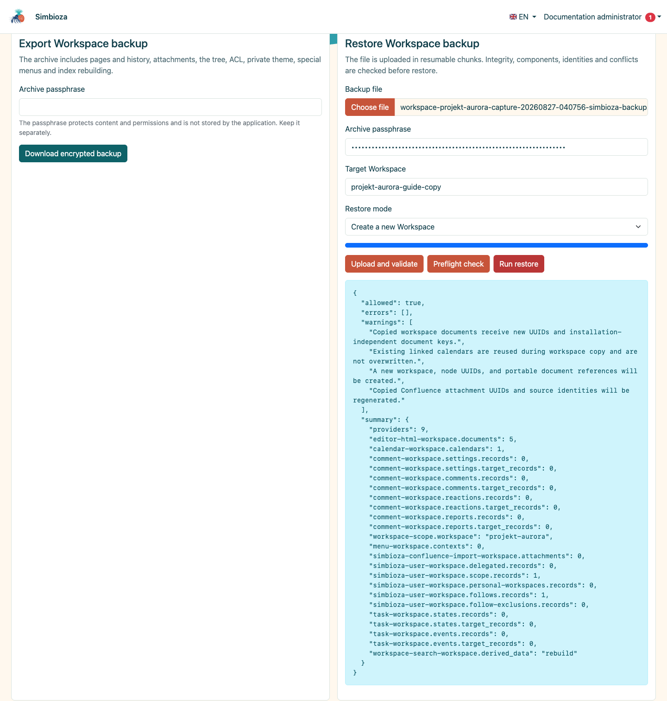
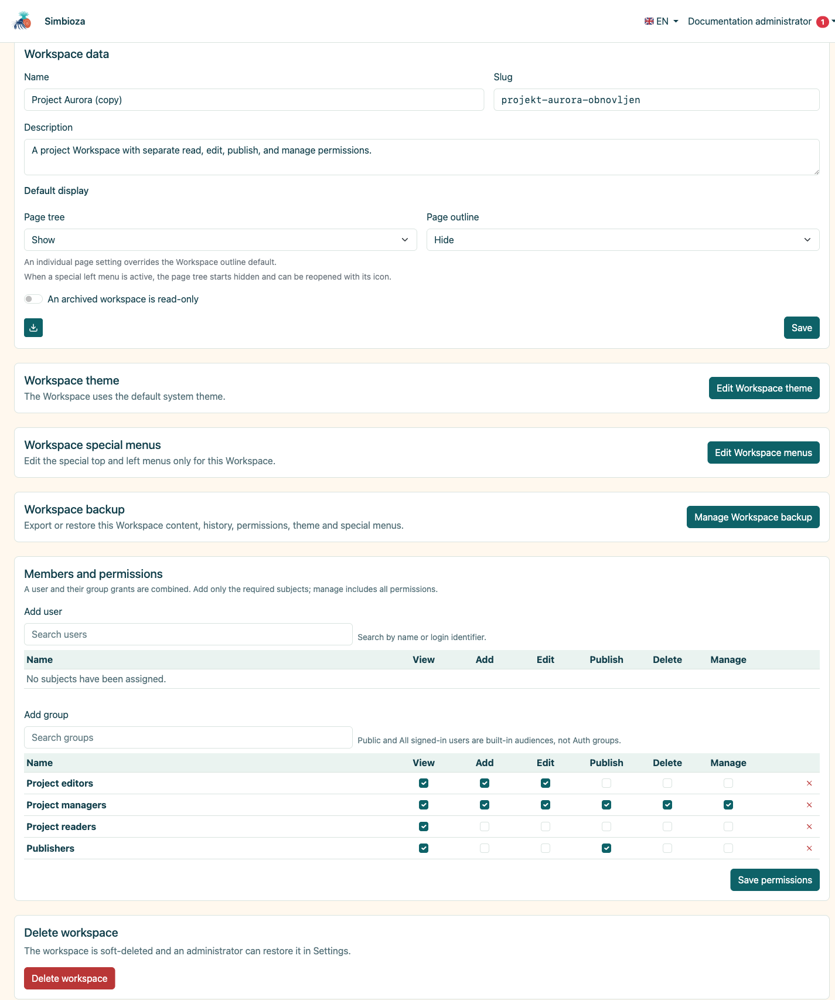

# Esporta un'area di lavoro o ripristina un backup

> Le schermate mostrano l’interfaccia in inglese.

[Aree di lavoro](podrucja_it.md)

**Per:** gestori e amministratori dell'area di lavoro. Per prima cosa scegli il tuo obiettivo: i lettori hanno bisogno di pagine statiche o hai bisogno di una copia da cui ripristinare l'area di lavoro?

| Hai bisogno di… | Utilizzo… |
| --- | --- |
| Documentazione che si apre come un normale pacchetto web | **HTML esporta** |
| Contenuto, cronologia, risposte al sondaggio e impostazioni per il ripristino | **Backup dell'area di lavoro** |
| L'intera installazione, comprese le impostazioni globali | Il backup dell'intero sito di un amministratore |

## HTML esporta per la lettura

1. Apri le impostazioni dell'area di lavoro e la relativa azione di esportazione HTML.
2. Esaminare le pagine pubblicate accessibili e le opzioni di navigazione/visualizzazione.
3. Avvia l'esportazione e scarica ZIP.
4. Estrailo e apri **index.html**. Controlla la navigazione, le immagini e i link.

**Risultato:** un pacchetto statico di pagine pubblicate che potresti leggere. Sono escluse le pagine inaccessibili e le bozze inedite. Il pacchetto si apre al di fuori di una sessione Simbioza autenticata, quindi condividilo solo con il pubblico previsto.

<figure class="my-4">

<figcaption>L'esportazione statica HTML è separata dal backup. I sondaggi sono esclusi da questo pacchetto HTML.</figcaption>
</figure>

<figure class="my-4">

<figcaption>Il sito esportato si apre senza una sessione autenticata o il live Simbioza API.</figcaption>
</figure>

I sondaggi vengono omessi dalle esportazioni HTML: un pacchetto statico non può ricreare l'accesso dei partecipanti, l'invio di risposte o i risultati. Utilizza il backup per trasferire i sondaggi.

Gli script approvati selezionati accompagnano l'esportazione: i file locali e il codice in linea vengono copiati, mentre i CSS/JavaScript esterni approvati rimangono collegamenti che richiedono una connessione di rete. Le tabelle interattive native di Simbioza hanno codice runtime locale. Le funzionalità che dipendono dall'accesso o da un API live non diventano un'applicazione offline.

## Crea un backup dell'area di lavoro

1. Apri **Gestisci backup dell'area di lavoro**.
2. Scegli Esporta e inserisci una passphrase di crittografia avanzata.
3. Scarica l'archivio e conserva la sua passphrase separatamente. Senza di esso, non puoi leggere il contenuto crittografato.

Il backup include contenuti supportati, versioni, allegati, albero, autorizzazioni, tema privato, menu speciali e dati dai moduli partecipanti. Per i sondaggi, trasferisce domande, impostazioni, traduzioni, revisioni, tutte le risposte accettate salvate, autorizzazioni e contenuti multimediali. Le impostazioni di Global Survey e le connessioni tecniche di accesso esterno appartengono al backup dell'intero sito; vedere [backup del sondaggio](ankete-backup-detalji_it.md).

<figure class="my-4">

<figcaption>L'esportazione è a sinistra e il ripristino del caricamento a destra. Inserisci la passphrase nel campo corrispondente e conservala separatamente dall'archivio.</figcaption>
</figure>

## Controlla e ripristina una copia

1. Carica ZIP nella schermata di backup e inserisci la passphrase.
2. Esegui prima il controllo. Leggi l'elenco dei moduli, il riepilogo dei contenuti, gli avvisi sulla versione e i conflitti di destinazione.
3. Per una prova, scegli una nuova copia e slug. Il ripristino su un'area di lavoro esistente può sostituirne i dati; eseguire prima il backup della destinazione.
4. Confermare la modalità di ripristino appropriata solo dopo averla esaminata.
5. Apri l'area di lavoro ripristinata e controlla pagine, lingue, allegati, autorizzazioni e contenuto collegato come utente previsto.

<figure class="my-4">

<figcaption>Il preflight convalida il backup e accetta un nuovo slug di destinazione.</figcaption>
</figure>

<figure class="my-4">

<figcaption>Il progetto Aurora è stato ripristinato come area di lavoro separata con un nuovo slug.</figcaption>
</figure>

**Calendari e riunioni:** i nuovi backup dell'area di lavoro includono calendari collegati e relativi eventi, organizzatori, partecipanti, risposte, prenotazioni e approvatori. Contengono anche le definizioni dei calendari delle risorse necessarie per tali riunioni. Una risorsa esistente con la stessa identità stabile può essere riutilizzata; la copia di un'area di lavoro non crea una pianificazione indipendente per ogni sala condivisa. Gli eventi non correlati su tale risorsa non vengono esposti o sostituiti semplicemente perché una riunione la utilizza.

Le credenziali private CalDAV sono escluse dal backup dell'area di lavoro. Utilizza il componente Calendario di un amministratore o il backup dell'intero sito per il ripristino completo del sistema di calendario. Gli archivi delle riunioni più vecchie incompleti vengono rifiutati prima del ripristino; gli eventi ordinari più vecchi rimangono supportati. Se in una copia precedente mancano i record della riunione, crea un nuovo backup con il modulo aggiornato o utilizza un backup completo.

I dati derivati per la ricerca vengono ricostruiti secondo quanto supportato dal modulo abilitato. Dopo il ripristino dei sondaggi, controllane lo stato, i destinatari dei rapporti e le impostazioni prima di riprendere la raccolta delle risposte o l'invio dei rapporti; consulta [backup dei sondaggi](ankete-backup-detalji_it.md).
