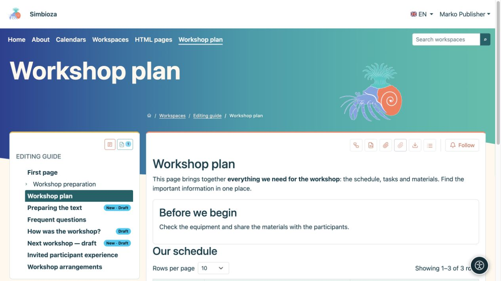

# Einen Entwurf speichern und eine Seite veröffentlichen

> Die Bildschirmaufnahmen zeigen die englische Benutzeroberfläche.

[Arbeitsbereiche](podrucja_de.md)

**Am wichtigsten:** Das Speichern eines Entwurfs und das Veröffentlichen sind unterschiedliche Aktionen. Leser sehen weiterhin die zuletzt veröffentlichte Version, bis Sie die neue veröffentlichen. Eine unveröffentlichte neue Seite ist für normale Leser nicht zugänglich.

## Sie schreiben Inhalte

1. Öffnen Sie die Seite und **Bearbeiten**. Für eine neue Seite folgen Sie [Seitenerstellung](uredivanje-stranica_de.md#new-page).
2. Bearbeiten Sie den Text und wählen Sie **Speichern**, um einen Entwurf zu behalten.
3. Öffnen Sie **Vorschauentwurf** und überprüfen Sie Text, Links, Bilder, Sprache und das Layout in einem schmalen Fenster.
4. Wenn jemand anderes Ihre Arbeit genehmigt, wählen Sie **Speichern und zur Überprüfung einreichen**.
5. Wenn Sie sowohl die Bearbeitungs- als auch die Veröffentlichungsberechtigung haben, können Sie **Speichern und veröffentlichen** wählen.

**Ergebnis:** Ihre Arbeit wird gespeichert; Veröffentlichung macht es zur neuen leserorientierten Version. Vollständige Formatierungsanweisungen finden Sie unter [Seiten bearbeiten](uredivanje-stranica_de.md).

<figure class="my-4">

<figcaption>Ivan kann einen Entwurf bearbeiten und in der Vorschau anzeigen, verfügt jedoch nicht über die Aktion „Veröffentlichen“.</figcaption>
</figure>

## Sie genehmigen die Arbeit eines anderen

1. Öffnen Sie die Seite und lesen Sie ihren Status.
2. Wählen Sie **Vorschauentwurf**. In der normalen Ansicht der veröffentlichten Seite wird möglicherweise noch früherer Text angezeigt.
3. Überprüfen Sie die richtige Sprache und den richtigen Inhalt. Zum Veröffentlichen kehren Sie zur Seite zurück und verwenden die verfügbare Aktion **Veröffentlichen**.
4. Öffnen Sie die Seite erneut als Leser und überprüfen Sie die neue Veröffentlichung.

Mit der Berechtigung **Veröffentlichen** allein ist das Umschreiben von Text nicht möglich. Wenn Änderungen erforderlich sind, geben Sie den Entwurf mit der verfügbaren Aktion an seinen Editor zurück. Ein Herausgeber kann auch einen Entwurf veröffentlichen, der nicht zuerst zur Überprüfung eingereicht wurde; eine gesonderte Einreichung ist für jemanden, der bereits über eine Veröffentlichungsberechtigung verfügt, nicht zwingend erforderlich.

<figure class="my-4">

<figcaption>Petra sieht, dass ein Entwurf vorliegt und kann ihn zur Genehmigung öffnen.</figcaption>
</figure>

<figure class="my-4">

<figcaption>Marko kann den gespeicherten Entwurf prüfen und Entwurfsbezeichnungen in der Baumstruktur sehen. Dieses Bild zeigt die Vorschau, nicht die Veröffentlichungsaktion.</figcaption>
</figure>

## Was bedeuten die Status?

| Status | Für Redakteure und Verleger | Für normale Leser |
| --- | --- | --- |
| **Entwurf** | Inhalte werden vorbereitet. | Letzte Veröffentlichung, falls vorhanden. |
| **Im Testbericht** | Der Entwurf wartet auf seine Genehmigung; ein Herausgeber kann es wegen Änderungen zurückziehen. | Letzte Veröffentlichung, falls vorhanden. |
| **Veröffentlicht** | Die genehmigte Version ist entsprechend den Berechtigungen verfügbar. | Zugängliche veröffentlichte Inhalte. |
| **Archiviert** | Ein Manager kann die Seite in den Entwurf zurückversetzen. | Eine archivierte Seite ist keine gewöhnliche veröffentlichte Seite mehr. |

Nachdem Sie eine archivierte Seite wieder in den Entwurfsmodus versetzt haben, veröffentlichen Sie sie erneut. Dies unterscheidet sich von der Archivierung des gesamten Arbeitsbereichs, bei der veröffentlichte Inhalte lesbar bleiben und Änderungen verhindert werden.

## Falscher Entwurf oder nicht gespeicherte Arbeit

**Abbrechen** verlässt den Editor; Lesen Sie die Meldung über nicht gespeicherte Änderungen. **Gemeinsamen Entwurf verwerfen** entfernt freigegebene unveröffentlichte Änderungen und kehrt zur letzten Veröffentlichung zurück. Auf einer neuen Seite, die noch nie veröffentlicht wurde, kann das Verwerfen des Entwurfs dazu führen, dass er dauerhaft entfernt wird. Stimmen Sie sich vor der Bestätigung mit anderen Redakteuren ab.

Wenn ein Leser immer noch alten Text sieht, prüfen Sie zunächst die Veröffentlichung und die Sprache. Ändern Sie die Zugriffsberechtigungen nicht, nur weil es sich bei der neuen Version noch um einen Entwurf handelt.
