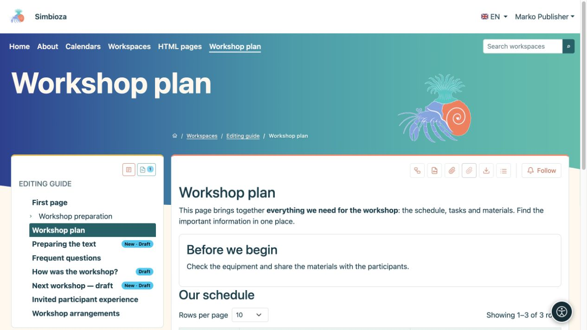

# Save a draft and publish a page

[Workspaces](podrucja_en.md)

**Most important:** saving a draft and publishing are different actions. Readers continue seeing the last published version until you publish the new one. An unpublished new page is unavailable to ordinary readers.

## You are writing content

1. Open the page and **Edit**. For a new page, follow [page creation](uredivanje-stranica_en.md#new-page).
2. Edit the text and choose **Save** to keep a draft.
3. Open **Preview draft** and check text, links, images, language and the layout in a narrow window.
4. If someone else approves your work, choose **Save and submit for review**.
5. With both editing and publishing permission, you may choose **Save and publish**.

**Result:** your work is saved; publication makes it the new reader-facing version. See [Editing pages](uredivanje-stranica_en.md) for full formatting instructions.

<figure class="my-4">

<figcaption>Ivan can edit and preview a draft but has no Publish action.</figcaption>
</figure>

## You approve someone else's work

1. Open the page and read its status.
2. Choose **Preview draft**. The ordinary published-page view may still show earlier text.
3. Check the correct language and content. To publish, return to the page and use the available **Publish** action.
4. Reopen the page as a reader and check the new publication.

**Publish** permission alone does not allow rewriting text. If changes are needed, return the draft to its editor using the available action. A publisher may also publish a draft which was not first submitted for review; a separate submission is not mandatory for someone who already has publishing permission.

<figure class="my-4">

<figcaption>Petra sees that a draft exists and can open it for approval.</figcaption>
</figure>

<figure class="my-4">

<figcaption>Marko can inspect the saved draft and see draft labels in the tree. This image shows the preview, not the publication action.</figcaption>
</figure>

## What do the statuses mean?

| Status | For editors and publishers | For ordinary readers |
| --- | --- | --- |
| **Draft** | Content is being prepared. | Last publication, if one exists. |
| **In review** | The draft awaits approval; an editor may withdraw it for changes. | Last publication, if one exists. |
| **Published** | The approved version is available according to permissions. | Accessible published content. |
| **Archived** | A manager may return the page to draft. | An archived page is no longer an ordinary published page. |

After returning an archived page to draft, publish it again. This differs from archiving the whole workspace, which keeps published content readable while stopping changes.

## Wrong draft or unsaved work

**Cancel** leaves the editor; read the message about unsaved changes. **Discard shared draft** removes shared unpublished changes and returns to the last publication. On a new page which has never been published, discarding the draft may permanently remove it. Coordinate with other editors before confirming.

If a reader still sees old text, check publication and language first. Do not change access permissions merely because the new version is still a draft.
