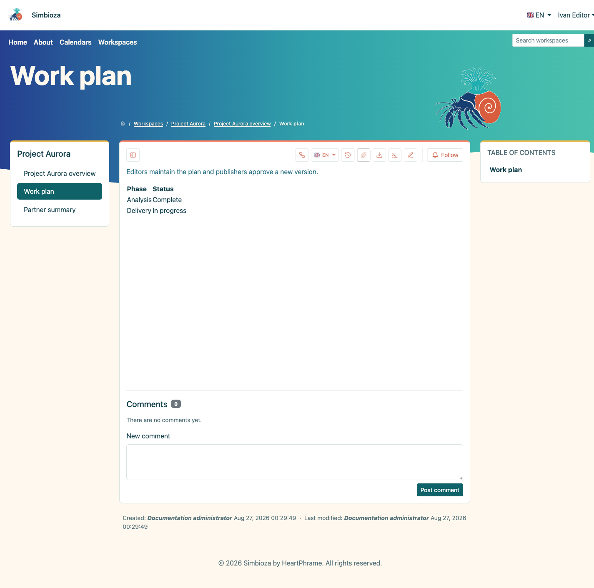
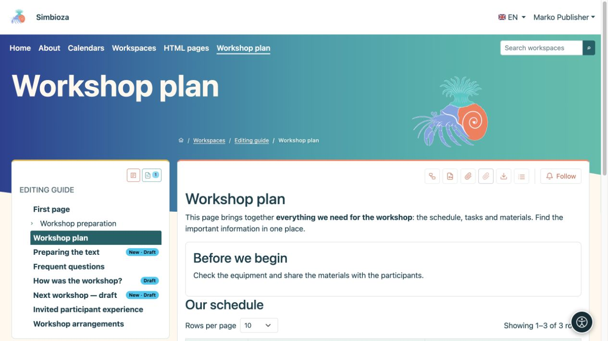

# Guardar un borrador y publicar una página

> Las capturas de pantalla muestran la interfaz en inglés.

[Espacios de trabajo](podrucja_es.md)

**Lo más importante:** guardar un borrador y publicarlo son acciones diferentes. Los lectores seguirán viendo la última versión publicada hasta que publiques la nueva. Una nueva página inédita no está disponible para los lectores comunes.

## Estas escribiendo contenido

1. Abra la página y **Editar**. Para obtener una nueva página, siga [creación de página](uredivanje-stranica_es.md#new-page).
2. Edite el texto y elija **Guardar** para conservar un borrador.
3. Abra **Vista previa del borrador** y verifique el texto, los enlaces, las imágenes, el idioma y el diseño en una ventana estrecha.
4. Si alguien más aprueba su trabajo, elige **Guardar y enviar para revisión**.
5. Con permiso de edición y publicación, puede elegir **Guardar y publicar**.

**Resultado:** su trabajo se guarda; La publicación la convierte en la nueva versión orientada al lector. Consulte [Edición de páginas](uredivanje-stranica_es.md) para obtener instrucciones completas de formato.

<figure class="my-4">

<figcaption>Ivan puede editar y obtener una vista previa de un borrador, pero no tiene ninguna acción de Publicar.</figcaption>
</figure>

## Apruebas el trabajo de otra persona.

1. Abra la página y lea su estado.
2. Elija **Vista previa del borrador**. Es posible que la vista normal de página publicada aún muestre texto anterior.
3. Compruebe el idioma y el contenido correctos. Para publicar, regrese a la página y use la acción **Publicar** disponible.
4. Vuelva a abrir la página como lector y consulte la nueva publicación.

**El permiso de publicación** por sí solo no permite reescribir el texto. Si es necesario realizar cambios, devuelva el borrador a su editor utilizando la acción disponible. Una persona con permiso para publicar también puede publicar un borrador que no se envió primero para revisión; un envío por separado no es obligatorio para alguien que ya tiene permiso de publicación.

<figure class="my-4">

<figcaption>Petra ve que existe un borrador y puede abrirlo para su aprobación.</figcaption>
</figure>

<figure class="my-4">

<figcaption>Marko puede inspeccionar el borrador guardado y ver las etiquetas del borrador en el árbol. Esta imagen muestra la vista previa, no la acción de publicación.</figcaption>
</figure>

## ¿Qué significan los estados?

| Estado | Para editores y editores | Para lectores comunes |
| --- | --- | --- |
| **Borrador** | Se está preparando el contenido. | Última publicación, si existe. |
| **En revisión** | El borrador espera aprobación; un editor puede retirarlo para realizar cambios. | Última publicación, si existe. |
| **Publicado** | La versión aprobada está disponible según los permisos. | Contenido publicado accesible. |
| **Archivado** | Un gestor puede devolver la página al borrador. | Una página archivada ya no es una página publicada normal. |

Después de devolver una página archivada al borrador, publíquela nuevamente. Esto difiere de archivar todo el espacio de trabajo, lo que mantiene legible el contenido publicado y al mismo tiempo detiene los cambios.

## Borrador incorrecto o trabajo no guardado

**Cancelar** sale del editor; lea el mensaje sobre cambios no guardados. **Descartar borrador compartido** elimina los cambios compartidos no publicados y regresa a la última publicación. En una página nueva que nunca se ha publicado, descartar el borrador puede eliminarlo permanentemente. Coordina con otros editores antes de confirmar.

Si un lector todavía ve un texto antiguo, primero verifique la publicación y el idioma. No cambie los permisos de acceso simplemente porque la nueva versión aún es un borrador.
