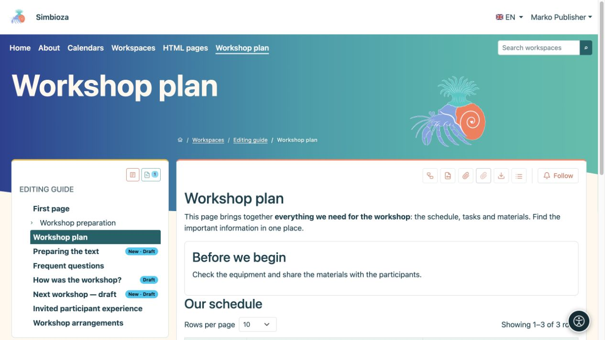

# Enregistrer un brouillon et publier une page

> Les captures d’écran présentent l’interface en anglais.

[Espaces de travail](podrucja_fr.md)

**À retenir :** enregistrer un brouillon et publier sont deux actions différentes. Les lecteurs continuent à voir la dernière version publiée jusqu’à la publication de la nouvelle version. Une nouvelle page non publiée n’est pas accessible aux lecteurs ordinaires.

## Vous rédigez du contenu

1. Ouvrez la page et choisissez **Modifier**. Pour une nouvelle page, consultez [la création d’une page](uredivanje-stranica_fr.md#new-page).
2. Modifiez le texte et choisissez **Enregistrer** pour conserver un brouillon.
3. Ouvrez **Aperçu du brouillon** et vérifiez le texte, les liens, les images, la langue et la disposition dans une fenêtre étroite.
4. Si une autre personne approuve votre travail, choisissez **Enregistrer et soumettre pour relecture**.
5. Si vous disposez des droits de modification et de publication, vous pouvez choisir **Enregistrer et publier**.

**Résultat :** votre travail est enregistré ; sa publication en fait la nouvelle version visible par les lecteurs. Consultez [Modifier les pages](uredivanje-stranica_fr.md) pour les instructions complètes de mise en forme.

<figure class="my-4">

<figcaption>Ivan peut modifier et prévisualiser un brouillon, mais ne dispose pas de l’action Publier.</figcaption>
</figure>

## Vous approuvez le travail d’une autre personne

1. Ouvrez la page et consultez son état.
2. Choisissez **Aperçu du brouillon**. L’affichage habituel de la page publiée peut encore présenter l’ancien texte.
3. Vérifiez la langue et le contenu. Pour publier, revenez à la page et utilisez l’action **Publier** disponible.
4. Rouvrez la page en tant que lecteur et vérifiez la nouvelle publication.

Le droit de **Publier** ne permet pas, à lui seul, de réécrire le texte. Si des modifications sont nécessaires, renvoyez le brouillon à son éditeur avec l’action disponible. La personne chargée de la publication peut aussi publier un brouillon qui n’a pas été soumis au préalable pour relecture ; cette soumission distincte n’est pas obligatoire pour une personne disposant déjà du droit de publication.

<figure class="my-4">

<figcaption>Petra voit qu’un brouillon existe et peut l’ouvrir pour l’approuver.</figcaption>
</figure>

<figure class="my-4">

<figcaption>Marko peut examiner le brouillon enregistré et voir les indications de brouillon dans l’arborescence. Cette image présente l’aperçu, pas l’action de publication.</figcaption>
</figure>

## Que signifient les états ?

| État | Pour les éditeurs et les personnes chargées de la publication | Pour les lecteurs ordinaires |
| --- | --- | --- |
| **Brouillon** | Le contenu est en cours de préparation. | Dernière publication, si elle existe. |
| **En relecture** | Le brouillon attend une approbation ; un éditeur peut le retirer pour le modifier. | Dernière publication, si elle existe. |
| **Publié** | La version approuvée est disponible selon les droits d’accès. | Contenu publié accessible. |
| **Archivé** | Un responsable peut remettre la page à l’état de brouillon. | Une page archivée n’est plus une page publiée ordinaire. |

Après avoir remis une page archivée à l’état de brouillon, publiez-la de nouveau. Cette action diffère de l’archivage de l’espace de travail entier, qui laisse le contenu publié accessible en lecture tout en empêchant les modifications.

## Mauvais brouillon ou travail non enregistré

**Annuler** quitte l’éditeur ; lisez le message concernant les modifications non enregistrées. **Supprimer le brouillon partagé** efface les modifications partagées non publiées et revient à la dernière publication. Pour une nouvelle page qui n’a jamais été publiée, la suppression du brouillon peut supprimer définitivement la page. Coordonnez-vous avec les autres éditeurs avant de confirmer.

Si un lecteur voit encore l’ancien texte, vérifiez d’abord la publication et la langue. Ne modifiez pas les droits d’accès simplement parce que la nouvelle version est encore un brouillon.
