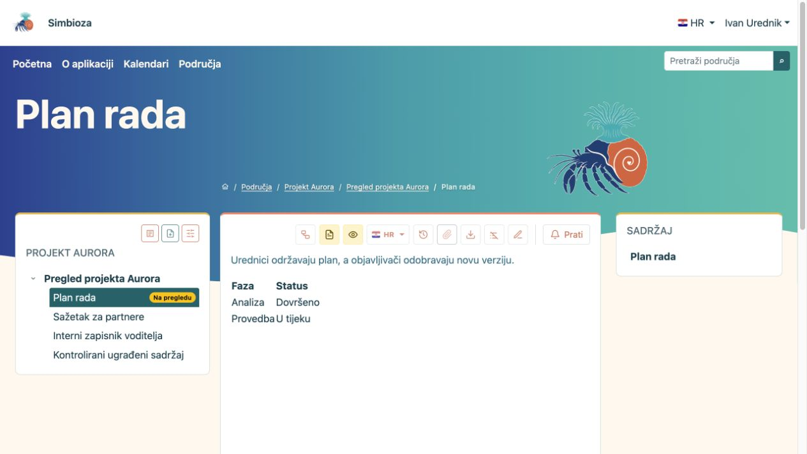
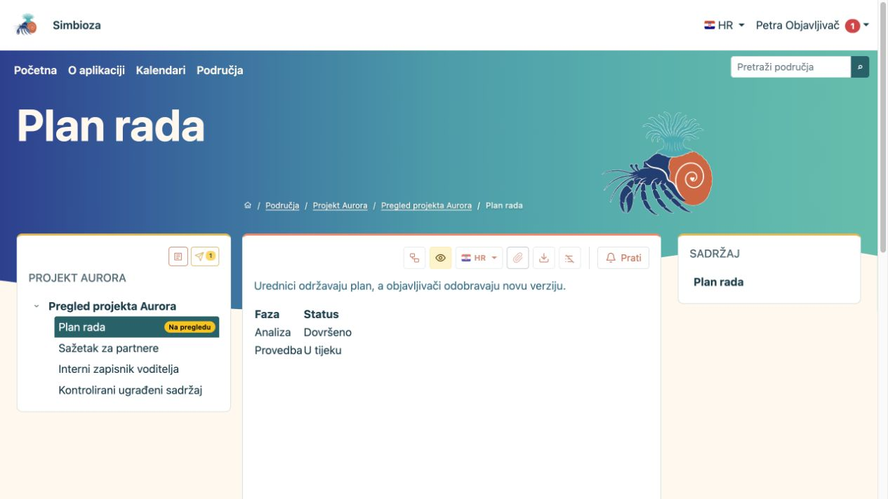
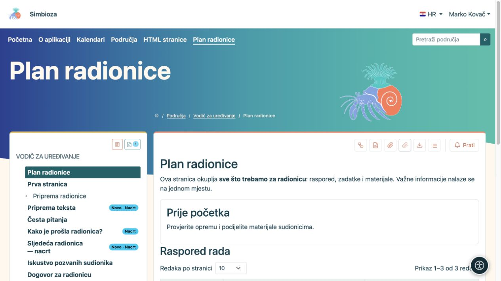

# Spremite nacrt i objavite stranicu

[Područja](podrucja_hr.md)

**Najvažnije:** spremanje nacrta i objava dvije su različite radnje. Čitatelji nastavljaju vidjeti posljednju objavljenu inačicu dok novu ne objavite. Nova stranica bez objave nije dostupna običnim čitateljima.

## Pišete sadržaj

1. Otvorite stranicu i **Uredi**. Za novu stranicu slijedite [stvaranje stranice](uredivanje-stranica_hr.md#nova-stranica).
2. Uredite tekst i odaberite **Spremi**. Time čuvate nacrt.
3. Otvorite **Pregled nacrta** i provjerite tekst, poveznice, slike, jezik i prikaz na uskom prozoru.
4. Ako sadržaj treba odobriti druga osoba, odaberite **Spremi i pošalji na pregled**.
5. Ako imate i uređivanje i objavljivanje, možete odabrati **Spremi i objavi**.

**Rezultat:** spremljeni rad nije izgubljen; tek objavljivanjem postaje nova inačica za čitatelje. Puni postupci oblikovanja nalaze se u [Uređivanju stranica](uredivanje-stranica_hr.md).

<figure class="my-4">

<figcaption>Ivan vidi uređivanje nacrta i pregled, ali nema akciju objave.</figcaption>
</figure>

## Odobravate sadržaj druge osobe

1. Otvorite stranicu i pročitajte njezino stanje.
2. Odaberite **Pregled nacrta**. Obični prikaz objavljene stranice može još pokazivati raniji tekst.
3. Provjerite odgovarajući jezik i sadržaj. Za objavu vratite se na stranicu i upotrijebite dostupnu radnju **Objavi**.
4. Ponovno otvorite stranicu kao čitatelj i provjerite novu objavu.

Samo pravo **Objavljivanje** ne daje pravo prepisivanja teksta. Ako treba dorada, vratite nacrt uredniku kroz dostupnu radnju. Objavljivač može objaviti i nacrt koji nije prethodno poslan na pregled; zasebno slanje nije obvezan uvjet za osobu koja već ima pravo objave.

<figure class="my-4">

<figcaption>Petra vidi da postoji nacrt i može ga otvoriti radi odobravanja.</figcaption>
</figure>

<figure class="my-4">

<figcaption>Marko može pregledati spremljeni nacrt i vidi oznake nacrta u stablu. Ova snimka prikazuje pregled, a ne radnju objave.</figcaption>
</figure>

## Što znače stanja?

| Stanje | Za urednika i objavljivača | Za običnog čitatelja |
| --- | --- | --- |
| **Nacrt** | Sadržaj se još priprema. | Posljednja objava, ako postoji. |
| **Na pregledu** | Nacrt čeka odobravanje; urednik ga može povući radi izmjene. | Posljednja objava, ako postoji. |
| **Objavljeno** | Odobrena inačica dostupna je publici prema pravima. | Dostupna objava. |
| **Arhivirano** | Upravitelj može vratiti stranicu u nacrt. | Arhivirana stranica nije redovna objavljena stranica. |

Nakon povrata arhivirane stranice u nacrt treba je ponovno objaviti. To se razlikuje od arhiviranja cijelog područja, koje čuva objavljeni sadržaj za čitanje i zaustavlja izmjene.

## Pogrešan nacrt ili nespremljeni rad

**Odustani** napušta uređivanje; pročitajte poruku o nespremljenim promjenama. **Odbaci zajednički nacrt** uklanja zajedničke neobjavljene izmjene i vraća zadnju objavu. Na novoj, nikad objavljenoj stranici odbacivanje nacrta može trajno ukloniti stranicu. Dogovorite se s drugim urednicima prije potvrde.

Ako čitatelj još vidi stari tekst, prvo provjerite objavu i odabrani jezik. Nemojte mijenjati prava samo zato što je nova inačica još nacrt.
