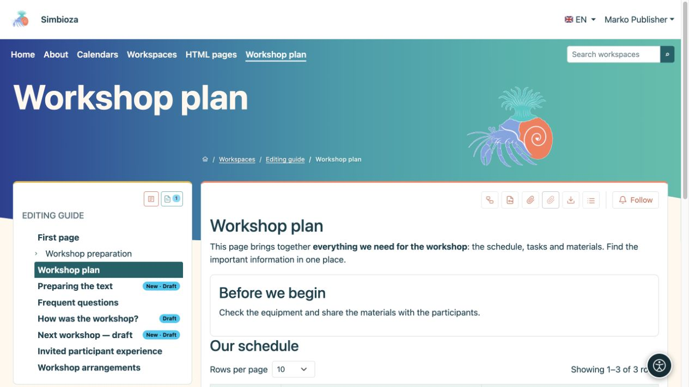

# Salva una bozza e pubblica una pagina

> Le schermate mostrano l’interfaccia in inglese.

[Aree di lavoro](podrucja_it.md)

**La cosa più importante:** il salvataggio di una bozza e la pubblicazione sono azioni diverse. I lettori continuano a vedere l'ultima versione pubblicata finché non pubblichi quella nuova. Una nuova pagina inedita non è disponibile per i lettori ordinari.

## Stai scrivendo contenuti

1. Apri la pagina e **Modifica**. Per una nuova pagina, seguire la [creazione della pagina](uredivanje-stranica_it.md#new-page).
2. Modifica il testo e scegli **Salva** per conservare una bozza.
3. Apri **Anteprima bozza** e controlla testo, collegamenti, immagini, lingua e layout in una finestra stretta.
4. Se qualcun altro approva il tuo lavoro, scegli **Salva e invia per la revisione**.
5. Con l'autorizzazione sia di modifica che di pubblicazione, puoi scegliere **Salva e pubblica**.

**Risultato:** il tuo lavoro viene salvato; la pubblicazione lo rende la nuova versione rivolta al lettore. Consulta [Modifica delle pagine](uredivanje-stranica_it.md) per istruzioni complete sulla formattazione.

<figure class="my-4">

<figcaption>Ivan può modificare e visualizzare in anteprima una bozza ma non ha l'azione Pubblica.</figcaption>
</figure>

## Approvi il lavoro di qualcun altro

1. Apri la pagina e leggine lo stato.
2. Scegli **Anteprima bozza**. La normale visualizzazione della pagina pubblicata potrebbe ancora mostrare il testo precedente.
3. Controlla la lingua e il contenuto corretti. Per pubblicare, torna alla pagina e utilizza l'azione disponibile **Pubblica**.
4. Riapri la pagina come lettore e controlla la nuova pubblicazione.

Il solo permesso **Pubblica** non consente di riscrivere il testo. Se sono necessarie modifiche, restituisci la bozza al relativo editor utilizzando l'azione disponibile. Un editore può anche pubblicare una bozza che non è stata prima sottoposta a revisione; un invio separato non è obbligatorio per chi dispone già dell'autorizzazione alla pubblicazione.

<figure class="my-4">

<figcaption>Petra vede che esiste una bozza e può aprirla per l'approvazione.</figcaption>
</figure>

<figure class="my-4">

<figcaption>Marko può controllare la bozza salvata e vedere le etichette della bozza nell'albero. Questa immagine mostra l'anteprima, non l'azione di pubblicazione.</figcaption>
</figure>

## Cosa significano gli stati?

| Stato | Per redattori ed editori | Per i lettori comuni |
| --- | --- | --- |
| **Bozza** | Il contenuto è in fase di preparazione. | Ultima pubblicazione, se esiste. |
| **In revisione** | La bozza attende di essere approvata; un editore può ritirarlo per modifiche. | Ultima pubblicazione, se esiste. |
| **Pubblicato** | La versione approvata è disponibile in base alle autorizzazioni. | Contenuti pubblicati accessibili. |
| **Archiviato** | Un manager può riportare la pagina allo stato di bozza. | Una pagina archiviata non è più una normale pagina pubblicata. |

Dopo aver riportato una pagina archiviata in bozza, pubblicala di nuovo. Ciò è diverso dall'archiviazione dell'intero area di lavoro, che mantiene leggibile il contenuto pubblicato interrompendo le modifiche.

## Bozza sbagliata o lavoro non salvato

**Annulla** esce dall'editor; leggere il messaggio sulle modifiche non salvate. **Elimina bozza condivisa** rimuove le modifiche condivise non pubblicate e torna all'ultima pubblicazione. In una nuova pagina che non è mai stata pubblicata, l'eliminazione della bozza potrebbe rimuoverla definitivamente. Coordinarsi con gli altri redattori prima di confermare.

Se un lettore vede ancora il vecchio testo, controlla prima la pubblicazione e la lingua. Non modificare i permessi di accesso semplicemente perché la nuova versione è ancora una bozza.
