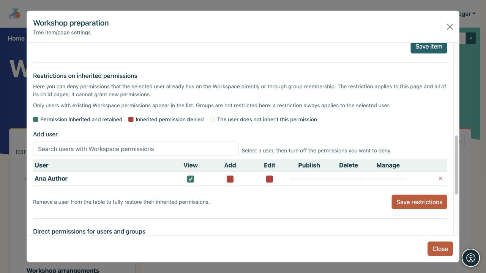
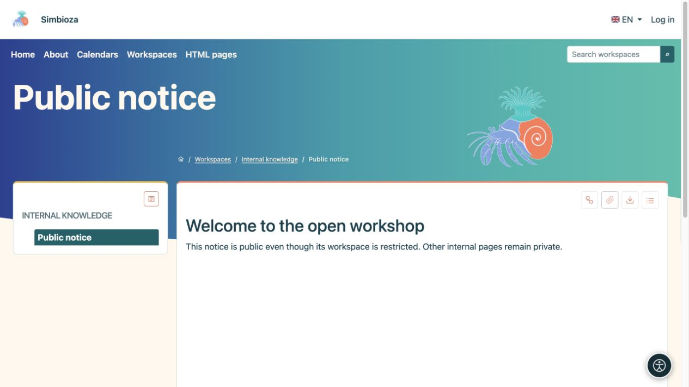
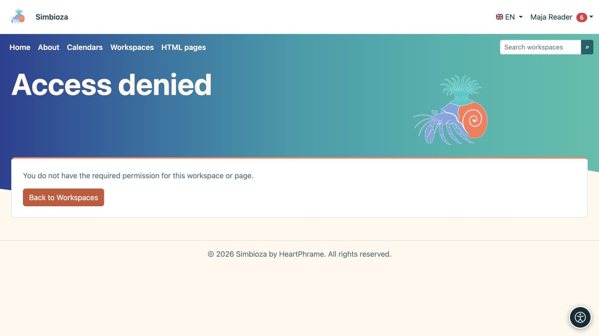

# Eine einzelne Seite einschränken oder freigeben

> Die Bildschirmaufnahmen zeigen die englische Benutzeroberfläche.

[Arbeitsbereiche](podrucja_de.md)

**Ziel:** Zugriff auf eine ausgewählte Seite ändern, ohne den gesamten Arbeitsbereich unnötig zu verändern. Öffnen Sie **Seite und Berechtigungen verwalten**. Dies steht einem Manager oder einem autorisierten Herausgeber zur Verfügung, der die Seite anzeigen darf.

## Entfernen Sie einige geerbte Berechtigungen

Verwenden Sie **Geerbte Berechtigungseinschränkungen**, wenn jemand bereits Zugriff auf den Arbeitsbereich hat, aber weniger Berechtigungen für diesen Zweig benötigt.

1. Suchen Sie im Abschnitt „Einschränkungen“ nach einem Benutzer, der bereits über Arbeitsbereichsberechtigungen verfügt. Geben Sie mindestens zwei Zeichen ein.
2. Fügen Sie den Benutzer zur Tabelle hinzu und löschen Sie die Berechtigung zum Zurückhalten.
3. Speichern Sie die Einschränkungen und überprüfen Sie diese Seite und eine untergeordnete Seite mit dem Konto dieser Person.

**Ergebnis:** Die Einschränkung gilt für diese Seite und ihre Nachkommen. Es werden keine neuen Berechtigungen gewährt. Durch das Entfernen der Person aus dieser Tabelle wird die Vererbung wiederhergestellt. Dieses Panel legt keine Einschränkung für eine ganze Gruppe fest.

Eine ausgewählte geerbte Berechtigung bleibt erhalten. Wenn Sie das Häkchen einer vorhandenen Berechtigung entfernen, wird sie für diesen Zweig eingeschränkt. Eine Berechtigung, die die Person bisher nicht hatte, lässt sich hier nicht neu vergeben. Achten Sie auf Feldnamen und Auswahlzustände, nicht nur auf die Farbe.

<figure class="my-4">

<figcaption>Ana behält die Ansicht; die geerbten Berechtigungen zum Hinzufügen und Bearbeiten wurden für diesen Zweig zurückgehalten.</figcaption>
</figure>

## Fügen Sie eine direkte Berechtigung für eine Seite hinzu

Verwenden Sie **Direkte Berechtigungen für Benutzer und Gruppen**, wenn jemand keinen normalen Zugriff auf den Arbeitsbereich hat, aber diese bestimmte Seite lesen oder bearbeiten muss.

1. Fügen Sie den Benutzer oder die Gruppe in der entsprechenden Auswahl hinzu.
2. Wählen Sie je nach Bedarf **Lesen**, **Bearbeiten** und/oder **Veröffentlichen**.
3. Wählen Sie **Direkte Berechtigungen speichern**.
4. Bitten Sie die Person, die Seite zu öffnen und zu prüfen, ob der verbleibende private Inhalt noch geschützt ist.

**Ergebnis:** Die Ausnahme gilt nur für diese Seite. Untergeordnete Seiten erben sie nicht. Der Arbeitsbereich kann dadurch in der Liste der Person erscheinen, sein Seitenbaum zeigt jedoch nur freigegebene Seiten. Nicht zugängliche übergeordnete Seiten und andere Zweige bleiben privat.

Zum Bearbeiten und Veröffentlichen gehört auch das Lesen. Die Berechtigung zum Veröffentlichen allein erlaubt jedoch keine Bearbeitung. Die Zielgruppe **Öffentlich** darf nur Lesezugriff erhalten. **Alle authentifizierten Benutzer** umfasst jedes angemeldete Konto. Prüfen Sie vor der Vergabe, ob ein so weiter Zugriff beabsichtigt ist.

<figure class="my-4">

<figcaption>Eine Seite kann direkte Benutzer- und Gruppenberechtigungen haben. Die Öffentlichkeit darf nur eine Leseberechtigung erhalten.</figcaption>
</figure>

## Eine öffentliche Seite in einem privaten Arbeitsbereich

Gewähren Sie dem **öffentlichen** Publikum Lesezugriff auf die ausgewählte Seite und veröffentlichen Sie deren Inhalt separat. Gäste können es dann öffnen, ohne Zugriff auf die verbleibenden privaten Seiten zu haben. Das gleiche Prinzip gilt für eine Seite, die eine veröffentlichte Umfrage enthält; Umfrageberechtigung und Ergebniszugang werden weiterhin getrennt geprüft.

Eine direkt zugewiesene Berechtigung macht einen unveröffentlichten Entwurf nicht öffentlich. Ein Link von der freigegebenen Seite zu anderen privaten Inhalten gewährt keinen Zugriff auf diese Inhalte.

<figure class="my-4">

<figcaption>Ein Gast sieht in der Baumstruktur nur den öffentlichen Hinweis. Die privaten übergeordneten und benachbarten Seiten bleiben geschützt.</figcaption>
</figure>

## Enthaltene Seiten oder Kalender

Durch das Einbetten von Inhalten werden die Quellberechtigungen nicht umgangen. Den Lesern muss außerdem gestattet werden, die enthaltene Seite oder den Kalender zu öffnen. Ohne diese Berechtigung erscheint eine kontrollierte Nachricht oder geschützte Daten bleiben verborgen. Eine erfolgreiche Administratorvorschau beweist nicht, dass ein normaler Leser die gleiche Ansicht hat.

<figure class="my-4">

<figcaption>Derselbe Leser kann eine eingebettete private Seite oder einen Nur-Manager-Kalender nicht sehen.</figcaption>
</figure>

**Prüfung:** Öffnen Sie den beabsichtigten Inhalt als Empfänger und versuchen Sie es dann als Negativprüfung mit einer benachbarten privaten Seite. Bitten Sie einen Manager oder Administrator um Hilfe, wenn Sie nicht sicher sind, welche Berechtigungen zusammenpassen.

<figure class="my-4">

<figcaption>Ein Link gewährt einer anderen Person keine Leseberechtigung. Bei verweigertem Zugriff werden die privaten Inhalte nicht preisgegeben.</figcaption>
</figure>
