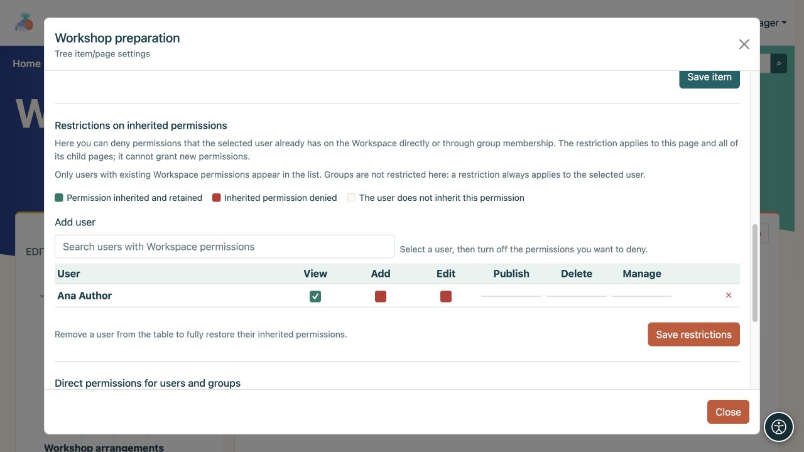
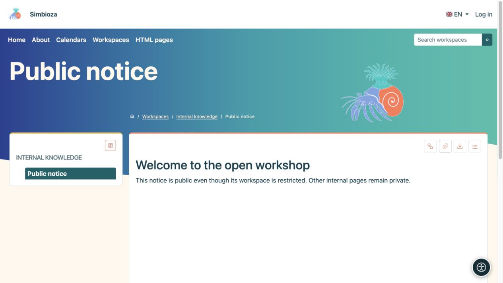
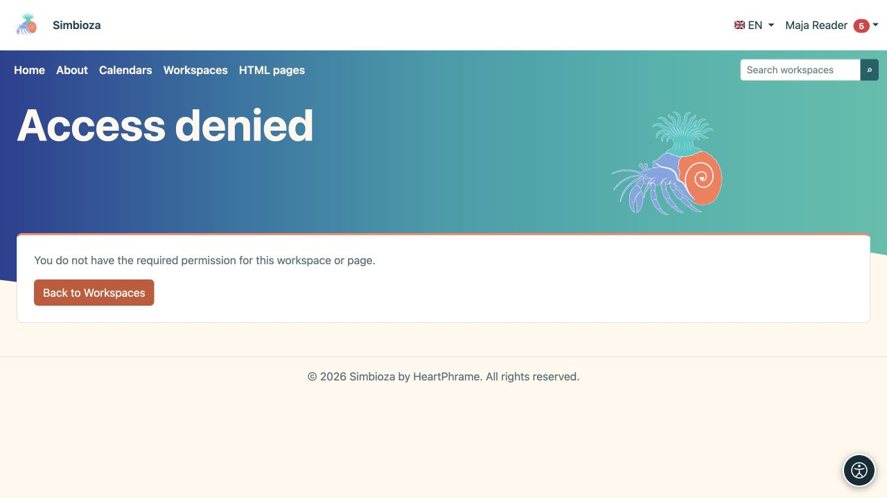

# Restrict or share one page

[Workspaces](podrucja_en.md)

**Goal:** change access to a selected page without unnecessarily changing the whole workspace. Open **Manage page and permissions**. This is available to a manager or an authorised publisher who may view the page.

## Remove some inherited permissions

Use **Inherited-permission restrictions** when someone already has workspace access but needs fewer permissions on this branch.

1. In the restriction section, search for a user who already has workspace permissions. Enter at least two characters.
2. Add the user to the table and clear the permission to withhold.
3. Save restrictions and check this page and a child page using that person's account.

**Result:** the restriction applies to this page and descendants. It does not grant new permissions. Removing the person from this table restores inheritance; this panel does not set a restriction for an entire group.

A selected inherited permission remains allowed; clearing an existing permission withholds it. A permission the person never had cannot be turned into a new grant here. Use field names and states, rather than colour alone.

<figure class="my-4">

<figcaption>Ana retains View; the inherited Add and Edit permissions have been withheld on this branch.</figcaption>
</figure>

## Add a direct permission for one page

Use **Direct permissions for users and groups** when someone lacks normal workspace access but needs to read or edit this particular page.

1. Add the user or group in the appropriate picker.
2. Select **Read**, **Editing** and/or **Publish** as required.
3. Choose **Save direct permissions**.
4. Ask the person to open the page and check that the remaining private content is still protected.

**Result:** the exception applies only to this page. Children do not inherit it. The workspace may appear in that person's list because of the exception, while its tree shows only permitted pages; inaccessible parents and other branches remain private.

Editing and publishing include reading, but publication alone does not grant editing. The **Public** audience may receive reading only. **All authenticated users** includes every signed-in account, so check whether such broad access is intended before granting it.

<figure class="my-4">

<figcaption>A page can have direct user and group grants. Public may receive reading permission only.</figcaption>
</figure>

## A public page inside a private workspace

Grant the **Public** audience read access to the selected page and publish its content separately. Guests may then open it without access to the remaining private pages. The same principle applies to a page containing a published survey; survey eligibility and result access are still checked separately.

A direct grant does not make an unpublished draft public. A link from the shared page to other private content does not grant access to that content.

<figure class="my-4">

<figcaption>A guest sees only Public notice in the tree. The private parent and neighbouring pages remain protected.</figcaption>
</figure>

## Included pages or calendars

Embedding content does not bypass source permissions. Readers must also be allowed to open the included page or calendar. Without that permission, a controlled message appears or protected data remains hidden. A successful administrator preview does not prove an ordinary reader has the same view.

<figure class="my-4">

<figcaption>The same reader cannot see an embedded private page or manager-only calendar.</figcaption>
</figure>

**Check:** open the intended content as the recipient, then try a neighbouring private page as a negative check. Ask a manager or administrator for help if you are unsure which permissions combine.

<figure class="my-4">

<figcaption>A link does not grant another person reading permission. Access denied does not reveal the private content.</figcaption>
</figure>
