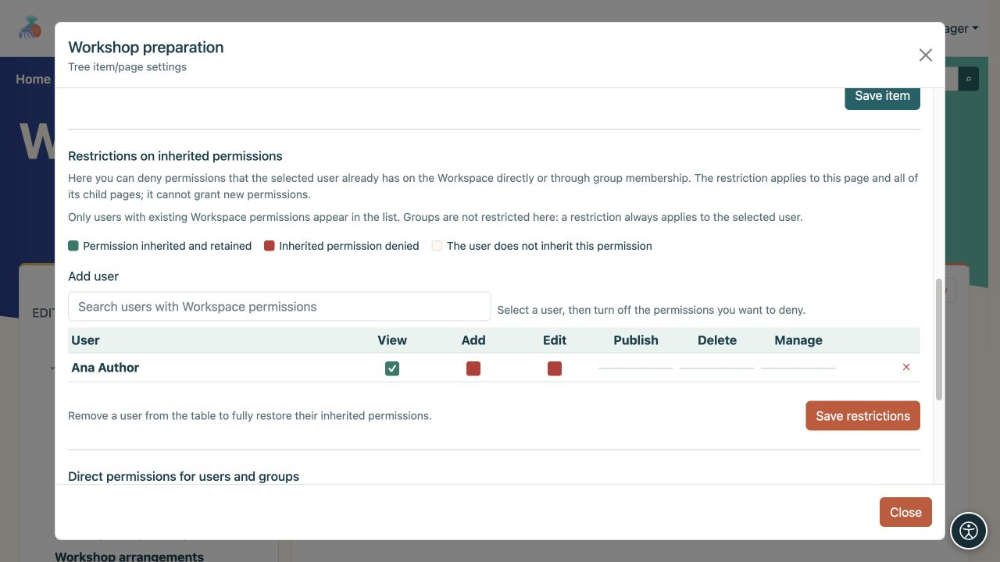
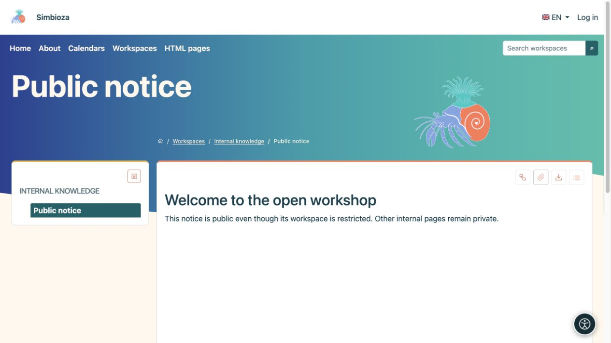
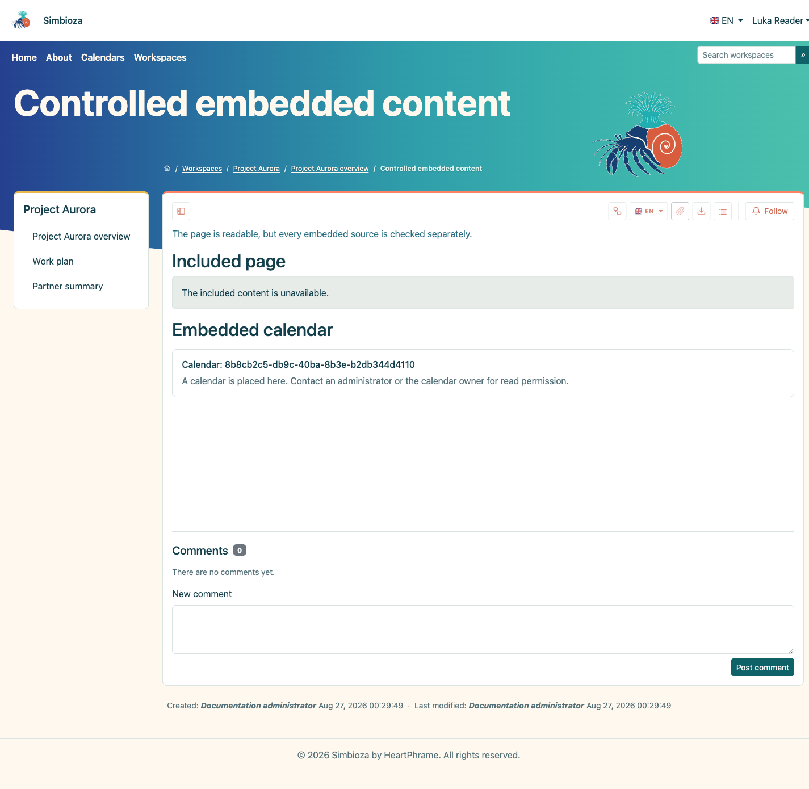
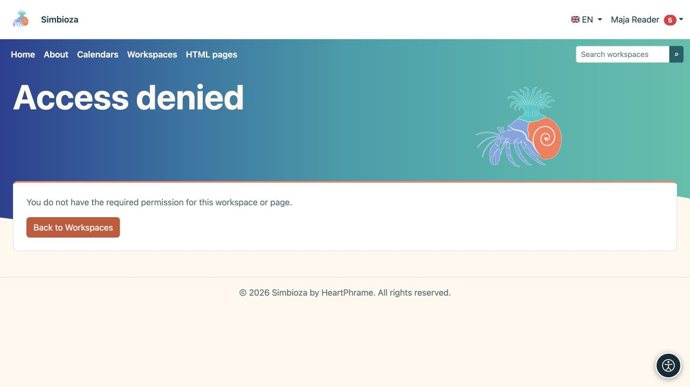

# Restringir o compartir una sola página

> Las capturas de pantalla muestran la interfaz en inglés.

[Espacios de trabajo](podrucja_es.md)

**Objetivo:** cambiar el acceso a una página seleccionada sin cambiar innecesariamente todo el espacio de trabajo. Abra **Administrar página y permisos**. Esto está disponible para un gestor o un persona con permiso para publicar que pueda ver la página.

## Eliminar algunos permisos heredados

Utilice **restricciones de permisos heredados** cuando alguien ya tenga acceso al espacio de trabajo pero necesite menos permisos en esta rama.

1. En la sección de restricción, busque un usuario que ya tenga permisos en el espacio de trabajo. Introduzca al menos dos caracteres.
2. Agregue el usuario a la tabla y borre el permiso para retener.
3. Guarde las restricciones y consulte esta página y una página infantil utilizando la cuenta de esa persona.

**Resultado:** la restricción aplica para esta página y descendientes. No otorga nuevos permisos. Quitar a la persona de esta tabla restablece la herencia; este panel no establece una restricción para un grupo completo.

Un permiso heredado seleccionado sigue estando permitido; borrar un permiso existente lo retiene. Un permiso que la persona nunca tuvo no se puede convertir en una nueva concesión aquí. Utilice nombres de campos y estados, en lugar de solo colores.

<figure class="my-4">

<figcaption>Ana conserva Vista; los permisos heredados Agregar y Editar se han retenido en esta rama.</figcaption>
</figure>

## Agregar un permiso directo para una página

Utilice **Permisos directos para usuarios y grupos** cuando alguien no tenga acceso normal al espacio de trabajo pero necesite leer o editar esta página en particular.

1. Agregue el usuario o grupo en el selector apropiado.
2. Seleccione **Leer**, **Edición** y/o **Publicar** según sea necesario.
3. Elija **Guardar permisos directos**.
4. Pídale a la persona que abra la página y verifique que el contenido privado restante aún esté protegido.

**Resultado:** la excepción se aplica solo a esta página. Las páginas secundarias no la heredan. El espacio de trabajo puede aparecer en la lista de esa persona debido a la excepción, pero el árbol solo muestra las páginas a las que tiene acceso. Las páginas superiores sin acceso y las demás ramas siguen siendo privadas.

Los permisos de edición y publicación incluyen la lectura, pero el permiso de publicación por sí solo no permite editar. Los destinatarios **Público** solo pueden recibir acceso de lectura. **Todos los usuarios autenticados** incluye cualquier cuenta con la sesión iniciada; compruebe si desea conceder un acceso tan amplio antes de hacerlo.

<figure class="my-4">

<figcaption>Una página puede tener concesiones directas para usuarios y grupos. El público sólo puede recibir permiso de lectura.</figcaption>
</figure>

## Una página pública dentro de un espacio de trabajo privado

Otorgue a la audiencia **Pública** acceso de lectura a la página seleccionada y publique su contenido por separado. Los invitados podrán entonces abrirlo sin tener acceso a las páginas privadas restantes. El mismo principio se aplica a una página que contiene una encuesta publicada; La elegibilidad de la encuesta y el acceso a los resultados aún se verifican por separado.

Un permiso asignado directamente no hace público un borrador sin publicar. Un enlace desde la página compartida a otros contenidos privados no concede acceso a esos contenidos.

<figure class="my-4">

<figcaption>Un invitado sólo ve aviso público en el árbol. Las páginas privadas principales y vecinas permanecen protegidas.</figcaption>
</figure>

## Páginas o calendarios incluidos.

La inserción de contenido no elude los permisos de origen. Los lectores también deben poder abrir la página o el calendario incluidos. Sin ese permiso, aparece un mensaje controlado o los datos protegidos permanecen ocultos. Una vista previa exitosa del administrador no prueba que un lector común tenga la misma vista.

<figure class="my-4">

<figcaption>El mismo lector no puede ver una página privada integrada o un calendario exclusivo del gestor.</figcaption>
</figure>

**Verificar:** abra el contenido deseado como destinatario y luego pruebe con una página privada vecina como verificación negativa. Pida ayuda a un gestor o administrador si no está seguro de qué permisos se combinan.

<figure class="my-4">

<figcaption>Un enlace no otorga permiso de lectura a otra persona. El acceso denegado no revela el contenido privado.</figcaption>
</figure>
