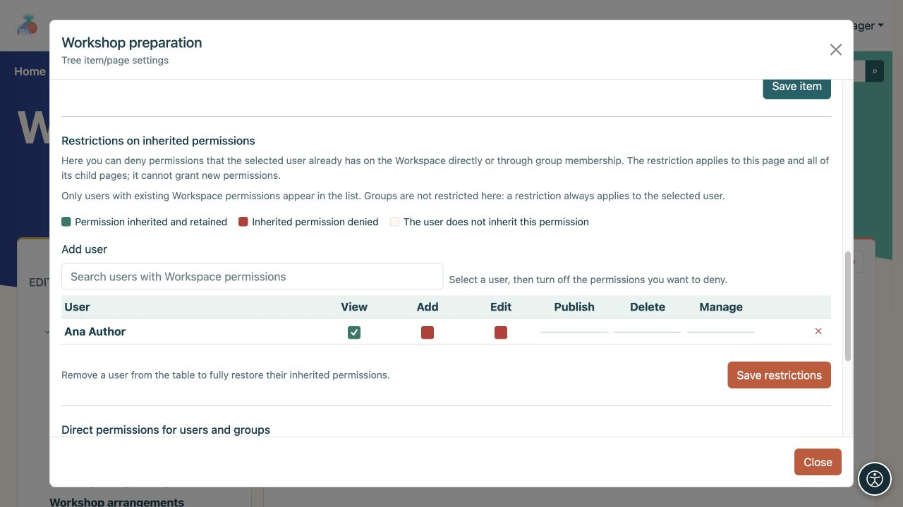
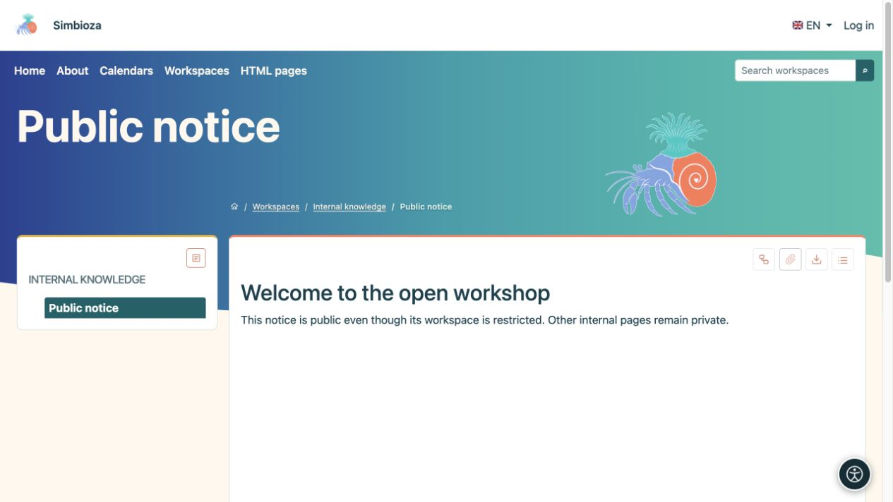
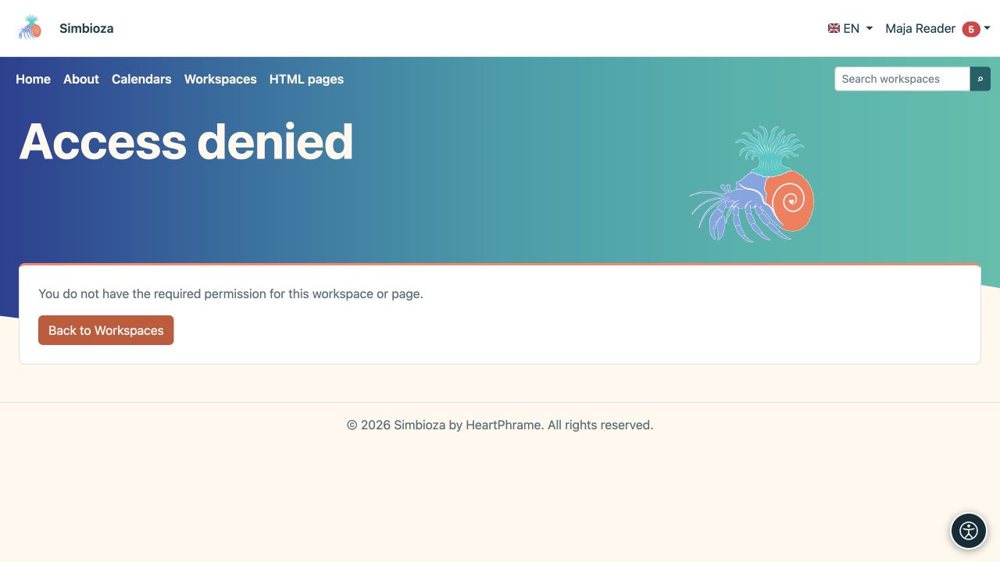

# Restreindre ou partager une page

> Les captures d’écran présentent l’interface en anglais.

[Espaces de travail](podrucja_fr.md)

**Objectif :** modifier l'accès à une page sélectionnée sans modifier inutilement l'ensemble de l'espace de travail. Ouvrez **Gérer la page et les autorisations**. Ceci est disponible pour un gestionnaire ou un responsable de publication autorisé qui peut consulter la page.

## Supprimer certaines autorisations héritées

Utilisez les **Restrictions d'autorisations héritées** lorsqu'une personne dispose déjà d'un accès à l'espace de travail mais a besoin de moins d'autorisations sur cette branche.

1. Dans la section de restriction, recherchez un utilisateur qui dispose déjà d'autorisations d'espace de travail. Saisissez au moins deux caractères.
2. Ajoutez l'utilisateur à la table et désactivez l'autorisation à refuser.
3. Enregistrez les restrictions et consultez cette page et une page enfant en utilisant le compte de cette personne.

**Résultat :** la restriction s'applique à cette page et à ses descendants. Il n'accorde pas de nouvelles autorisations. Supprimer la personne de cette table restaure l'héritage ; ce panneau ne définit pas de restriction pour un groupe entier.

Un droit hérité coché reste accordé ; décocher un droit existant le retire. Vous ne pouvez pas accorder ici un droit que la personne n’avait jamais. Fiez-vous aux noms des champs et à leur état, plutôt qu’à la couleur seule.

<figure class="my-4">

<figcaption>Ana conserve le droit de consultation ; les droits hérités d’ajout et de modification ont été retirés sur cette branche.</figcaption>
</figure>

## Ajouter une autorisation directe pour une page

Utilisez **Autorisations directes pour les utilisateurs et les groupes** lorsqu'une personne ne dispose pas d'un accès normal à l'espace de travail mais doit lire ou modifier cette page particulière.

1. Ajoutez l'utilisateur ou le groupe dans le sélecteur approprié.
2. Sélectionnez **Lire**, **Modifier** et/ou **Publier** selon vos besoins.
3. Choisissez **Enregistrer les autorisations directes**.
4. Demandez à la personne d'ouvrir la page et vérifiez que le contenu privé restant est toujours protégé.

**Résultat :** l'exception s'applique uniquement à cette page. Les enfants n'en héritent pas. L'espace de travail peut apparaître dans la liste de cette personne en raison de l'exception, alors que son arborescence n'affiche que les pages autorisées ; Les parents inaccessibles et les autres branches restent privées.

L'édition et la publication incluent la lecture, mais la publication à elle seule ne permet pas l'édition. Le public **Public** ne peut recevoir que de la lecture. **Tous les utilisateurs authentifiés** incluent tous les comptes connectés. Vérifiez donc si un accès aussi large est prévu avant de l'accorder.

<figure class="my-4">

<figcaption>Une page peut recevoir des droits attribués directement à des utilisateurs et à des groupes. Le public ne peut recevoir qu’un droit de lecture.</figcaption>
</figure>

## Une page publique dans un espace de travail privé

Accordez à l'audience **Public** un accès en lecture à la page sélectionnée et publiez son contenu séparément. Les invités peuvent alors l’ouvrir sans accéder aux pages privées restantes. Le même principe s'applique à une page contenant un sondage publié ; L’éligibilité au scrutin et l’accès aux résultats sont toujours vérifiés séparément.

Un droit attribué directement ne rend pas public un brouillon non publié. Un lien de la page partagée vers un autre contenu privé ne donne pas accès à ce contenu.

<figure class="my-4">

<figcaption>Un invité ne voit que l'avis public dans l'arborescence. Le parent privé et les pages voisines restent protégés.</figcaption>
</figure>

## Pages ou calendriers inclus

L'intégration de contenu ne contourne pas les autorisations de la source. Les lecteurs doivent également être autorisés à ouvrir la page ou le calendrier inclus. Sans cette autorisation, un message contrôlé apparaît ou les données protégées restent cachées. Un aperçu administrateur réussi ne prouve pas qu’un lecteur ordinaire a le même point de vue.

<figure class="my-4">

<figcaption>Le même lecteur ne peut pas voir une page privée intégrée ou un calendrier réservé aux gestionnaires.</figcaption>
</figure>

**Vérifiez :** ouvrez le contenu souhaité en tant que destinataire, puis essayez une page privée voisine en guise de vérification négative. Demandez de l'aide à un responsable ou à un administrateur si vous ne savez pas quelles autorisations sont combinées.

<figure class="my-4">

<figcaption>Un lien n’accorde pas à une autre personne l’autorisation de lecture. L'accès refusé ne révèle pas le contenu privé.</figcaption>
</figure>
