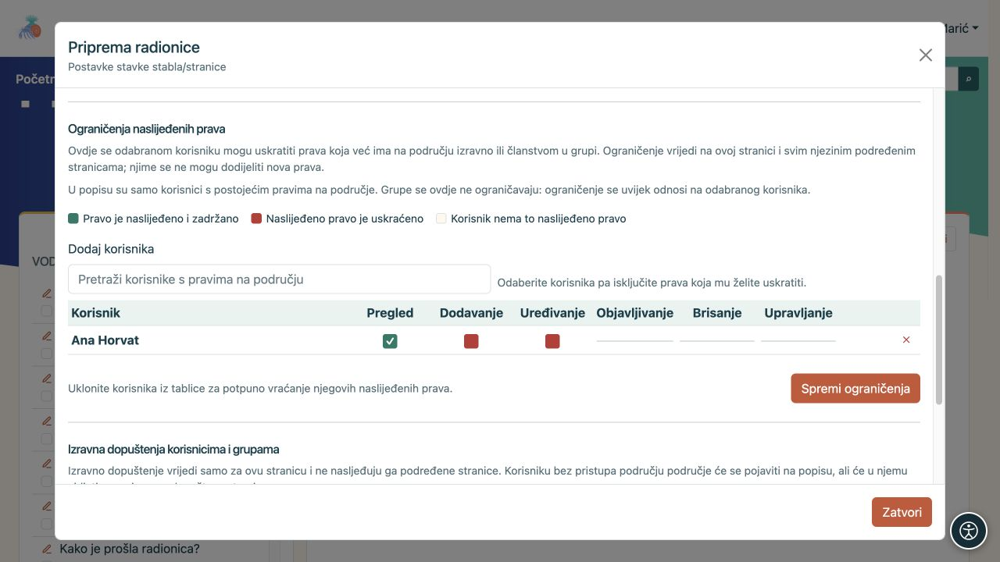
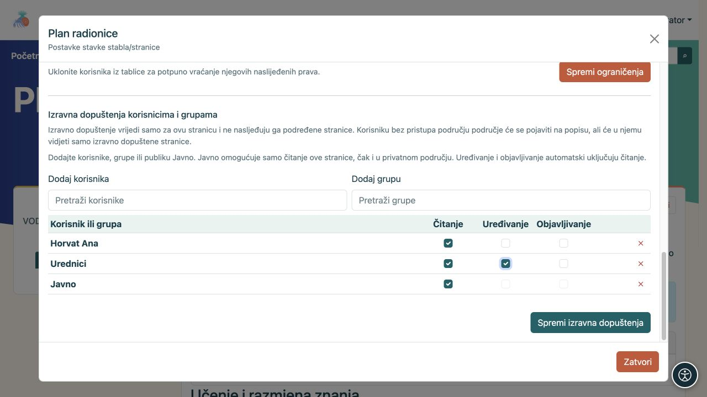
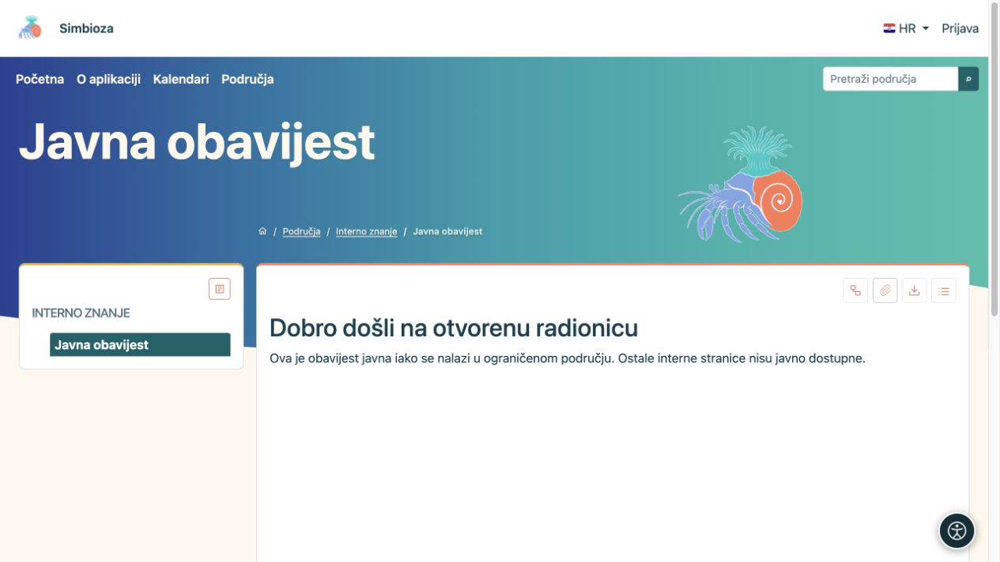
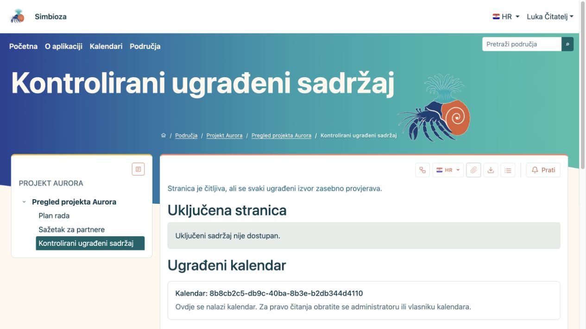
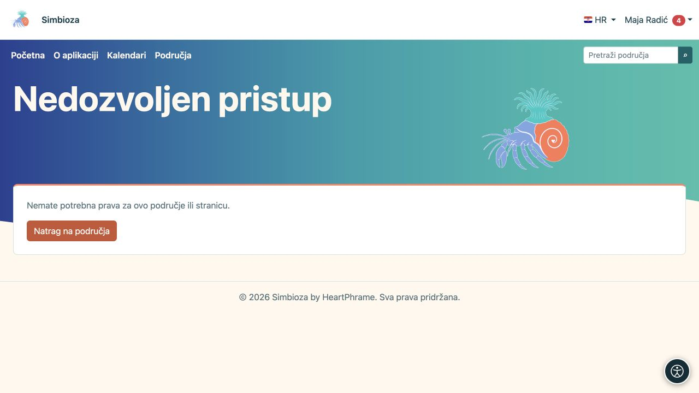

# Ograničite ili otvorite jednu stranicu

[Područja](podrucja_hr.md)

**Cilj:** promijeniti pristup odabranoj stranici, bez nepotrebnog mijenjanja cijelog područja. Otvorite ikonu **Upravljaj stranicom i dozvolama**. Radnja je dostupna upravitelju ili ovlaštenom objavljivaču koji smije vidjeti tu stranicu.

## Oduzmite dio naslijeđenih prava

Koristite **Ograničenja naslijeđenih prava** kada osoba već dobiva pristup iz područja, ali na ovoj grani treba imati manje prava.

1. U odjeljku ograničenja pretražite korisnika koji već ima prava na području. Upišite barem dva znaka.
2. Dodajte korisnika u tablicu i isključite pravo koje treba uskratiti.
3. Spremite ograničenja i provjerite istu stranicu te njezinu podstranicu korisnikovim računom.

**Rezultat:** ograničenje vrijedi na odabranoj stranici i potomcima. Ne daje nova prava. Uklanjanje korisnika iz ove tablice vraća nasljeđivanje; za cijelu grupu ovdje se ne postavlja pojedinačno ograničenje.

Označeno naslijeđeno pravo ostaje dopušteno; isključeno postojeće pravo uskraćuje se. Polje koje osoba nije ni imala ne može se ovdje pretvoriti u novo dopuštenje. Oslonite se na nazive i stanje polja, ne samo na njihovu boju.

<figure class="my-4">

<figcaption>Ana zadržava pregled, a označena naslijeđena prava dodavanja i uređivanja uskraćena su na ovoj grani.</figcaption>
</figure>

## Dodajte izravno dopuštenje jedne stranice

Koristite **Izravna dopuštenja korisnicima i grupama** kada osoba inače nema pristup području, ali treba čitati ili uređivati baš ovu stranicu.

1. Dodajte korisnika ili grupu u odgovarajućem biraču.
2. Označite **Čitanje**, **Uređivanje** i/ili **Objavljivanje** prema potrebi.
3. Odaberite **Spremi izravna dopuštenja**.
4. Zatražite da osoba otvori stranicu, a zatim provjeri da ostali privatni sadržaji nisu otvoreni.

**Rezultat:** iznimka vrijedi samo na toj stranici. Ne nasljeđuju je potomci. Područje se može pojaviti u korisnikovu popisu zbog te iznimke, a stablo prikazuje samo dopuštene stranice; nedostupni roditelji i ostale grane ne postaju javni.

Uređivanje i objavljivanje uključuju čitanje, ali samo objavljivanje ne daje uređivanje. Kod publike **Javno** moguće je samo čitanje. Publika **Svi prijavljeni** odnosi se na sve prijavljene korisnike, pa prije dodjele provjerite želite li doista tako širok pristup.

<figure class="my-4">

<figcaption>Pojedinačna stranica može imati izravne dodjele korisniku ili grupi. Za Javno je dopušteno samo čitanje.</figcaption>
</figure>

## Javna stranica u privatnom području

Dodajte publici **Javno** pravo čitanja odabrane stranice i zasebno objavite njezin sadržaj. Tada je gost može otvoriti bez pristupa ostalim privatnim stranicama. Isto načelo vrijedi za stranicu s objavljenom anketom; uvjeti ispunjavanja i pristup rezultatima ankete i dalje se provjeravaju zasebno.

Izravno pravo ne pretvara neobjavljeni nacrt u javnu stranicu. Ako u iznimci pokažete poveznicu na drugi privatni sadržaj, ta poveznica ne daje pravo na njega.

<figure class="my-4">

<figcaption>Gost u stablu vidi samo Javnu obavijest. Privatni roditelj i ostale stranice nisu otvoreni ovom iznimkom.</figcaption>
</figure>

## Uključena stranica ili kalendar

Uključivanje sadržaja ne zaobilazi prava izvora. Čitatelj mora smjeti otvoriti i uključenu stranicu ili kalendar. Ako nema pravo, prikazuje se kontrolirana poruka ili se zaštićeni podatci ne prikazuju. Administratorski uspješan pregled nije dokaz da isti prikaz ima običan korisnik.

<figure class="my-4">

<figcaption>Na istoj stranici čitatelju se ne otkrivaju uključena privatna stranica ni kalendar za koje nema pravo.</figcaption>
</figure>

**Provjerite:** nakon promjene otvorite željeni sadržaj kao primatelj, a susjednu privatnu stranicu kao negativnu provjeru. Ako niste sigurni koja se prava zbrajaju, zatražite pomoć upravitelja ili administratora.

<figure class="my-4">

<figcaption>Ista poveznica ne daje pravo čitanja drugoj osobi. Nedopušten pristup ne prikazuje privatni sadržaj.</figcaption>
</figure>
