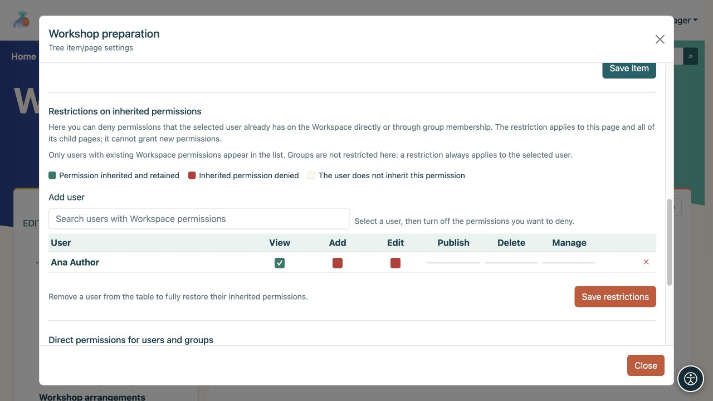
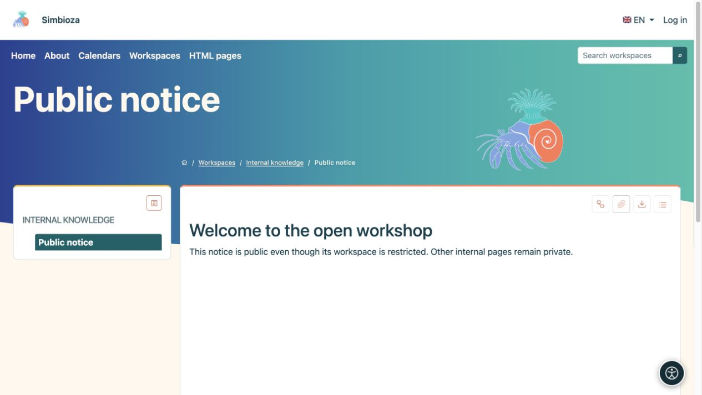
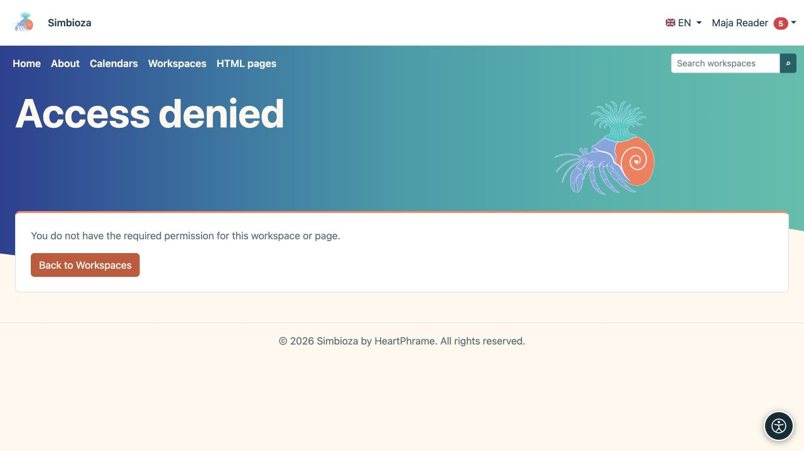

# Limita o condividi una pagina

> Le schermate mostrano l’interfaccia in inglese.

[Aree di lavoro](podrucja_it.md)

**Obiettivo:** modificare l'accesso a una pagina selezionata senza modificare inutilmente l'intera area di lavoro. Apri **Gestisci pagina e autorizzazioni**. Questo è disponibile per un manager o un editore autorizzato che può visualizzare la pagina.

## Rimuovere alcune autorizzazioni ereditate

Utilizza le **Restrizioni sulle autorizzazioni ereditate** quando qualcuno ha già accesso all'area di lavoro ma necessita di meno autorizzazioni su questo ramo.

1. Nella sezione delle restrizioni, cerca un utente che dispone già delle autorizzazioni per l'area di lavoro. Inserisci almeno due caratteri.
2. Aggiungi l'utente alla tabella e deseleziona l'autorizzazione da negare.
3. Salva le restrizioni e controlla questa pagina e una pagina secondaria utilizzando l'account di quella persona.

**Risultato:** la restrizione si applica a questa pagina e ai discendenti. Non concede nuove autorizzazioni. Rimuovere la persona da questa tabella ripristina l'ereditarietà; questo pannello non imposta una restrizione per un intero gruppo.

Un'autorizzazione ereditata selezionata rimane consentita; deselezionando un'autorizzazione esistente, la si nega. Qui non è possibile concedere una nuova autorizzazione che la persona non ha mai avuto. Considera i nomi e gli stati dei campi, non soltanto il colore.

<figure class="my-4">

<figcaption>Ana mantiene la vista; le autorizzazioni di aggiunta e modifica ereditate sono state trattenute su questo ramo.</figcaption>
</figure>

## Aggiungi un'autorizzazione diretta per una pagina

Utilizza le **Autorizzazioni dirette per utenti e gruppi** quando qualcuno non ha il normale accesso all'area di lavoro ma ha bisogno di leggere o modificare questa particolare pagina.

1. Aggiungi l'utente o il gruppo nel selettore appropriato.
2. Seleziona **Leggi**, **Modifica** e/o **Pubblica** come richiesto.
3. Scegli **Salva autorizzazioni dirette**.
4. Chiedi alla persona di aprire la pagina e verificare che il contenuto privato rimanente sia ancora protetto.

**Risultato:** l'eccezione si applica soltanto a questa pagina. Le pagine figlie non la ereditano. L'area di lavoro può comparire nell'elenco della persona grazie all'eccezione, mentre l'albero mostra soltanto le pagine consentite; le pagine superiori inaccessibili e gli altri rami rimangono privati.

L'editing e la pubblicazione includono la lettura, ma la pubblicazione da sola non garantisce l'editing. Il pubblico **pubblico** può ricevere solo la lettura. **Tutti gli utenti autenticati** include tutti gli account a cui è stato effettuato l'accesso, quindi controlla se è previsto un accesso così ampio prima di concederlo.

<figure class="my-4">

<figcaption>Una pagina può avere concessioni dirette per utenti e gruppi. Il pubblico può ricevere solo il permesso di lettura.</figcaption>
</figure>

## Una pagina pubblica all'interno di un'area di lavoro privata

Concedi al pubblico **pubblico** l'accesso in lettura alla pagina selezionata e pubblicane il contenuto separatamente. Gli ospiti potranno quindi aprirlo senza accedere alle restanti pagine private. Lo stesso principio vale per una pagina contenente un sondaggio pubblicato; l'idoneità al sondaggio e l'accesso ai risultati vengono ancora controllati separatamente.

Un'autorizzazione diretta non rende pubblica una bozza non pubblicata. Un collegamento dalla pagina condivisa ad altri contenuti privati non concede l'accesso a tali contenuti.

<figure class="my-4">

<figcaption>Un ospite vede solo l'avviso pubblico nell'albero. La pagina principale privata e quelle vicine rimangono protette.</figcaption>
</figure>

## Pagine o calendari inclusi

L'incorporamento del contenuto non ignora le autorizzazioni della fonte. I lettori devono inoltre essere autorizzati ad aprire la pagina o il calendario inclusi. Senza tale autorizzazione, viene visualizzato un messaggio controllato o i dati protetti rimangono nascosti. Un'anteprima dell'amministratore riuscita non dimostra che un lettore normale abbia la stessa visione.

<figure class="my-4">

<figcaption>Lo stesso lettore non può vedere una pagina privata incorporata o un calendario riservato solo al gestore.</figcaption>
</figure>

**Verifica:** apri il contenuto previsto come destinatario, quindi prova una pagina privata vicina come controllo negativo. Chiedi aiuto a un manager o un amministratore se non sei sicuro di quali autorizzazioni combinare.

<figure class="my-4">

<figcaption>Un collegamento non concede a un'altra persona il permesso di lettura. L'accesso negato non rivela il contenuto privato.</figcaption>
</figure>
