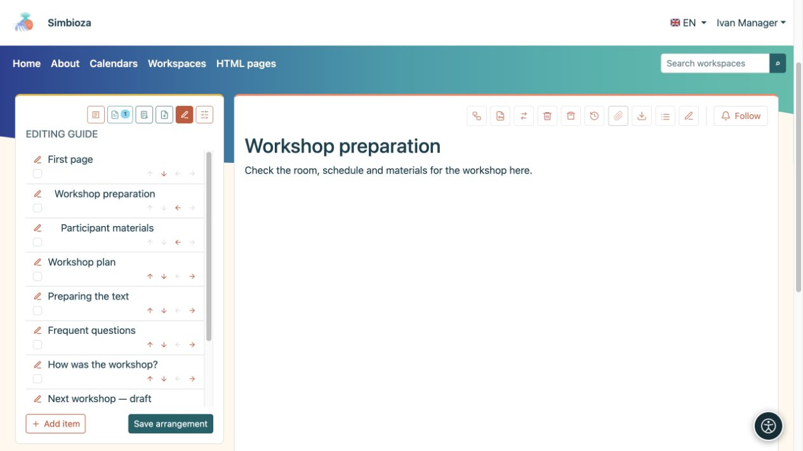
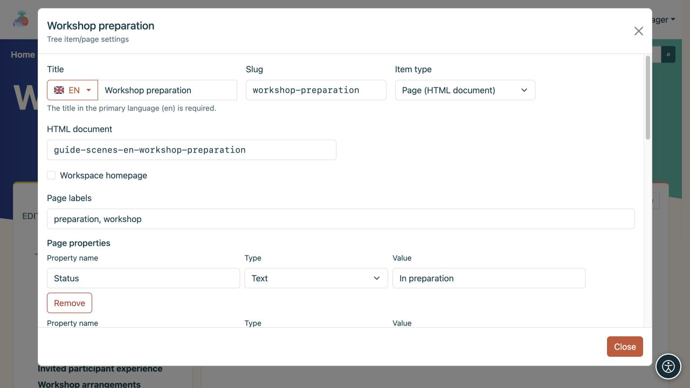

# Seitenbaum und Seitendaten bearbeiten

> Die Bildschirmaufnahmen zeigen die englische Benutzeroberfläche.

[Arbeitsbereiche](podrucja_de.md)

**Ziel:** Geben Sie den Lesern eine klare Seitenreihenfolge. Der Baumorganisator ist für Arbeitsbereichsmanager gedacht. Die Erlaubnis zum Bearbeiten von Text allein erlaubt nicht, den gesamten Baum neu anzuordnen.

## Reihenfolge oder übergeordnetes Element ändern

1. Öffnen Sie den Arbeitsbereich, sein **Baum**-Symbol und **Baum bearbeiten**.
2. Verwenden Sie die Aufwärts-/Abwärtspfeile, um ein Element zwischen Geschwistern auf derselben Ebene zu verschieben.
3. Verwenden Sie den Rechtspfeil, um es unter dem vorherigen Element zu platzieren, oder den Linkspfeil, um es eine Ebene nach oben zu verschieben. Ein ausgegrauter Pfeil zeigt einen Zug an, der derzeit nicht verfügbar ist.
4. Überprüfen Sie die Vereinbarung und wählen Sie **Vereinbarung speichern**.

**Ergebnis:** Die neue Bestellung wird im Arbeitsbereich gespeichert. Bis zum Speichern sind Änderungen nur im geöffneten Organizer vorhanden. Durch den Umzug unter ein anderes übergeordnetes Element können sich auch die übernommenen Zugriffsbeschränkungen ändern.

<figure class="my-4">

<figcaption>Pfeile verändern die Anordnung; der Stift öffnet die Elementeinstellungen. Bestätigen Sie die Änderungen mit Anordnung speichern.</figcaption>
</figure>

## Verstecken Sie ein Element aus der Navigation

Aktivieren Sie im Organizer **Element ausblenden** oder **Zweig ausblenden**, wenn er untergeordnete Elemente hat, und wählen Sie **Anordnung speichern**. Dadurch werden das Element und sein Unterbaum aus der normalen Navigation entfernt, ohne dass deren Inhalt gelöscht wird.

**Dadurch wird der Zugriff nicht eingeschränkt.** Jemand, der die Seite lesen darf, kann dennoch den direkten Link öffnen. Der Pfad, der zum Erreichen einer geöffneten ausgeblendeten Seite erforderlich ist, wird möglicherweise vorübergehend abgeblendet angezeigt. Um das Lesen tatsächlich zu verweigern, verwenden Sie [Seitenberechtigungen](podrucja-prava-stranice_de.md).

## Fügen Sie ein Dokument oder einen Link hinzu

**Neue Seite** erstellt ein neues HTML-Dokument und öffnet den Editor. **Element hinzufügen** im Organizer verbindet ein Dokument oder ein anderes Ziel:

- **Seite (HTML Dokument)** verknüpft das entsprechende Dokument.
- **Interner Link** öffnet eine angebotene Anwendungsroute oder einen internen Pfad, z. B. Kalender.
- **Externer Link** öffnet eine vollständige URL auf einer anderen Website.

Geben Sie einen Titel und einen Slug ein, wählen Sie ein übergeordnetes Element und ein Ziel aus und speichern Sie dann. Andere aktivierte Module, wie z. B. Umfragen, fügen Inhalte mithilfe ihrer entsprechenden Aktionen hinzu.

<figure class="my-4">

<figcaption>Titel, Slug, Eintragstyp, übergeordnete Seite und das Ziel eines internen Links sind alle sichtbar.</figcaption>
</figure>

## Bearbeiten Sie die Seitendetails

Der Stift neben einem Element und **Seite und Berechtigungen verwalten** öffnen die Einstellungen dieser Seite. Manager nutzen sie, um den Arbeitsbereich zu organisieren. Ein Herausgeber mit entsprechendem Zugriff verfügt möglicherweise auch über Seitenberechtigungskontrollen. Dies gewährt keine Verwaltung des gesamten Baums.

- Die **Arbeitsbereichs-Homepage** wählt aus, was geöffnet wird, wenn ein Leser den Arbeitsbereich selbst auswählt.
- **Titel** kann Übersetzungen enthalten; **Slug** liefert einen Teil der Adresse.
- **Seitenbezeichnungen** helfen dabei, verwandte Seiten zu finden und zu filtern.
- **Seiteneigenschaften** speichern Informationen wie Status, Fälligkeitsdatum, Nummer oder Link. Verwenden Sie konsistente Eigenschaftsnamen auf allen zugehörigen Seiten, wenn Sie diese in einer [dynamischen Tabelle](uredivanje-stranica_de.md#integrations) anzeigen.
- **Standardanzeige des Seiteninhalts** übernimmt den Arbeitsbereich oder zeigt/versteckt speziell dessen Überschriftenliste.

<figure class="my-4">

<figcaption>Beschriftungen beschreiben die Seite und die Eigenschaft „Status“ zeichnet ihren aktuellen Wert auf. Der ausgewählte Typ bestimmt, wie ein Eigenschaftswert interpretiert wird.</figcaption>
</figure>

**Unterbaum löschen** entfernt auch Nachkommen. Überprüfen Sie vor der Bestätigung den gesamten Zweig und seine Berechtigungen. Verwenden Sie den [HTML-Editor](uredivanje-stranica_de.md), um Text zu ändern, und [Seitenzugriff](podrucja-prava-stranice_de.md), um die Zielgruppe zu ändern.
