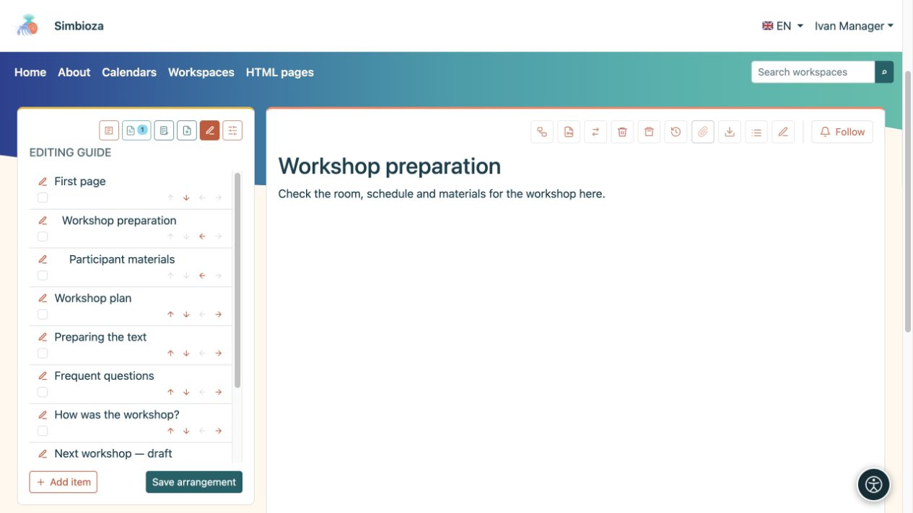
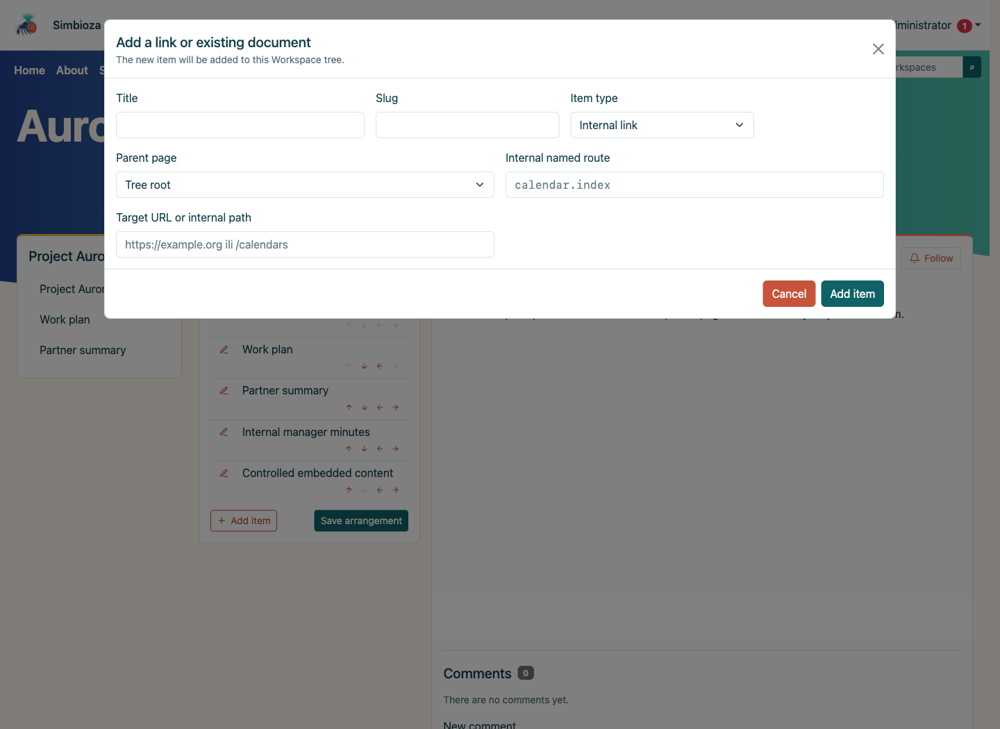
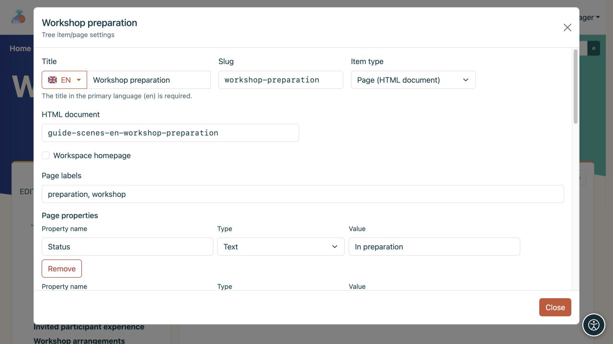

# Arrange the tree and page details

[Workspaces](podrucja_en.md)

**Goal:** give readers a clear page order. The tree organiser is for workspace managers; being allowed to edit text does not by itself permit rearranging the whole tree.

## Change order or parent

1. Open the workspace, its **Tree** icon and **Edit tree**.
2. Use the up/down arrows to move an item among siblings on the same level.
3. Use the right arrow to place it under the preceding item, or the left arrow to move it one level out. A greyed-out arrow indicates a move which is currently unavailable.
4. Check the arrangement and choose **Save arrangement**.

**Result:** the new order is saved in the workspace. Until you save, changes exist only in the open organiser. Moving under another parent may also change inherited access restrictions.

<figure class="my-4">

<figcaption>Arrows change the arrangement; the pencil opens item settings. Confirm the changes with Save arrangement.</figcaption>
</figure>

## Hide an item from navigation

In the organiser, enable **Hide item**, or **Hide branch** when it has children, and select **Save arrangement**. This removes the item and its subtree from normal navigation without deleting their content.

**This does not restrict access.** Someone allowed to read the page can still open its direct link. The path needed to reach an opened hidden page may temporarily appear dimmed. To actually deny reading, use [page permissions](podrucja-prava-stranice_en.md).

## Add a document or link

**New page** creates a new HTML document and opens the editor. **Add item** in the organiser connects a document or another destination:

- **Page (HTML document)** links the appropriate document.
- **Internal link** opens an offered application route or internal path, such as calendars.
- **External link** opens a full URL on another site.

Enter a title and slug, choose a parent and destination, then save. Other enabled modules, such as Surveys, add content using their corresponding actions.

<figure class="my-4">

<figcaption>Title, Slug, Item type, Parent page and the target of an internal link are all visible.</figcaption>
</figure>

## Edit page details

The pencil beside an item and **Manage page and permissions** open that page's settings. Managers use them to organise the workspace. A publisher with suitable access may also have page-permission controls; this does not grant management of the whole tree.

- **Workspace home page** chooses what opens when a reader selects the workspace itself.
- **Title** may have translations; **Slug** supplies part of the address.
- **Page labels** help find and filter related pages.
- **Page properties** store information such as status, due date, number or link. Use consistent property names across related pages when displaying them in a [dynamic table](uredivanje-stranica_en.md#integrations).
- **Default page contents display** inherits the workspace or specifically shows/hides its heading list.

<figure class="my-4">

<figcaption>Labels describe the page, and the Status property records its current value. The selected type determines how a property value is interpreted.</figcaption>
</figure>

**Delete subtree** removes descendants too. Review the whole branch and its permissions before confirming. Use the [HTML editor](uredivanje-stranica_en.md) to change text, and [page access](podrucja-prava-stranice_en.md) to change the audience.
