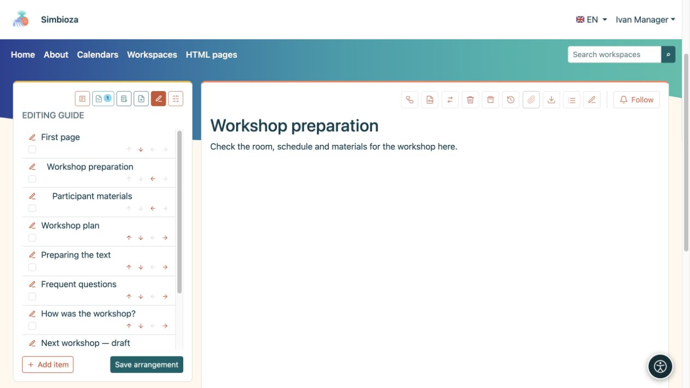
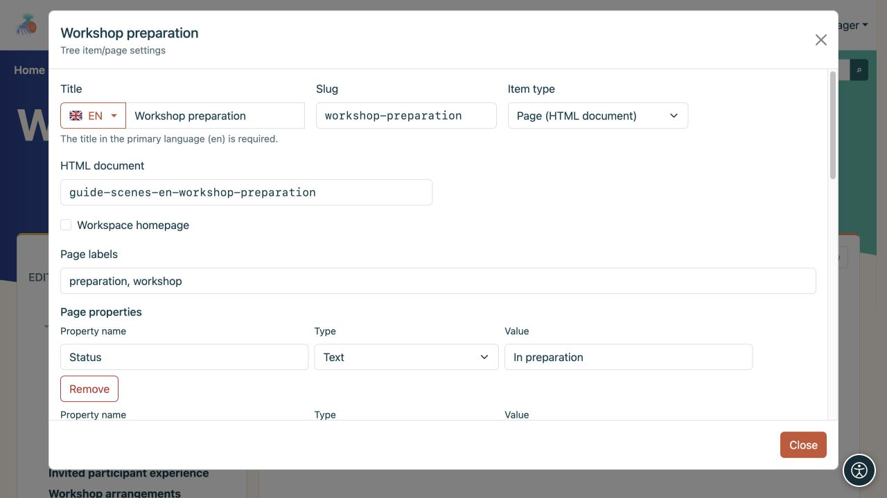

# Organizar el árbol y los datos de las páginas

> Las capturas de pantalla muestran la interfaz en inglés.

[Espacios de trabajo](podrucja_es.md)

**Objetivo:** brindar a los lectores un orden de páginas claro. El organizador en árbol es para gestores de espacios de trabajo; Tener permiso para editar texto no permite por sí solo reorganizar todo el árbol.

## Cambiar orden o padre

1. Abra el espacio de trabajo, su ícono **Árbol** y **Editar árbol**.
2. Utilice las flechas arriba/abajo para mover un elemento entre hermanos en el mismo nivel.
3. Utilice la flecha derecha para colocarlo debajo del elemento anterior, o la flecha izquierda para moverlo un nivel hacia afuera. Una flecha atenuada indica un movimiento que actualmente no está disponible.
4. Verifique el arreglo y elija **Guardar arreglo**.

**Resultado:** el nuevo orden queda guardado en el espacio de trabajo. Hasta que guarde, los cambios solo existen en el organizador abierto. Mover un elemento bajo otro elemento superior también puede cambiar las restricciones de acceso heredadas.

<figure class="my-4">

<figcaption>Las flechas cambian la disposición; el lápiz abre la configuración del elemento. Confirme los cambios con Guardar arreglo.</figcaption>
</figure>

## Ocultar un elemento de la navegación

En el organizador, habilite **Ocultar elemento** u **Ocultar rama** cuando tenga hijos y seleccione **Guardar arreglo**. Esto elimina el elemento y su subárbol de la navegación normal sin eliminar su contenido.

**Esto no restringe el acceso.** Alguien a quien se le permita leer la página aún puede abrir su enlace directo. La ruta necesaria para llegar a una página oculta abierta puede aparecer atenuada temporalmente. Para denegar realmente la lectura, utilice [permisos de página](podrucja-prava-stranice_es.md).

## Agregar un documento o enlace

**Nueva página** crea un nuevo documento HTML y abre el editor. **Agregar elemento** en el organizador conecta un documento u otro destino:

- **La página (documento HTML)** vincula el documento correspondiente.
- **Enlace interno** abre una ruta de aplicación ofrecida o una ruta interna, como calendarios.
- **Enlace externo** abre una URL completa en otro sitio.

Ingrese un título y un slug, elija una página superior y un destino, luego guarde. Otros módulos habilitados, como Encuestas, agregan contenido mediante sus acciones correspondientes.

<figure class="my-4">

<figcaption>El título, el Slug, el tipo de elemento, la página superior y el destino de un enlace interno son todos visibles.</figcaption>
</figure>

## Editar detalles de la página

El lápiz al lado de un elemento y **Administrar página y permisos** abren la configuración de esa página. Los gestores los utilizan para organizar el espacio de trabajo. Una persona con permiso para publicar con acceso adecuado también puede tener controles de permiso de página; esto no garantiza la gestión de todo el árbol.

- **La página de inicio del espacio de trabajo** elige lo que se abre cuando un lector selecciona el espacio de trabajo.
- **Título** puede tener traducciones; **Slug** proporciona parte de la dirección.
- **Etiquetas de página** ayudan a encontrar y filtrar páginas relacionadas.
- **Propiedades de la página** almacena información como estado, fecha de vencimiento, número o enlace. Utilice nombres de propiedades coherentes en páginas relacionadas cuando las muestre en una [tabla dinámica](uredivanje-stranica_es.md#integrations).
- **Visualización predeterminada del contenido de la página** hereda el espacio de trabajo o muestra/oculta específicamente su lista de encabezados.

<figure class="my-4">

<figcaption>Las etiquetas describen la página y la propiedad Estado registra su valor actual. El tipo seleccionado determina cómo se interpreta el valor de una propiedad.</figcaption>
</figure>

**Eliminar subárbol** también elimina los descendientes. Revise toda la rama y sus permisos antes de confirmar. Utilice el [HTML editor](uredivanje-stranica_es.md) para cambiar el texto y el [acceso a la página](podrucja-prava-stranice_es.md) para cambiar la audiencia.
