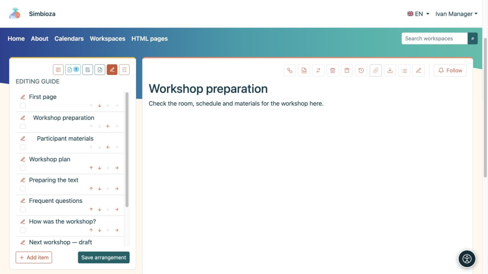
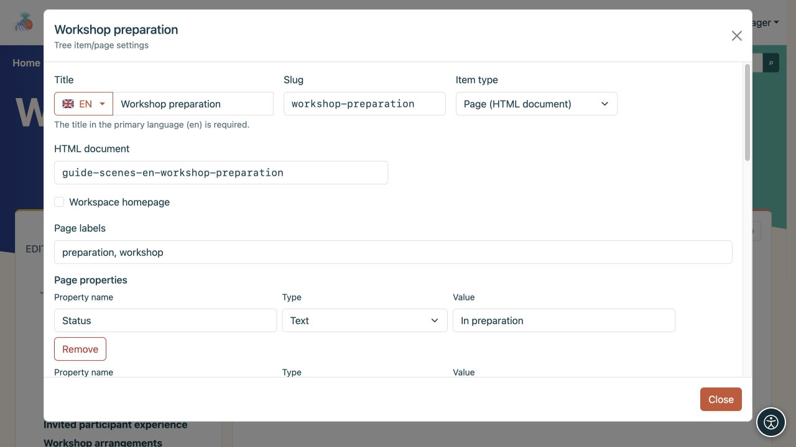

# Organiser l’arborescence et les informations de la page

> Les captures d’écran présentent l’interface en anglais.

[Espaces de travail](podrucja_fr.md)

**Objectif :** donner aux lecteurs un ordre clair des pages. L'organisateur d'arborescence est destiné aux gestionnaires d'espace de travail ; être autorisé à modifier du texte ne permet pas en soi de réorganiser l'ensemble de l'arborescence.

## Modifier la commande ou le parent

1. Ouvrez l'espace de travail, son icône **Arbre** et **Modifier l'arborescence**.
2. Utilisez les flèches haut/bas pour déplacer un élément parmi les frères et sœurs du même niveau.
3. Utilisez la flèche droite pour le placer sous l'élément précédent, ou la flèche gauche pour le déplacer d'un niveau. Une flèche grisée indique un mouvement actuellement indisponible.
4. Vérifiez l'arrangement et choisissez **Enregistrer l'arrangement**.

**Résultat :** la nouvelle commande est enregistrée dans l'espace de travail. Jusqu'à ce que vous enregistriez, les modifications n'existent que dans l'organiseur ouvert. Passer sous la direction d'un autre parent peut également modifier les restrictions d'accès héritées.

<figure class="my-4">

<figcaption>Les flèches modifient la disposition ; le crayon ouvre les paramètres de l'élément. Confirmez les modifications avec Enregistrer l'arrangement.</figcaption>
</figure>

## Masquer un élément de la navigation

Dans l'organiseur, activez **Masquer l'élément** ou **Masquer la branche** lorsqu'elle a des enfants, puis sélectionnez **Enregistrer l'arrangement**. Cela supprime l'élément et son sous-arbre de la navigation normale sans supprimer leur contenu.

**Cela ne restreint pas l'accès.** Une personne autorisée à lire la page peut toujours ouvrir son lien direct. Le chemin nécessaire pour atteindre une page cachée ouverte peut apparaître temporairement grisé. Pour refuser la lecture, utilisez [autorisations de page](podrucja-prava-stranice_fr.md).

## Ajouter un document ou un lien

**Nouvelle page** crée un nouveau document HTML et ouvre l'éditeur. **Ajouter un élément** dans l'organiseur connecte un document ou une autre destination :

- **La page (document HTML)** relie le document approprié.
- **Lien interne** ouvre un route d'application proposé ou un chemin interne, tel que des calendriers.
- **Lien externe** ouvre une URL complète sur un autre site.

Entrez un titre et un slug, choisissez un parent et une destination, puis enregistrez. D'autres modules activés, tels que les sondages, ajoutent du contenu en utilisant leurs actions correspondantes.

<figure class="my-4">

<figcaption>Le titre, le Slug, le type d'élément, la page parentee et la cible d'un lien interne sont tous visibles.</figcaption>
</figure>

## Modifier les détails de la page

Le crayon à côté d'un élément et **Gérer la page et les autorisations** ouvrent les paramètres de cette page. Les responsables les utilisent pour organiser l'espace de travail. Un responsable de publication disposant d'un accès approprié peut également disposer de contrôles d'autorisation de page ; cela n'accorde pas la gestion de l'ensemble de l’arborescence.

- **La page d'accueil de l'espace de travail** choisit ce qui s'ouvre lorsqu'un lecteur sélectionne l'espace de travail lui-même.
- **Le titre** peut avoir des traductions ; **Slug** fournit une partie de l'adresse.
- **Étiquettes de page** permettent de rechercher et de filtrer les pages associées.
- **Propriétés de la page** stockent des informations telles que le statut, la date d'échéance, le numéro ou le lien. Utilisez des noms de propriété cohérents sur les pages associées lorsque vous les affichez dans une [table dynamique](uredivanje-stranica_fr.md#integrations).
- **Affichage du contenu de la page par défaut** hérite de l'espace de travail ou affiche/masque spécifiquement sa liste de titres.

<figure class="my-4">

<figcaption>Les étiquettes décrivent la page et la propriété Status enregistre sa valeur actuelle. Le type sélectionné détermine la manière dont une valeur de propriété est interprétée.</figcaption>
</figure>

**Supprimer le sous-arbre** supprime également les descendants. Vérifiez la branche entière et ses autorisations avant de confirmer. Utilisez l'[éditeur HTML](uredivanje-stranica_fr.md) pour modifier le texte et l'[accès à la page](podrucja-prava-stranice_fr.md) pour modifier l'audience.
