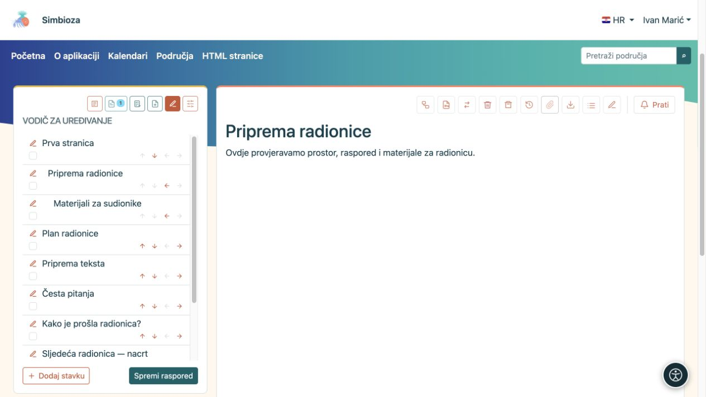
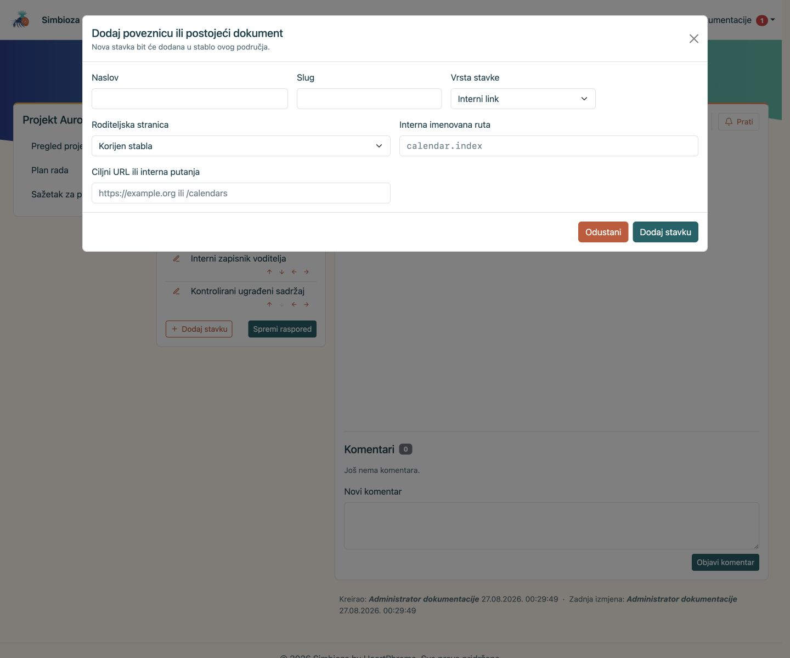
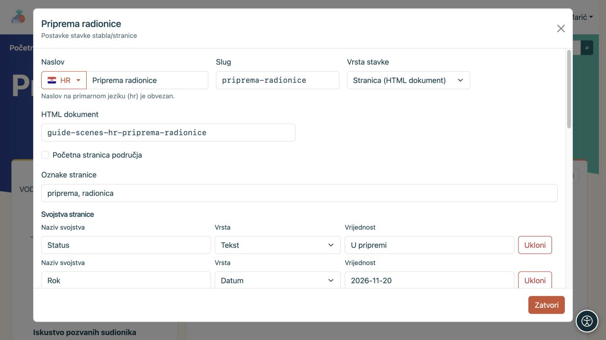

# Uredite stablo i podatke stranice

[Područja](podrucja_hr.md)

**Cilj:** čitatelju složiti jasan redoslijed stranica. Organizator stabla namijenjen je upravitelju područja; pravo pisanja teksta samo po sebi ne daje pravo preslagivanja cijelog stabla.

## Promijenite redoslijed ili roditelja

1. Otvorite područje, njegovu ikonu **Stablo** i **Uredi stablo**.
2. Strelicama gore/dolje pomaknite stavku među susjedima iste razine.
3. Strelicom udesno stavite je ispod prethodne stavke; strelicom ulijevo vratite je jednu razinu više. Zasivljena strelica označuje potez koji trenutačno nije moguć.
4. Provjerite raspored i odaberite **Spremi raspored**.

**Rezultat:** novi se redoslijed čuva u području. Dok ne spremite raspored, pomaci su samo u otvorenom organizatoru. Premještanjem pod drugog roditelja mogu se promijeniti i naslijeđena ograničenja pristupa.

<figure class="my-4">

<figcaption>Strelice mijenjaju raspored, a olovka otvara postavke stavke. Promjenu potvrdite radnjom Spremi raspored.</figcaption>
</figure>

## Sakrijte stavku iz navigacije

U organizatoru uz stavku označite **Sakrij stavku**, odnosno **Sakrij granu** ako ima potomke, pa odaberite **Spremi raspored**. Tako uklanjate stavku i njezinu podgranu iz uobičajenog stabla bez brisanja sadržaja.

**To nije ograničenje pristupa.** Osoba koja smije čitati stranicu i dalje je može otvoriti izravnom poveznicom. Pri takvom otvaranju potreban put do stranice može se privremeno pojaviti prigušeno. Za stvarno uskraćivanje čitanja koristite [prava stranice](podrucja-prava-stranice_hr.md).

## Dodajte dokument ili poveznicu

**Nova stranica** otvara stvaranje novog HTML dokumenta i editor. **Dodaj stavku** u organizatoru služi povezivanju dokumenta ili drugog cilja:

- **Stranica (HTML dokument)** povezuje odgovarajući dokument.
- **Interni link** vodi na ponuđenu rutu ili internu putanju aplikacije, primjerice kalendare.
- **Vanjski link** vodi na puni URL drugog sitea.

Unesite naslov i slug, odaberite roditelja i cilj pa spremite. U područje možete dodati i sadržaje drugih uključenih modula, primjerice anketu, kroz njihove pripadajuće radnje.

<figure class="my-4">

<figcaption>Obrazac jasno prikazuje naslov, slug, tip stavke, roditeljsku stranicu i cilj internog linka.</figcaption>
</figure>

## Uredite podatke stranice

Olovka uz stavku i ikona **Upravljaj stranicom i dozvolama** otvaraju postavke konkretne stranice. Upravitelj ih koristi za organizaciju područja. Objavljivaču s odgovarajućim pristupom mogu biti dostupne dozvole te stranice; to mu ne daje upravljanje cijelim stablom.

- **Početna stranica područja** određuje što se otvara kada čitatelj odabere samo područje.
- **Naslov** može imati prijevode; **Slug** određuje dio adrese.
- **Oznake stranice** pomažu pronaći i filtrirati povezane stranice.
- **Svojstva stranice** pohranjuju podatke poput statusa, roka, broja ili poveznice. Na povezanim stranicama koristite ista imena svojstava ako ih želite prikazati u [dinamičkoj tablici](uredivanje-stranica_hr.md#integracije).
- **Zadani prikaz sadržaja stranice** nasljeđuje područje ili posebno prikazuje/skriva popis naslova.

<figure class="my-4">

<figcaption>Stranica ima oznake te svojstva Status i Rok. Vrsta određuje kako se vrijednost svojstva tumači.</figcaption>
</figure>

**Obriši podgranu** uklanja i potomke. Prije potvrde pregledajte cijelu granu i njezina prava. Za promjenu samog teksta otvorite [HTML editor](uredivanje-stranica_hr.md); za publiku stranice pogledajte [prava jedne stranice](podrucja-prava-stranice_hr.md).
