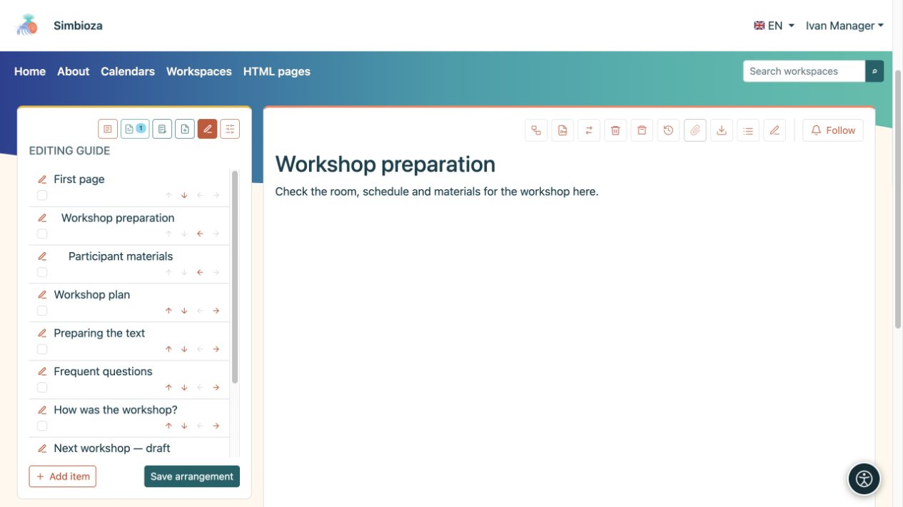
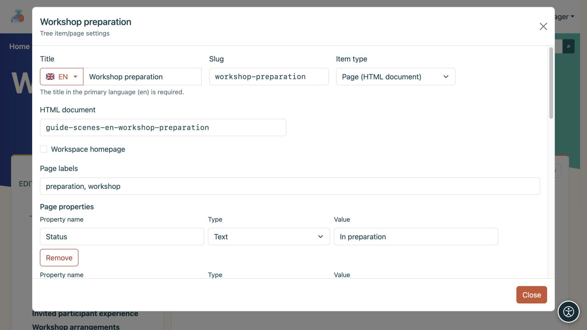

# Organizza l’albero e i dettagli della pagina

> Le schermate mostrano l’interfaccia in inglese.

[Aree di lavoro](podrucja_it.md)

**Obiettivo:** fornire ai lettori un ordine chiaro delle pagine. L'organizzatore dell'albero è destinato ai gestori dell'area di lavoro; il permesso di modificare il testo non consente di per sé di riorganizzare l'intero albero.

## Cambiare ordine o pagina superiore

1. Apri l'area di lavoro, la sua icona **Albero** e **Modifica albero**.
2. Usa le frecce su/giù per spostare un elemento tra quelli dello stesso livello.
3. Utilizza la freccia destra per posizionarlo sotto l'elemento precedente o la freccia sinistra per spostarlo di un livello verso l'alto. Una freccia grigia indica una mossa che al momento non è disponibile.
4. Controlla la disposizione e scegli **Salva disposizione**.

**Risultato:** il nuovo ordine viene salvato nell'area di lavoro. Fino al salvataggio, le modifiche esistono soltanto nell'organizzatore aperto. Lo spostamento sotto un'altra pagina superiore può cambiare anche le restrizioni di accesso ereditate.

<figure class="my-4">

<figcaption>Le frecce cambiano la disposizione; la matita apre le impostazioni dell'elemento. Conferma le modifiche con Salva disposizione.</figcaption>
</figure>

## Nascondi un elemento dalla navigazione

Nell'organizzatore, attiva **Nascondi elemento** o **Nascondi ramo** quando ha elementi secondari e seleziona **Salva disposizione**. Ciò rimuove l'elemento e il relativo sottoalbero dalla normale navigazione senza eliminarne il contenuto.

**Ciò non limita l'accesso.** Qualcuno autorizzato a leggere la pagina può comunque aprire il suo collegamento diretto. Il percorso necessario per raggiungere una pagina nascosta aperta potrebbe apparire temporaneamente oscurato. Per negare effettivamente la lettura, utilizzare [autorizzazioni pagina](podrucja-prava-stranice_it.md).

## Aggiungi un documento o un collegamento

**Nuova pagina** crea un nuovo documento HTML e apre l'editor. **Aggiungi elemento** nell'organizzatore collega un documento o un'altra destinazione:

- **Pagina (HTML documento)** collega il documento appropriato.
- **Collegamento interno** apre un percorso applicativo offerto o un percorso interno, ad esempio i calendari.
- **Link esterno** apre un URL completo su un altro sito.

Inserisci un titolo e uno slug, scegli una pagina superiore e una destinazione, quindi salva. Altri moduli abilitati, come Sondaggi, aggiungono contenuti attraverso le rispettive azioni.

<figure class="my-4">

<figcaption>Sono visibili Titolo, Slug, Tipo di elemento, Pagina superiore e la destinazione di un collegamento interno.</figcaption>
</figure>

## Modifica i dettagli della pagina

La matita accanto a un elemento e **Gestisci pagina e autorizzazioni** aprono le impostazioni di quella pagina. I manager li usano per organizzare l'area di lavoro. Un editore con accesso adeguato può anche disporre di controlli sui permessi della pagina; questo non garantisce la gestione dell'intero albero.

- La **Home page dell'area di lavoro** sceglie cosa si apre quando un lettore seleziona l'area di lavoro stessa.
- **Titolo** può avere traduzioni; **Slug** fornisce parte dell'indirizzo.
- Le **Etichette delle pagine** aiutano a trovare e filtrare le pagine correlate.
- Le **Proprietà della pagina** memorizzano informazioni come stato, data di scadenza, numero o collegamento. Utilizza nomi di proprietà coerenti tra le pagine correlate quando le visualizzi in una [tabella dinamica](uredivanje-stranica_it.md#integrations).
- **Visualizzazione predefinita dell'indice della pagina** eredita l'impostazione dell'area di lavoro oppure mostra/nasconde esplicitamente l'elenco dei titoli.

<figure class="my-4">

<figcaption>Le etichette descrivono la pagina e la proprietà Status ne registra il valore corrente. Il tipo selezionato determina il modo in cui viene interpretato il valore di una proprietà.</figcaption>
</figure>

**Elimina sottoalbero** rimuove anche i discendenti. Esamina l'intero ramo e le sue autorizzazioni prima di confermare. Utilizza l'[HTML editor](uredivanje-stranica_it.md) per modificare il testo e [l'accesso alla pagina](podrucja-prava-stranice_it.md) per modificare il pubblico.
