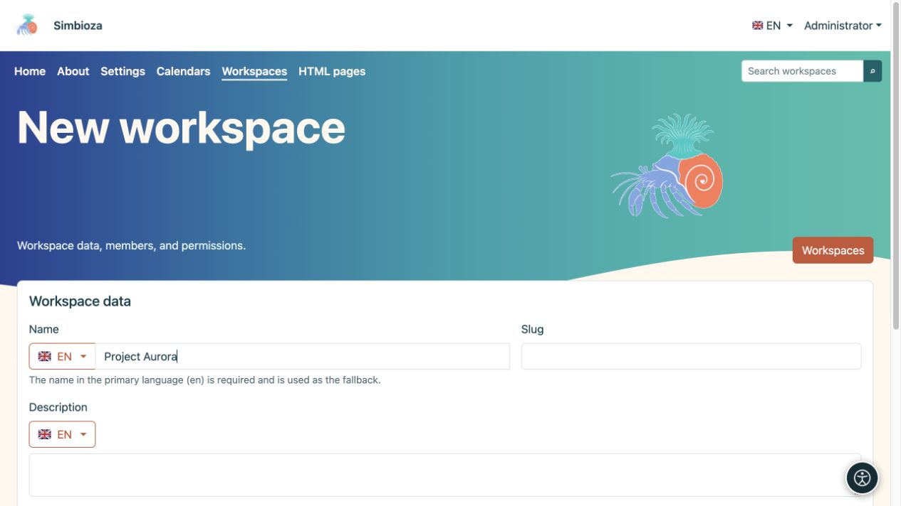

# Einen Arbeitsbereich erstellen

> Die Bildschirmaufnahmen zeigen die englische Benutzeroberfläche.

[Arbeitsbereiche](podrucja_de.md)

**Ziel:** Erstellen Sie einen separaten Bereich für ein Projekt, ein Team oder eine Seitensammlung. Ein Administrator oder ein von einem Administrator autorisierter Benutzer/eine Gruppe kann einen Arbeitsbereich erstellen. Dies unterscheidet sich von der Berechtigung zum Hinzufügen von Seiten zu einem vorhandenen Arbeitsbereich.

1. Öffnen Sie **Arbeitsbereiche → Neuer Arbeitsbereich**.
2. Geben Sie einen **Namen** ein, der den Lesern sagt, wozu der Bereich dient. Überprüfen Sie die Sprache neben der Flagge. Der Name der Primärsprache ist erforderlich. Sie können weitere Übersetzungen separat hinzufügen.
3. Geben Sie einen kurzen **Slug**, z. B. `project-aurora`, und eine klare **Beschreibung** ein. Der Slug ist Teil der Adresse, vermeiden Sie daher temporäre Namen.
4. Lassen Sie **Seitenbaum** und **Seiteninhalte** übernommen oder wählen Sie deren anfängliche Anzeige. Unter Inhalt versteht man hier die Liste der Überschriften der Seite und nicht den Haupttext.
5. Wählen Sie **Speichern**.

**Ergebnis:** Der Arbeitsbereich existiert und seine Einstellungen werden geöffnet. [Fügen Sie Mitglieder und Berechtigungen hinzu](podrucja-clanovi-prava_de.md), bevor Sie Inhalte teilen; Sein Name und seine Beschreibung bestimmen nicht die Zielgruppe.

<figure class="my-4">

<figcaption>Geben Sie den Namen in der ausgewählten Sprache ein, dann den Slug und die Beschreibung. Weitere Einstellungen und Speicherung finden Sie weiter unten im Formular.</figcaption>
</figure>

## Fügen Sie die erste Seite hinzu

1. Öffnen Sie den Arbeitsbereich und wählen Sie das Symbol **Neue Seite** neben der Baumstruktur aus.
2. Geben Sie einen Titel in der gewünschten Sprache ein und wählen Sie ein übergeordnetes Element oder **Baumwurzel**.
3. Wählen Sie **Erstellen und bearbeiten**. Schreiben Sie den Inhalt, speichern Sie einen Entwurf und [veröffentlichen Sie ihn oder reichen Sie ihn zur Überprüfung ein](podrucja-objava_de.md).

Die erste neue Seite wird automatisch zur Startseite eines leeren Arbeitsbereichs. Sie können später in den [Seiteneinstellungen](podrucja-stablo_de.md) eine andere auswählen.

## Was passiert mit seiner Adresse?

Ein Beispiel ist `/workspace/project-aurora/work-plan`. Der Administrator kann das erste Pfadsegment ändern; der Arbeitsbereich und die Seiten-Slugs bestimmen den Rest. Ändern Sie Slugs sorgfältig: Überprüfen Sie anschließend gespeicherte Links, externe Seiten und Browser-Lesezeichen.

Wenn **Neuer Arbeitsbereich** fehlt, bitten Sie einen Administrator um die Berechtigung zum Erstellen. Wenn ein Arbeitsbereich existiert, aber **Neue Seite** fehlt, bitten Sie seinen Manager um Berechtigung, Seiten hinzuzufügen.
