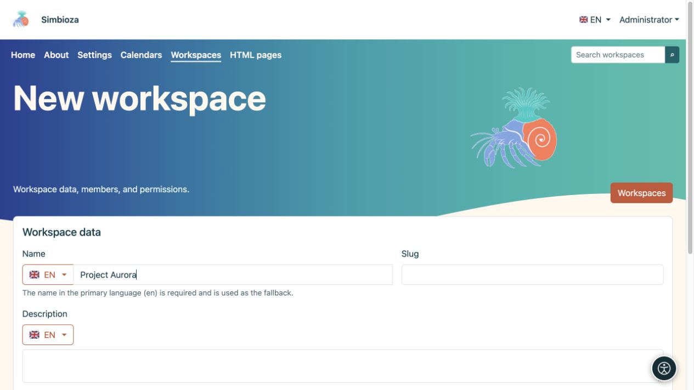

# Create a workspace

[Workspaces](podrucja_en.md)

**Goal:** create a separate space for a project, team or collection of pages. An administrator, or a user/group authorised by an administrator, may create a workspace. This differs from permission to add pages to an existing workspace.

1. Open **Workspaces → New workspace**.
2. Enter a **Name** which tells readers what the space is for. Check the language beside the flag; the primary-language name is required. You may add other translations separately.
3. Enter a short **Slug**, such as `project-aurora`, and a clear **Description**. The slug forms part of the address, so avoid temporary names.
4. Leave **Page tree** and **Page contents** inherited or choose their initial display. Contents here means the page's list of headings, rather than its main text.
5. Choose **Save**.

**Result:** the workspace exists and its settings open. [Add members and permissions](podrucja-clanovi-prava_en.md) before sharing content; its name and description do not determine its audience.

<figure class="my-4">

<figcaption>Enter the name in the selected language, then the slug and description. Further settings and saving are below in the form.</figcaption>
</figure>

## Add the first page

1. Open the workspace and choose the **New page** icon beside its tree.
2. Enter a title in the required language and choose a parent or **Tree root**.
3. Choose **Create and edit**. Write the content, save a draft and [publish it or submit it for review](podrucja-objava_en.md).

The first new page automatically becomes an empty workspace's home page. You may choose a different one later in [page settings](podrucja-stablo_en.md).

## What happens to its address?

An example is `/workspace/project-aurora/work-plan`. The administrator can change the first path segment; the workspace and page slugs determine the rest. Change slugs carefully: afterwards, check saved links, external pages and browser bookmarks.

If **New workspace** is missing, ask an administrator for creation permission. If a workspace exists but **New page** is missing, ask its manager for permission to add pages.
