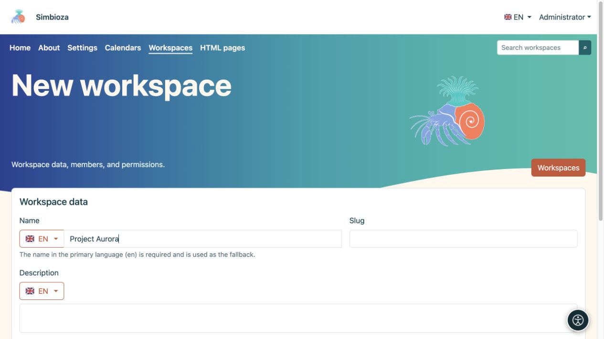

# Crear un espacio de trabajo

> Las capturas de pantalla muestran la interfaz en inglés.

[Espacios de trabajo](podrucja_es.md)

**Objetivo:** crear un espacio separado para un proyecto, equipo o colección de páginas. Un administrador, o un usuario/grupo autorizado por un administrador, puede crear un espacio de trabajo. Esto difiere del permiso para agregar páginas a un espacio de trabajo existente.

1. Abra **Espacios de trabajo → Nuevo espacio de trabajo**.
2. Ingrese un **Nombre** que indique a los lectores para qué sirve el espacio. Verifique el idioma al lado de la bandera; se requiere el nombre del idioma principal. Puede agregar otras traducciones por separado.
3. Introduzca un **Slug** breve, como `project-aurora`, y una **Descripción** clara. El slug forma parte de la dirección, así que evite nombres temporales.
4. Deje el **árbol de páginas** y el **contenido de la página** heredados o elija su visualización inicial. Contenido aquí significa la lista de títulos de la página, en lugar de su texto principal.
5. Elija **Guardar**.

**Resultado:** el espacio de trabajo existe y su configuración está abierta. [Agregar miembros y permisos](podrucja-clanovi-prava_es.md) antes de compartir contenido; su nombre y descripción no determinan su audiencia.

<figure class="my-4">

<figcaption>Ingrese el nombre en el idioma seleccionado, luego el slug y la descripción. Más configuraciones y guardados se encuentran a continuación en el formulario.</figcaption>
</figure>

## Añadir la primera página

1. Abra el espacio de trabajo y elija el icono **Nueva página** junto a su árbol.
2. Ingrese un título en el idioma requerido y elija una página superior o **Raíz del árbol**.
3. Elija **Crear y editar**. Escriba el contenido, guarde un borrador y [publíquelo o envíelo para revisión](podrucja-objava_es.md).

La primera página nueva se convierte automáticamente en la página de inicio de un espacio de trabajo vacío. Puede elegir uno diferente más adelante en [configuración de página](podrucja-stablo_es.md).

## ¿Qué pasa con su dirección?

Un ejemplo es `/workspace/project-aurora/work-plan`. El administrador puede cambiar el primer segmento de ruta; el espacio de trabajo y los slugs de página determinan el resto. Cambie los slugs con cuidado: luego, verifique los enlaces guardados, las páginas externas y los marcadores del navegador.

Si falta **Nuevo espacio de trabajo**, solicite permiso de creación a un administrador. Si existe un espacio de trabajo pero falta **Nueva página**, solicite permiso a su administrador para agregar páginas.
