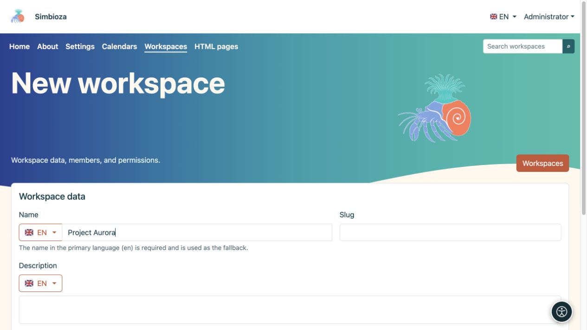

# Créer un espace de travail

> Les captures d’écran présentent l’interface en anglais.

[Espaces de travail](podrucja_fr.md)

**Objectif :** créer un espace séparé pour un projet, une équipe ou une collection de pages. Un administrateur, ou un utilisateur/groupe autorisé par un administrateur, peut créer un espace de travail. Cela diffère de l’autorisation d’ajouter des pages à un espace de travail existant.

1. Ouvrez **Espaces de travail → Nouvel espace de travail**.
2. Saisissez un **Nom** qui indique aux lecteurs à quoi sert l'espace. Vérifiez la langue à côté du drapeau ; le nom de la langue principale est requis. Vous pouvez ajouter d'autres traductions séparément.
3. Saisissez un **Slug** court, tel que `project-aurora`, et une **Description** claire. Le slug fait partie de l’adresse, évitez donc les noms temporaires.
4. Laissez l'**Arborescence des pages** et le **Contenu de la page** hérités ou choisissez leur affichage initial. Le contenu désigne ici la liste des titres de la page, plutôt que son texte principal.
5. Choisissez **Enregistrer**.

**Résultat :** l'espace de travail existe et ses paramètres sont ouverts. [Ajouter des membres et des autorisations](podrucja-clanovi-prava_fr.md) avant de partager du contenu ; son nom et sa description ne déterminent pas son public.

<figure class="my-4">

<figcaption>Saisissez le nom dans la langue sélectionnée, puis le slug et la description. D'autres paramètres et enregistrements se trouvent ci-dessous dans le formulaire.</figcaption>
</figure>

## Ajouter la première page

1. Ouvrez l'espace de travail et choisissez l'icône **Nouvelle page** à côté de son arborescence.
2. Saisissez un titre dans la langue requise et choisissez un parent ou une **racine d'arbre**.
3. Choisissez **Créer et modifier**. Rédigez le contenu, enregistrez un brouillon et [publiez-le ou soumettez-le pour révision](podrucja-objava_fr.md).

La première nouvelle page devient automatiquement la page d'accueil d'un espace de travail vide. Vous pourrez en choisir un autre ultérieurement dans [paramètres de la page](podrucja-stablo_fr.md).

## Que devient son adresse ?

Un exemple est `/workspace/project-aurora/work-plan`. L'administrateur peut modifier le premier segment de chemin ; l'espace de travail et les slugs de page déterminent le reste. Modifiez soigneusement les slugs : vérifiez ensuite les liens enregistrés, les pages externes et les favoris du navigateur.

Si le **Nouvel espace de travail** est manquant, demandez l'autorisation de création à un administrateur. Si un espace de travail existe mais que **Nouvelle page** est manquante, demandez à son responsable l'autorisation d'ajouter des pages.
