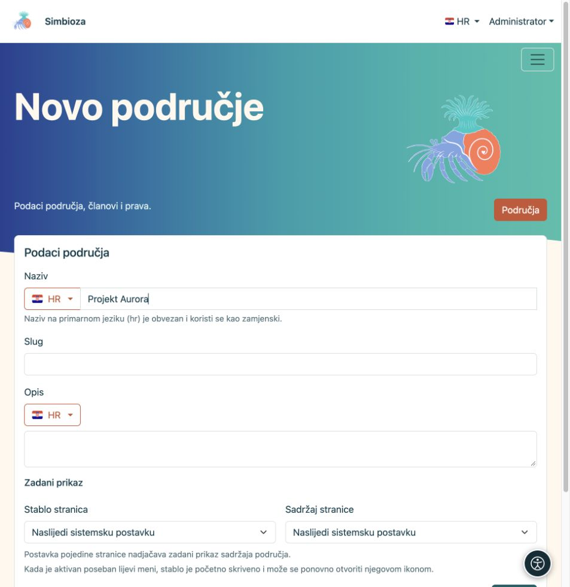

# Napravite novo područje

[Područja](podrucja_hr.md)

**Cilj:** dobiti odvojeni prostor za projekt, tim ili zbirku stranica. Novo područje može napraviti administrator ili korisnik/grupa kojoj je administrator dopustio stvaranje. To nije isto što i pravo dodavanja stranica u postojeće područje.

1. Otvorite **Područja → Novo područje**.
2. Upišite **Naziv** koji čitatelju jasno govori čemu područje služi. Uz zastavicu provjerite jezik; naziv na primarnom jeziku je obvezan. Ostale prijevode možete dodati zasebno.
3. Upišite kratak **Slug**, primjerice `projekt-aurora`, i razumljiv **Opis**. Slug je dio adrese pa izbjegavajte privremene nazive.
4. Za **Stablo stranica** i **Sadržaj stranice** ostavite nasljeđivanje ili izaberite početni prikaz. Sadržaj ovdje znači popis naslova stranice, a ne njezin glavni tekst.
5. Odaberite **Spremi**.

**Rezultat:** područje postoji, a otvaraju se njegove postavke. [Dodajte članove i prava](podrucja-clanovi-prava_hr.md) prije dijeljenja sadržaja; naziv i opis sami ne određuju publiku.

<figure class="my-4">

<figcaption>Upišite naziv na označenom jeziku te slug i opis. Dodatne postavke i spremanje nalaze se niže u obrascu.</figcaption>
</figure>

## Dodajte prvu stranicu

1. Otvorite područje i odaberite ikonu **Nova stranica** uz stablo.
2. Upišite naslov na traženom jeziku i odaberite nadređenu stranicu ili **Korijen stabla**.
3. Odaberite **Kreiraj i uredi**. Upišite sadržaj, spremite nacrt i [objavite ga ili pošaljite na pregled](podrucja-objava_hr.md).

Prva nova stranica automatski postaje početna stranica praznog područja. Kasnije možete odabrati drugu u [postavkama stranice](podrucja-stablo_hr.md).

## Što s adresom područja?

Primjer adrese stranice je `/workspace/projekt-aurora/plan-rada`. Administrator može promijeniti prvi dio putanje, a slug područja i stranice određuju ostatak. Slug mijenjajte promišljeno: nakon promjene provjerite spremljene poveznice, vanjske stranice i oznake preglednika.

Ako nema **Novo područje**, zatražite pravo stvaranja od administratora. Ako područje postoji, ali nema **Nova stranica**, zatražite pravo dodavanja od njegova upravitelja.
