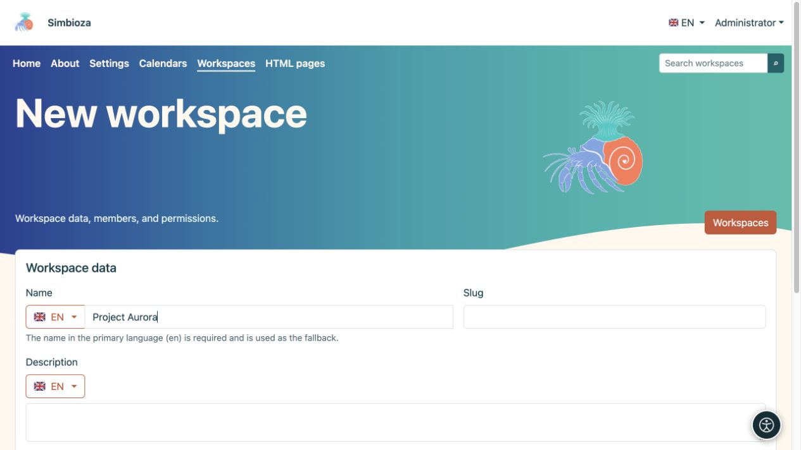

# Creare un'area di lavoro

> Le immagini mostrano l'interfaccia in inglese.

[Aree di lavoro](podrucja_it.md)

**Obiettivo:** creare uno spazio separato per un progetto, un gruppo o una raccolta di pagine. Un amministratore, oppure un utente o gruppo autorizzato da un amministratore, può creare un'area di lavoro. Questa facoltà è diversa dall'autorizzazione ad aggiungere pagine a un'area esistente.

1. Aprire **Aree di lavoro → Nuova area di lavoro**.
2. Inserire un **Nome** che indichi ai lettori lo scopo dell'area. Controllare la lingua accanto alla bandiera; il nome nella lingua principale è obbligatorio. È possibile aggiungere separatamente altre traduzioni.
3. Inserire uno **Slug** breve, per esempio `project-aurora`, e una **Descrizione** chiara. Lo slug fa parte dell'indirizzo, quindi evitare nomi provvisori.
4. Lasciare **Albero delle pagine** e **Indice della pagina** ereditati oppure sceglierne la visualizzazione iniziale. In questo caso l'indice è l'elenco dei titoli della pagina, non il testo principale.
5. Scegliere **Salva**.

**Risultato:** l'area di lavoro esiste e si aprono le sue impostazioni. [Aggiungere membri e autorizzazioni](podrucja-clanovi-prava_it.md) prima di condividere i contenuti; nome e descrizione non ne determinano i destinatari.

<figure class="my-4">

<figcaption>Inserire il nome nella lingua selezionata, quindi lo slug e la descrizione. Le altre impostazioni e il salvataggio si trovano più in basso nel modulo.</figcaption>
</figure>

## Aggiungere la prima pagina

1. Aprire l'area di lavoro e scegliere l'icona **Nuova pagina** accanto al suo albero.
2. Inserire un titolo nella lingua richiesta e scegliere una pagina superiore oppure **Radice dell'albero**.
3. Scegliere **Crea e modifica**. Scrivere il contenuto, salvare una bozza e [pubblicarla o inviarla per revisione](podrucja-objava_it.md).

La prima pagina nuova diventa automaticamente la pagina iniziale di un'area vuota. È possibile sceglierne un'altra successivamente nelle [impostazioni della pagina](podrucja-stablo_it.md).

## Cosa succede al suo indirizzo?

Un esempio è `/workspace/project-aurora/work-plan`. L'amministratore può cambiare il primo segmento del percorso; gli slug dell'area di lavoro e della pagina determinano il resto. Cambiare gli slug con attenzione: in seguito, verificare collegamenti salvati, pagine esterne e segnalibri del browser.

Se manca **Nuova area di lavoro**, chiedere a un amministratore l'autorizzazione alla creazione. Se un'area esiste ma manca **Nuova pagina**, chiedere al suo responsabile l'autorizzazione ad aggiungere pagine.
