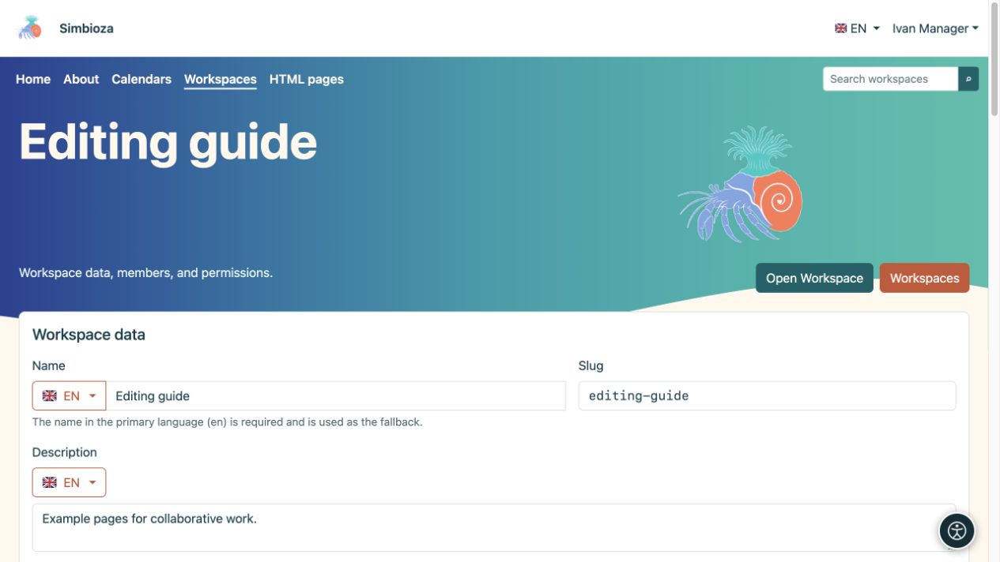

# Den eigenen Arbeitsbereich verwalten

> Die Bildschirmaufnahmen zeigen die englische Benutzeroberfläche.

[Arbeitsbereiche](podrucja_de.md)

**Für:** Benutzer mit der Berechtigung **Verwalten** für den ausgewählten Arbeitsbereich und Administratoren. Durch die Verwaltung eines Arbeitsbereichs werden Sie nicht zum Simbioza-Administrator.

## Details ändern und anzeigen

1. Öffnen Sie den Arbeitsbereich und sein Einstellungssymbol oder **Arbeitsbereich verwalten** in der Arbeitsbereichsliste.
2. Bearbeiten Sie unter **Arbeitsbereichsdetails** den Namen und die Beschreibung in der gewünschten Sprache. Ändern Sie den Slug nur, wenn sich die Adresse ändern muss.
3. Wählen Sie für **Seitenbaum** und **Seiteninhalt** **Anzeigen**, **Ausblenden** oder Vererbung. Eine Seite kann die anfängliche Anzeige ihres eigenen Inhaltsbereichs überschreiben.
4. Wählen Sie **Speichern**, öffnen Sie den Arbeitsbereich und überprüfen Sie das Ergebnis.

**Ergebnis:** Der Arbeitsbereich verwendet die neuen Details und das ursprüngliche Layout. Leser können die Navigation weiterhin über das angebotene Symbol öffnen oder ausblenden; das Verstecken eines Baumes stellt keine Zugangsbeschränkung dar.

<figure class="my-4">

<figcaption>Ivan verwaltet den Beispielarbeitsbereich, ohne globale Administratoreinstellungen zu öffnen.</figcaption>
</figure>

<figure class="my-4">

<figcaption>Arbeitsbereichsdaten, Standardanzeige, Design, private Menüs, Backup und die Benutzer-/Gruppen-Berechtigungsmatrix.</figcaption>
</figure>

## Wo ändere ich die einzelnen Einstellungen?

| Um sich zu ändern… | Offen… |
| --- | --- |
| Wer darf lesen, hinzufügen oder veröffentlichen? | [Mitglieder und Berechtigungen](podrucja-clanovi-prava_de.md) |
| Seitenreihenfolge, übergeordnete Elemente, Beschriftungen oder Eigenschaften | [Baum- und Seitendetails](podrucja-stablo_de.md) |
| Zugriff auf eine einzelne Seite | [Seitenzugriff](podrucja-prava-stranice_de.md) |
| Arbeitsbereichsfarben, Karten, Kopfzeile oder Hero-Bereich | **Arbeitsbereichsdesign bearbeiten**; [Designanleitung](teme-pocetak_de.md) |
| Projektspezifische Navigation | **Arbeitsbereichsmenüs bearbeiten**; [Arbeitsbereichsmenüs](izbornici-podrucja_de.md) |
| Ein statisches Paket oder eine wiederherstellbare Kopie | [HTML Export und Sicherung](podrucja-izvoz-backup_de.md) |

Ein privates Arbeitsbereichsdesign ändert nicht das globale Design anderer Arbeitsbereiche. Spezielle Menüs oben und links gelten nur für diesen Arbeitsbereich und werden separat gespeichert. Wenn das linke Menü die Navigationsposition einnimmt, bleibt der Baum über sein Symbol verfügbar.

<figure class="my-4">

<figcaption>Ein Arbeitsbereichsmanager sieht den Link „Arbeitsbereichsdesign bearbeiten“ in den Einstellungen dieses Arbeitsbereichs. Der Design-Editor selbst wird in einem separaten Handbuch behandelt.</figcaption>
</figure>

## Abgeschlossenes Projekt: Archivieren oder löschen?

**Archivierter Arbeitsbereich ist schreibgeschützt** behält Seiten und ihre Adressen bei und stoppt Änderungen. Aktivieren Sie die Einstellung und speichern Sie. Um wieder zu funktionieren, deaktivieren Sie es und speichern Sie; die vorhandenen Berechtigungen bestimmen wieder die verfügbaren Aktionen.

**Arbeitsbereich löschen** entfernt ihn aus normalen Listen. Lesen Sie die Bestätigung und überprüfen Sie die Homepages, Links und eingebetteten Inhalte, die sie verwenden, bevor Sie sie löschen. Ein Administrator kann es aus gelöschten Arbeitsbereichen wiederherstellen, bis es dauerhaft entfernt wird.

Das Archivieren eines gesamten Arbeitsbereichs unterscheidet sich vom Archivieren einer Seite. Für den [Seitenveröffentlichungsprozess](podrucja-objava_de.md) gelten separate Sichtbarkeitsregeln.

**Überprüfen Sie:** Öffnen Sie den Arbeitsbereich auch als einer seiner Leser. Ihre Manageransicht bietet mehr Aktionen und bestätigt nicht, was ein anderer Benutzer sieht.
