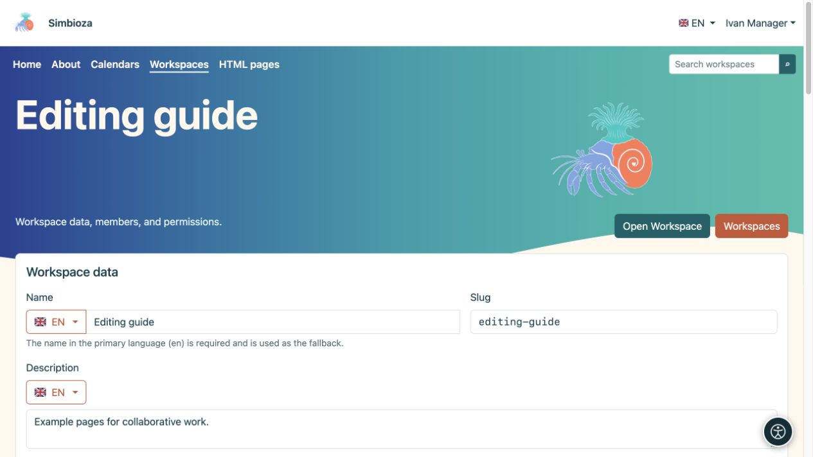

# Manage your workspace

[Workspaces](podrucja_en.md)

**For:** users with **Manage** permission on the selected workspace and administrators. Managing one workspace does not make you a Simbioza administrator.

## Change details and display

1. Open the workspace and its settings icon, or **Manage workspace** in the workspace list.
2. Under **Workspace details**, edit its name and description in the desired language. Change the slug only when the address needs to change.
3. For **Page tree** and **Page contents**, choose **Show**, **Hide** or inheritance. A page may override the initial display of its own contents panel.
4. Choose **Save**, open the workspace and check the result.

**Result:** the workspace uses the new details and initial layout. Readers can still open or hide navigation using the offered icon; hiding a tree is not an access restriction.

<figure class="my-4">

<figcaption>Ivan manages the example workspace without opening global administrator settings.</figcaption>
</figure>

<figure class="my-4">

<figcaption>Workspace data, default display, Theme, private menus, backup and the user/group permission matrix.</figcaption>
</figure>

## Where do I change each setting?

| To change… | Open… |
| --- | --- |
| Who may read, add or publish | [Members and permissions](podrucja-clanovi-prava_en.md) |
| Page order, parents, labels or properties | [Tree and page details](podrucja-stablo_en.md) |
| Access to a single page | [Page access](podrucja-prava-stranice_en.md) |
| Workspace colours, cards, header or hero | **Edit workspace theme**; [theme instructions](teme-pocetak_en.md) |
| Project-specific navigation | **Edit workspace menus**; [workspace menus](izbornici-podrucja_en.md) |
| A static package or restorable copy | [HTML export and backup](podrucja-izvoz-backup_en.md) |

A private workspace theme does not change other workspaces' global theme. Special top and left menus apply only to this workspace and are saved separately. When the left menu occupies the navigation position, the tree remains available through its icon.

<figure class="my-4">

<figcaption>A Workspace manager sees the Edit Workspace theme link in that Workspace's settings. The Theme editor itself is covered in a separate guide.</figcaption>
</figure>

## Finished project: archive or delete?

**Archived workspace is read-only** keeps pages and their addresses while stopping changes. Enable the setting and save. To work again, disable it and save; the existing permissions determine available actions again.

**Delete workspace** removes it from normal lists. Read the confirmation and check home pages, links and embedded content which use it before deleting. An administrator may restore it from deleted workspaces until it is permanently removed.

Archiving a whole workspace differs from archiving a page. The [page publication process](podrucja-objava_en.md) has separate visibility rules.

**Check:** also open the workspace as one of its readers. Your manager view offers more actions and does not prove what another user sees.
