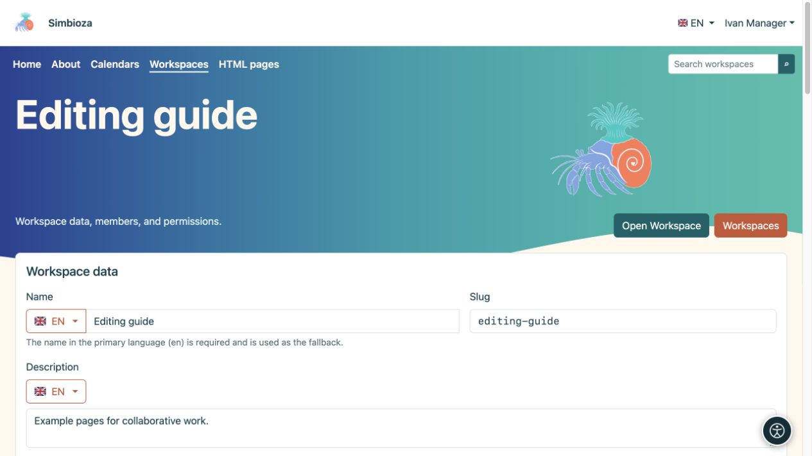

# Gestionar su espacio de trabajo

> Las capturas de pantalla muestran la interfaz en inglés.

[Espacios de trabajo](podrucja_es.md)

**Para:** usuarios con permiso **Administrar** en el espacio de trabajo seleccionado y administradores. Administrar un espacio de trabajo no lo convierte en administrador Simbioza.

## Cambiar detalles y mostrar

1. Abra el espacio de trabajo y su ícono de configuración, o **Administrar espacio de trabajo** en la lista de espacios de trabajo.
2. En **Detalles del espacio de trabajo**, edite su nombre y descripción en el idioma deseado. Cambie el slug solo cuando sea necesario cambiar la dirección.
3. Para **Árbol de páginas** y **Contenido de la página**, elija **Mostrar**, **Ocultar** o herencia. Una página puede anular la visualización inicial de su propio panel de contenidos.
4. Elija **Guardar**, abra el espacio de trabajo y verifique el resultado.

**Resultado:** el espacio de trabajo utiliza los nuevos detalles y el diseño inicial. Los lectores aún pueden abrir u ocultar la navegación usando el ícono ofrecido; Esconder un árbol no es una restricción de acceso.

<figure class="my-4">

<figcaption>Ivan administra el espacio de trabajo de ejemplo sin abrir la configuración del administrador global.</figcaption>
</figure>

<figure class="my-4">

<figcaption>Datos del espacio de trabajo, visualización predeterminada, tema, menús privados, copia de seguridad y matriz de permisos de usuario/grupo.</figcaption>
</figure>

## ¿Dónde cambio cada configuración?

| Para cambiar… | Abierto… |
| --- | --- |
| ¿Quién puede leer, agregar o publicar? | [Miembros y permisos](podrucja-clanovi-prava_es.md) |
| Orden de páginas, páginas superiores, etiquetas o propiedades | [Detalles del árbol y la página](podrucja-stablo_es.md) |
| Acceso a una sola página | [Acceso a la página](podrucja-prava-stranice_es.md) |
| Colores, tarjetas, encabezado o elemento principal del espacio de trabajo | **Editar tema del espacio de trabajo**; [instrucciones del tema](teme-pocetak_es.md) |
| Navegación específica del proyecto | **Editar menús del espacio de trabajo**; [menús del espacio de trabajo](izbornici-podrucja_es.md) |
| Un paquete estático o una copia restaurable | [HTML exportación y copia de seguridad](podrucja-izvoz-backup_es.md) |

Un tema de espacio de trabajo privado no cambia el tema global de otros espacios de trabajo. Los menús especiales superior e izquierdo se aplican solo a este espacio de trabajo y se guardan por separado. Cuando el menú de la izquierda ocupa la posición de navegación, el árbol permanece disponible a través de su icono.

<figure class="my-4">

<figcaption>Un gestor del espacio de trabajo ve el enlace Editar tema del espacio de trabajo en la configuración de ese espacio de trabajo. El editor de temas en sí se trata en una guía separada.</figcaption>
</figure>

## Proyecto terminado: ¿archivar o eliminar?

**El espacio de trabajo archivado es de solo lectura** mantiene las páginas y sus direcciones mientras detiene los cambios. Habilite la configuración y guarde. Para volver a funcionar, desactívelo y guarde; los permisos existentes determinan nuevamente las acciones disponibles.

**Eliminar espacio de trabajo** lo elimina de las listas normales. Lea la confirmación y verifique las páginas de inicio, los enlaces y el contenido incrustado que la utilizan antes de eliminarla. Un administrador puede restaurarlo desde espacios de trabajo eliminados hasta que se elimine permanentemente.

Archivar un espacio de trabajo completo es diferente a archivar una página. El [proceso de publicación de la página](podrucja-objava_es.md) tiene reglas de visibilidad independientes.

**Compruebe:** también abre el espacio de trabajo como uno de sus lectores. Su vista de gestor ofrece más acciones y no prueba lo que ve otro usuario.
