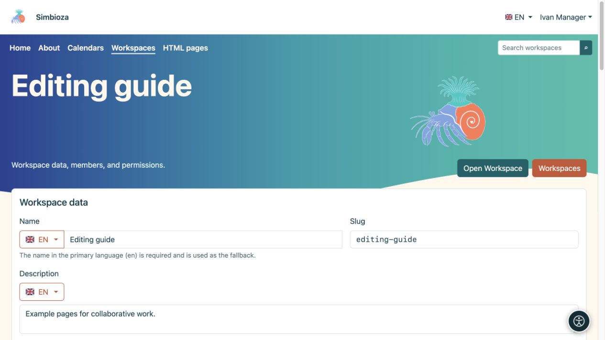

# Gérer votre espace de travail

> Les captures d’écran présentent l’interface en anglais.

[Espaces de travail](podrucja_fr.md)

**Pour :** les utilisateurs disposant de l'autorisation **Gérer** sur l'espace de travail sélectionné et les administrateurs. La gestion d’un espace de travail ne fait pas de vous un administrateur Simbioza.

## Modifier les détails et l'affichage

1. Ouvrez l'espace de travail et son icône de paramètres, ou **Gérer l'espace de travail** dans la liste des espaces de travail.
2. Sous **Détails de l'espace de travail**, modifiez son nom et sa description dans la langue souhaitée. Modifiez le slug uniquement lorsque l'adresse doit changer.
3. Pour **Arborescence des pages** et **Contenu de la page**, choisissez **Afficher**, **Masquer** ou héritage. Une page peut remplacer l'affichage initial de son propre panneau de contenu.
4. Choisissez **Enregistrer**, ouvrez l'espace de travail et vérifiez le résultat.

**Résultat :** l'espace de travail utilise les nouveaux détails et la disposition initiale. Les lecteurs peuvent toujours ouvrir ou masquer la navigation à l'aide de l'icône proposée ; cacher un arbre n'est pas une restriction d'accès.

<figure class="my-4">

<figcaption>Ivan gère l'exemple d'espace de travail sans ouvrir les paramètres d'administrateur globaux.</figcaption>
</figure>

<figure class="my-4">

<figcaption>Données de l'espace de travail, affichage par défaut, thème, menus privés, sauvegarde et matrice d'autorisation utilisateur/groupe.</figcaption>
</figure>

## Où puis-je modifier chaque paramètre ?

| Pour changer… | Ouvrir… |
| --- | --- |
| Qui peut lire, ajouter ou publier | [Membres et autorisations](podrucja-clanovi-prava_fr.md) |
| Ordre des pages, parents, étiquettes ou propriétés | [Détails de l'arborescence et de la page](podrucja-stablo_fr.md) |
| Accès à une seule page | [Accès à la page](podrucja-prava-stranice_fr.md) |
| Couleurs, cartes, en-tête ou bandeau principal de l'espace de travail | **Modifier le thème de l'espace de travail** ; [instructions du thème](teme-pocetak_fr.md) |
| Navigation spécifique au projet | **Modifier les menus de l'espace de travail** ; [menus de l'espace de travail](izbornici-podrucja_fr.md) |
| Un package statique ou une copie restaurable | [HTML exportation et sauvegarde](podrucja-izvoz-backup_fr.md) |

Un thème d'espace de travail privé ne modifie pas le thème global des autres espaces de travail. Les menus spéciaux en haut et à gauche s'appliquent uniquement à cet espace de travail et sont enregistrés séparément. Lorsque le menu de gauche occupe la position de navigation, l'arborescence reste disponible via son icône.

<figure class="my-4">

<figcaption>Un gestionnaire d'espace de travail voit le lien Modifier le thème de l'espace de travail dans les paramètres de cet espace de travail. L'éditeur de thème lui-même est couvert dans un guide séparé.</figcaption>
</figure>

## Projet terminé : archiver ou supprimer ?

**L'espace de travail archivé est en lecture seule** conserve les pages et leurs adresses tout en arrêtant les modifications. Activez le paramètre et enregistrez. Pour fonctionner à nouveau, désactivez-le et enregistrez ; les autorisations existantes déterminent à nouveau les actions disponibles.

**Supprimer l'espace de travail** le supprime des listes normales. Lisez la confirmation et vérifiez les pages d'accueil, les liens et le contenu intégré qui l'utilisent avant de les supprimer. Un administrateur peut le restaurer à partir des espaces de travail supprimés jusqu'à ce qu'il soit définitivement supprimé.

L'archivage d'un espace de travail entier diffère de l'archivage d'une page. Le [processus de publication de page](podrucja-objava_fr.md) a des règles de visibilité distinctes.

**Vérifiez :** ouvrez également l'espace de travail en tant que l'un de ses lecteurs. Votre vue gestionnaire propose plus d'actions et ne prouve pas ce que voit un autre utilisateur.
